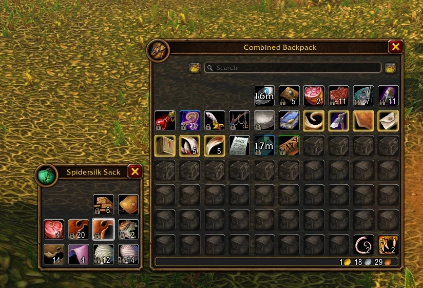
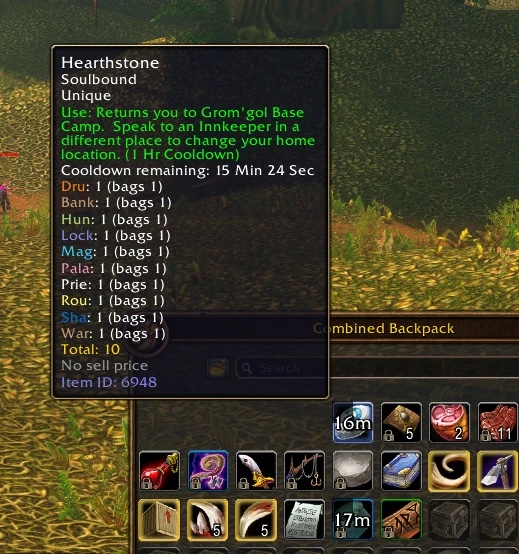
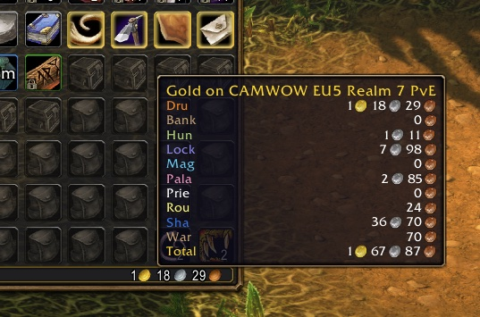
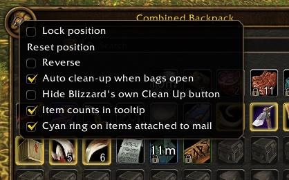
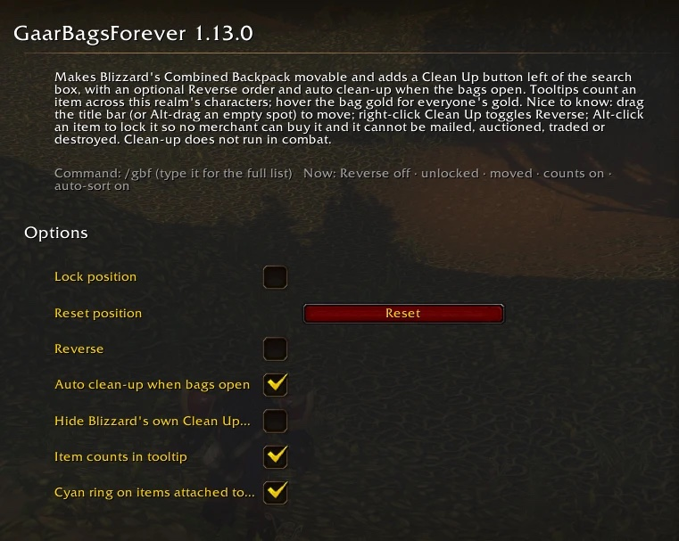
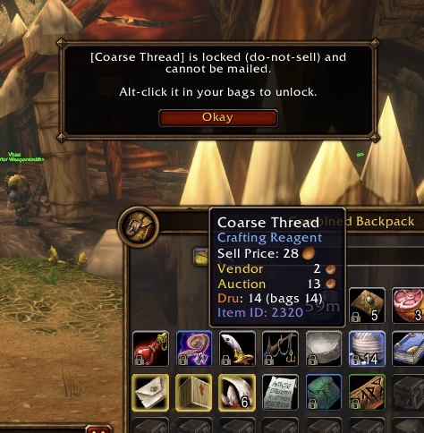

# GaarBagsForever

Part of the **Gaar…Forever** suite — [see all addons](https://www.curseforge.com/wow/addons/gaarforever).

> Formerly **BetterBagsForever**. The folder is now `GaarBagsForever` as well; settings from the old Better…Forever names were migrated up to this version (the old settings-bridge folder is no longer shipped and can be deleted). The command is
> now `/gbf` (`/gaarbagsforever`); the old `/bbf` and `/betterbagsforever` still work.
> CurseForge: https://www.curseforge.com/wow/addons/gaarbagsforever

A small standalone addon for the WoW Forever client (`_classic_beta_`, interface 16001). It
improves Blizzard's own **Combined Backpack** (`ContainerFrameCombinedBags`) and, since 1.7,
shows how many of an item and how much gold your other characters on the same realm have.
Since 1.9 you can lock items so a merchant can never get them, since 1.11 they cannot be mailed either, and since 1.12 they cannot be destroyed, auctioned or traded. It needs GaarForever, the family hub, and no other addon or library.

## Right-click menu

Right-click the Combined Backpack's round bag portrait (top-left) to open this addon's menu (the same options as the GaarForever hub menu).

## What it does

- **Movable bags.** Drag the title bar, or Alt-drag any empty part of the frame (item slots keep
  their normal drag). The position is saved in `GaarBagsForeverDB` and put back every time
  Blizzard re-anchors the bags, which it does whenever a bag opens, closes or changes size. It is
  stored in UIParent units, so it holds when Blizzard rescales the bags to fit the screen, and it
  is clamped to the screen.
- **Clean Up Bags on the left.** On Forever the native button (`BagItemAutoSortButton`) ends up
  hidden under the bag slot icons right of the search box. A copy of it, with the same broom art
  and the same tooltip (Blizzard's `BAG_CLEANUP_BAGS` title and `BAG_CLEANUP_BAGS_DESCRIPTION`),
  sits left of the search box; the search box moves right and narrows by the same amount, so its
  right end stays where it was. It is greyed out in combat and refuses with a short message there.
- **What a clean-up does.** A left-click always starts with exactly what Forever's own button
  does: it plays the sort sound and calls `C_Container.SortBags()`. Blizzard decides where every
  item goes.
- **Auto clean-up (since 1.8, on by default).** When you open your bags, the same clean-up as the
  button runs by itself (including Reverse, if on). It only triggers on the bag window's `OnShow`,
  never on bag events, so it cannot loop, and it is skipped for the bank, in combat, while a
  clean-up is running, and when an item is locked or on the cursor. Turn it off with
  `/gbf autosort off`; saved in `GaarBagsForeverDB.autoSort`.
- **Reverse (optional, off by default).** Right-click the button (or `/gbf reverse`) to turn it
  on or off; it is saved in `GaarBagsForeverDB.reverse` and the tooltip shows the current
  value. With Reverse on and the Combined Backpack in use, a left-click waits for Blizzard's sort
  to settle and then mirrors the whole visible order: the last slot on screen trades places with
  the first, the second-to-last with the second, and so on. Empty slots count too, so a block of
  empty slots ends up mirrored as well. After Blizzard's Standard sort that puts the Hearthstone
  (last slot) first and whatever was first in the last slot.

  | View | Reverse | Left-click |
  |---|---|---|
  | Separate bags | either | Sound + `SortBags()`, nothing else |
  | Combined Backpack | off | Sound + `SortBags()`, nothing else |
  | Combined Backpack | on | Sound + `SortBags()`, then the whole visible order mirrored |

  How it works:
  - *Waiting:* Blizzard's sort counts as finished once no `BAG_UPDATE`, `BAG_UPDATE_DELAYED` or
    `ITEM_LOCK_CHANGED` has arrived for about 0.35 s and no carried slot is locked. After about
    15 s it gives up with a message and moves nothing.
  - *Reading the order:* from the screen. The visible item buttons of `ContainerFrameCombinedBags`
    are mapped to bag and slot (`GetBagID()`, `GetID()`) and sorted top to bottom, then left to
    right, using their effective scale. Only the backpack and bags 1-4 count; the keyring, the
    bank, hidden buttons and specialty bags (soul, quiver, ammo, profession) are left out.
  - *Mirroring:* slot i pairs with slot N+1-i. Pairs that are both empty or hold the same item are
    skipped (nothing visible would change, and stacks can never merge). Every other pair is one
    `C_Container.PickupContainerItem` on each slot: a move into an empty slot or a swap.
  - *One burst (since 1.5):* no two pairs share a slot, so the moves do not depend on each other
    and all of them go out in one burst, without waiting for the server between them: up to 10
    pairs per frame, the rest in the next frames. Both slots are re-read right before each move,
    and the cursor has to be empty after every pair or the burst ends there. Then a verify pass
    waits until none of the slots is locked (about 3 s at most), re-reads them, and gives any
    pair that did not end up mirrored another burst, up to three more rounds. It prints
    `Reversed (N swaps).` at the end, or how many pairs could not be swapped. Version 1.4 made
    one move per 0.05 s and waited for the server after each one, plus about 1 s before the
    first, so the same bags now take a fraction of the time.
  - *Stops* on combat (checked before every pair), `/gbf stop`, something on the cursor that the addon did not pick up, the
    client refusing a move repeatedly, the bags changing underneath, or a safety limit. The
    cursor is cleared only when it holds the addon's own item.
- **Item counts in tooltips (since 1.7, on by default).** Every item tooltip - bags, bank, chat
  links, vendor, auction house and so on - gets one line per character on this realm that has the
  item, the character you are playing first and the rest alphabetically, the name in its class
  colour:

      Dru: 12 (bags 10 · bank 2)
      Alt: 3 (mail 3)
      Total: 15

  Sources with nothing in them are left out. `Total` appears when more than one character has the
  item, or when the one character has it in more than one place. Turn it off with `/gbf counts off`
  or the **Item counts in tooltip** checkbox in the GaarForever hub.
- **Vendor price on the item buttons (since 1.14, on by default).** Every bag, bank and Combined
  Backpack item with a sell value shows the price of ONE item in the top-left corner of its
  button: the largest coin only, rounded down, in the coin's colour (`1g`, `35s`, `8c`). Items
  without a sell price show nothing; an item that is not cached yet gets its price as soon as the
  client delivers it. The game's tooltip shows the price of one item; hover a stack and a `Sell price (N):` line with the
  stack total is added (by GaarTooltipsForever when it is loaded with its vendor price on, otherwise by
  Bags itself, never twice). Turn it off with `/gbf vendor off` or the
  **Vendor price on bag items** checkbox in the bags menu. Lives in `VendorPrice.lua`.
- **Auction price on the item buttons (since 1.15, on by default).** The top-right corner of every item
  button shows the lowest buyout per item (largest coin only, same format and colours as the vendor
  price), read from the **Auctionator** addon's public API. It is grey when Auctionator has not seen the
  item in the auction house for more than 3 days, and nothing is shown for items without a price or for
  soulbound items. **Auctionator is an optional dependency**: without it the feature silently shows
  nothing. The display refreshes when Auctionator's data updates and when the auction house closes. Turn it
  off with `/gbf ah off` or the **Auction price on bag items (Auctionator)** checkbox in the bags menu.
  Lives in `AuctionPrice.lua`.
- **Gold across characters (since 1.7).** Hover the gold amount in the bag window (the Combined
  Backpack, or the backpack when the bags are separate) for every character's gold on this realm
  and the total. `/gbf gold` prints the same to chat, then the other realms' characters and what
  the hover found (see below). Clicking the coins still does what it always did.
  Since 1.13.2 the hover no longer hangs on one frame layout: every frame inside the money frame
  is hooked (coin buttons a level deeper, a money frame without a global name), and a light poll
  (every 0.1 s, out of combat) shows the gold when the mouse is over the money frame even if no
  frame there takes the mouse. Characters recorded before the Better -> Gaar rename were migrated from
  `BetterBagsForeverDB` up to this version (the old bridge folder is no longer shipped).
- **What is counted, and when it is read.** Only the character you are logged in as is ever read,
  so a character shows up once it has logged in with 1.7. Each character's record is kept
  account-wide, per realm, and only the current realm is ever shown (both factions).

  | Source | What | Read |
  |---|---|---|
  | bags | Backpack and the bag slots, plus the keyring on a client that has one | At login and after bag changes (`BAG_UPDATE_DELAYED`, coalesced over 0.5 s) |
  | bank | The character bank: its bank tabs on Forever, or the bank and bank bags on an older client | Only while the bank is open (`BANKFRAME_OPENED`, `PLAYERBANKSLOTS_CHANGED`, `BAG_UPDATE`). Otherwise the last scan is kept |
  | equipped | The 19 equipment slots, ranged included | At login and on `PLAYER_EQUIPMENT_CHANGED` |
  | mail | Every attachment in the inbox, stacks counted | Only while the mailbox is open (`MAIL_SHOW`, `MAIL_INBOX_UPDATE`). Otherwise the last scan is kept |
  | gold | The character's money | At login and on `PLAYER_MONEY` |

  Not counted: the warband/account bank (it belongs to every character, not one), the bags sitting
  in the bag slots themselves, the classic ammo slot (it only points at ammo that is already in a
  bag, so counting it would count the ammo twice), the guild bank, and items on the auction house.
  So the bank and mail lines are as fresh as that character's last visit to the bank or the
  mailbox. While either is open, every change is read again. Mail sent to a character shows up in
  the counts only once that character has opened its mailbox, and letters beyond what the inbox
  shows at once (more than 50) are not seen until they are shown.

  The scans are plain reads, never in combat: one that falls in combat waits for it to end.
  Everything is stored by item id, so the saved file stays small:
  `GaarBagsForeverDB.inventory[realm][name] = { class, faction, gold, bags = { [itemID] = count },
  bank, equipped, mail, bankScanned, mailScanned }` (the two `...Scanned` values are `time()`).
- **Do-not-sell item lock (since 1.9).** **Alt + left-click** an item in your bags to lock it;
  Alt + left-click it again to unlock it. Chat says `<item> locked` or `<item> unlocked`. The lock
  is per item ID, so every copy of that item is locked, and it is kept per character in
  `GaarBagsForeverCharDB.lockedItems[itemID]`. Alt-click only toggles the lock: it never picks
  the item up or uses it. A locked item shows a small padlock in the bottom-left corner of its
  slot (the stack count stays bottom-right), in every bag window the addon covers: the Combined
  Backpack, the separate bags (`ContainerFrame1`-`13`, which includes the bank bags) and the
  bank's own slots (`BankPanel` on Forever, `BankFrameItemN` on an older client). The padlock
  follows the items when they move, a bag opens, a clean-up runs or the bags change
  (`BAG_UPDATE`, `BAG_UPDATE_DELAYED`, `ITEM_LOCK_CHANGED`, the frames' `OnShow` and
  `UpdateItems`). The art is the first of these the client has: the atlas `Padlock`, the atlas
  `AdventureMapIcon-Lock`, `Interface\PetBattles\PetBattle-LockIcon`,
  `Interface\Buttons\LockButton-Locked-Up` (`/gbf status` says which one is used).

  While a merchant is open, a locked item cannot be sold:

  | How you would sell it | What happens |
  |---|---|
  | Right-click it in the bags | A guard of the addon's own sits over the slot and takes the right-click, so Blizzard's click (which would sell) never runs. Chat: `<item> is locked - Alt-click to unlock`. Left clicks and drags still go through to the item, so you can move it, and its tooltip still shows |
  | Pick it up and drop it on the merchant | While the cursor holds a locked item, a guard covers the merchant window. Dropping or clicking there prints the same message and puts the item back in its slot (`ClearCursor()`) |
  | Blizzard's Sell Junk button | While a locked grey item sits in a bag that a junk sale would empty, a guard covers the button and says which item is in the way. Unlock it, or move it to a bag set to "Don't sell junk from this bag" |
  | Anything else (another addon, say) | Safety net: if within 3 s the item's count in the bags drops *and* a new buyback entry of that item and stack size appears, it is bought back once (`BuybackItem`) and chat says so. If that fails, chat tells you to buy it back on the Buyback tab |

  On a client that cannot let left clicks pass through a frame (`SetPassThroughButtons`), the
  slot guard takes the left button too while a merchant is open: Alt-click still unlocks, a plain
  left-click only prints the message. `/gbf locked` lists the locked items as links and
  `/gbf unlockall yes` unlocks all of them. The addon has no junk selling of its own.
- **Locked items cannot be mailed (since 1.11, always on).** While the mailbox is open, a locked
  item that lands in a Send Mail attachment slot is taken off again and goes back to its bag
  slot, however it got there: drag-and-drop, a right-click in the bags with the Send tab open,
  or another addon. Chat says `<item> is locked - it cannot be mailed. Alt-click to unlock.` and
  a popup with an OK button says the same (no popup in combat; the chat line still comes).

  How: `MAIL_SEND_INFO_UPDATE`, `hooksecurefunc("SendMailFrame_Update")` and every padlock
  refresh schedule a scan one frame later. It reads `GetSendMailItem` / `GetSendMailItemLink`
  for every slot up to `ATTACHMENTS_MAX_SEND` (12 if missing), and each attachment whose item ID
  is locked is taken off with `ClickSendMailItemButton(index, true)`. If that leaves it attached
  on this client, the slot is clicked once more (which picks the item up) and `ClearCursor()`
  puts it back in its bag slot; an item of ours is never left on the cursor. A locked attachment
  still there after three scans in a row gets one chat line asking you to take it off by hand.
  There is no check on `SendMail` itself: a post-hook runs only after the mail has gone, and the
  scan has already run by the time you can click Send.
- **Locked items cannot be destroyed, auctioned or traded (since 1.12, always on).** Each block
  ends like the mail block: one chat line, `<item> is locked - it cannot be <action>. Alt-click
  to unlock.`, and one OK popup, `<item> is locked (do-not-sell) and cannot be
  destroyed|auctioned|traded|mailed. Alt-click it in your bags to unlock.` (one shared
  `StaticPopupDialogs.GAARBAGSFOREVER_LOCKED`, mail included; no popup in combat, the chat line
  still comes). One attempt seen by two paths gives one message (same action and item within
  1.5 s).

  | Way out | What happens | Guaranteed / best effort |
  | --- | --- | --- |
  | Destroy: drop it from the bags on the world | `DELETE_ITEM_CONFIRM` and `hooksecurefunc("StaticPopup_Show")` see Blizzard's `DELETE_ITEM` / `DELETE_GOOD_ITEM` / `DELETE_QUEST_ITEM` / `DELETE_GOOD_QUEST_ITEM` popup while the item is still on the cursor (`GetCursorInfo`). A locked item goes back to its bag slot with `ClearCursor()`, and the delete popup is closed with `StaticPopup_Hide` (again one frame later, in case the popup came after the event) | Guaranteed once the cursor is empty: the popup's Delete / OK button calls `DeleteCursorItem()`, which then has nothing to delete, even if the popup could not be hidden. Not covered: a macro or addon that calls `DeleteCursorItem()` directly, with no popup. `DeleteCursorItem` cannot be stopped, and a post-hook would only run after the item is gone, so there is none |
  | Auction house sell slot | Classic `AuctionFrame`: `NEW_AUCTION_UPDATE` (and `CURSOR_CHANGED`) checks `GetAuctionSellItemInfo()` one frame later; a locked item is picked up with `ClickAuctionSellItemButton()` (only with an empty cursor) and put back with `ClearCursor()`. Retail-engine `AuctionHouseFrame`: `hooksecurefunc` on `ItemSellFrame` / `CommoditiesSellFrame` `SetItem`; one frame later the frame's `GetItem()` location is read (`C_Item.GetItemID` / `GetItemLink`), and a locked item is cleared with the frame's `ClearItem`, or `SetItem(nil)`. Whichever UI the client has is used | Best effort, one frame after the item lands, before Post / Create Auction can be clicked (an empty slot disables it). The post functions themselves are not hooked, so another addon that posts directly is not stopped |
  | Trade window | `TRADE_SHOW`, `TRADE_PLAYER_ITEM_CHANGED` and `CURSOR_CHANGED` scan `GetTradePlayerItemLink(i)` for slots 1..`MAX_TRADE_ITEMS` one frame later, except the "Will not be traded" slot (`TRADE_ENCHANT_SLOT`, 7: the item stays yours, so a locked item can still be enchanted). A locked item is picked up with `ClickTradeButton(i)` (only with an empty cursor), put back with `ClearCursor()`, and the slot is read again | Best effort, one frame after the item lands; changing a slot clears both sides' accept, and `AcceptTrade` needs your click |

  No loops: clearing an item fires the same events again, but then nothing locked is left. A
  locked item still in place after three checks in a row gets one chat line asking you to take
  it off by hand. Not blocked: guild bank deposits (no guild bank in 1-60 content), splitting,
  equipping, the bank, disenchanting and prospecting (not in 1-60).
- **Cyan ring on attached items (since 1.11, on by default).** While the Send tab has
  attachments, every bag slot whose item is attached gets a pulsing cyan ring, the same kind of
  ring as GaarBarsForever's orange low-rank ring (`Interface\Buttons\UI-ActionButton-Border`,
  additive blend, 1.8x the button, alpha pulse). It goes away when the attachment is taken off,
  the mail is sent (`MAIL_SEND_SUCCESS`) or the mailbox closes (`MAIL_CLOSED`). Turn it off with
  `/gbf mailglow off`; saved in `GaarBagsForeverDB.mailGlow`.

  Which slot: the client does not say which bag slot an attachment came from, so it is worked
  out from the bags. An attached item stays in its slot, locked (greyed), until the mail goes.
  Each attachment claims one locked slot of the carried bags with the same item ID: first one
  with the same stack size, then any. The stack on the cursor is locked too; when
  `C_Cursor.GetCursorItem` says which slot it came from, that slot is left out, otherwise one
  slot of that item is held back. So two locked stacks of the same item with only one attached
  give one ring, not two (with two identical stacks it may sit on the twin). It is worked out
  from scratch on every refresh (`MAIL_SEND_INFO_UPDATE`, `BAG_UPDATE_DELAYED`,
  `ITEM_LOCK_CHANGED`, `CURSOR_CHANGED`, a bag window opening), so it never goes stale.
- **The sort direction is left alone.** The addon never calls `C_Container.SetSortBagsRightToLeft`
  and does not read it either. Version 1.2 could switch it; if you changed it there and want
  Forever's default back, run `/run C_Container.SetSortBagsRightToLeft(true)` once.

## Commands

| Command | Does |
|---|---|
| `/gbf` | Help |
| `/gbf reset` | Back to Blizzard's default position |
| `/gbf lock`, `/gbf unlock` | Stop or allow moving. Locking also gives clicks on the title back to the bag menu |
| `/gbf native hide`, `/gbf native show` | Hide or show Blizzard's own clean-up button (shown by default) |
| `/gbf reverse`, `/gbf reverse on`, `/gbf reverse off` | Toggle or set Reverse (same as right-clicking the button) |
| `/gbf autosort`, `/gbf autosort on`, `/gbf autosort off` | Toggle or set the automatic clean-up when the bags open (on by default) |
| `/gbf stop` | Stop a running reversal |
| `/gbf counts`, `/gbf counts on`, `/gbf counts off` | Toggle or set the item counts in tooltips (on by default) |
| `/gbf gold` | Print every character's gold on this realm, and the total; then each other realm's characters, and (since 1.13.2) the gold diagnosis: the saved variable in use with characters per realm, whether the old `BetterBagsForeverDB` is loaded and merged, the money frames hooked (by name or path), how many hooked frames take the mouse, and the last hover (when, via hook or poll, on which frame, how many characters, or the error) |
| Alt + left-click an item | Lock or unlock it (all copies of the item, this character only). A locked item shows a padlock and is never sold, mailed, auctioned, traded or destroyed |
| `/gbf locked` | List the locked items as links |
| `/gbf unlockall`, `/gbf unlockall yes` | Unlock every locked item; the plain form only says how many and asks for `yes` |
| `/gbf mailglow`, `/gbf mailglow on`, `/gbf mailglow off` | Toggle or set the cyan ring on bag items attached to the outgoing mail (on by default) |
| `/gbf forget <name>` | Remove a character from this realm's counts and gold (not the one you are playing). Say what was removed |
| `/gbf status` | Which of the frames and functions this client has, whether combined bags are in use, Reverse and what the next clean-up will do, how many slots it finds in the Combined Backpack, whether the bags are locked, and the saved position. Since 1.7 also one inventory line: characters on this realm, counts on/off, when the bank and the mail were last read, and how many money frames have the gold tooltip. Since 1.9 also one item lock line: how many items are locked, which padlock art is used, whether left clicks pass the merchant guard, and whether `BuybackItem` is there. Since 1.11 also one mail line: how many locked attachments were taken off this session, whether `ClickSendMailItemButton` and `GetSendMailItem` are there, whether `SendMailFrame_Update` is hooked, and mail glow on/off with how many rings are shown. Since 1.12 also one blocks line: how many destroys, auctions and trades were blocked this session, whether `StaticPopup_Show` is hooked, which auction UI this client has, and whether `ClickTradeButton` is there. Since 1.13.2 also the gold diagnosis lines of `/gbf gold` |

## With GaarForever (required)

Since 1.9.1 this addon lists `GaarForever` (the GaarForever folder) under `## Dependencies`: install the `GaarForever` folder next to it, or the client will not load this addon. GaarForever also gives it a page under **Esc > Options > AddOns > Gaar Forever**, built from the same `MenuEntries()` as the hub's menu, with a short intro at the top; that intro comes from `Intro()`, a field the API table gained in 1.9.1 (it is also the first line of the slash command's help).

Since 1.9.2 the small helpers (the chat prefix, the combat check, secret-value checks, client API
lookups and the menu drawing) come from GaarForever's shared library (`GaarForever`,
`Lib.lua`) instead of a copy in this addon. Nothing you see changed.

[GaarForever](../GaarForever/README.md) is the family hub: one minimap button whose
menu has a **Bags** submenu with **Lock position**, **Reset position**, **Reverse**, **Auto clean-up when bags open**, **Hide
Blizzard's own Clean Up button**, **Item counts in tooltip** and **Cyan ring on items attached to mail**, the same settings as
`/gbf lock|unlock`, `/gbf reset`, `/gbf reverse`, `/gbf native hide|show`, `/gbf counts on|off` and `/gbf mailglow on|off`
(both go through the same functions). This addon has
no minimap button or menu of its own, so nothing here changes with or without the hub: the
settings stay in `GaarBagsForeverDB` and `/gbf` stays as it is.

The hub talks to this addon only through `GaarBagsForeverAPI` (since 1.6):

| Field | What it is |
|---|---|
| `version` | This addon's version, a string |
| `StatusLine()` | One line of state, e.g. `Reverse off · unlocked · default position · counts on` |
| `MenuEntries()` | The options as plain data (`{ text, func }`, `{ text, checkbox, checked, func }`), for a menu drawn without `MenuUtil` |
| `AddMenuEntries(root)` | Adds the same options to a `MenuUtil` root or submenu description |
| `SetMinimapHidden(hidden)` | Does nothing: there is no minimap button to hide. It is there so every addon the hub knows has the same API |

## How it stays out of the way

- The clean-up is Blizzard's own `C_Container.SortBags()`. Items are moved by the addon only for
  Reverse, only with `C_Container.PickupContainerItem`, never in combat. No Blizzard button is
  clicked and no protected function is called.
- Blizzard code is only followed, never replaced: `hooksecurefunc("UpdateContainerFrameAnchors")`,
  `hooksecurefunc(ContainerFrameCombinedBags, "UpdateSearchBox")` and `HookScript` on the frame's
  `OnShow`, `OnHide` and drag scripts. No Blizzard function is called from addon code.
- The item counts come from `TooltipDataProcessor.AddTooltipPostCall` for item tooltips (or
  `HookScript("OnTooltipSetItem")` on a client without it), and only add lines. A tooltip gets
  them once per display: the guard is a weak table of the addon's own, released on the
  tooltip's `OnTooltipCleared`, so nothing is written into Blizzard's tooltip tables. Secret
  values are skipped, and every read is behind `pcall` and a type check.
- The gold tooltip is `HookScript("OnEnter")` / `HookScript("OnLeave")` on the bag money frame
  (`ContainerFrameCombinedBags.MoneyFrame`, `ContainerFrame1MoneyFrame` and the like) and every
  frame inside it, three levels deep (the coin buttons). Their clicks are never touched. If
  Blizzard showed a tooltip there first, the gold lines are added below it. Since 1.13.2 an
  OnUpdate of the addon's own (throttled to 0.1 s, idle in combat) also asks the money frames
  `IsMouseOver()` and shows the same tooltip; it never replaces a tooltip another frame owns.
- The item lock never replaces or wraps a Blizzard click handler, and never clicks a Blizzard
  button. A blocked sale is blocked by separate frames of the addon's own laid on top (over the
  slot, the merchant window or the Sell Junk button), so Blizzard's handlers simply do not run
  for that click and nothing tainted enters their path. Alt-click is seen through
  `HookScript("PreClick")` / `HookScript("OnClick")` on the item buttons, which runs after
  Blizzard's handler. The padlock is a texture added to the item button; everything else is kept
  in weak tables of the addon's own. A guard is never shown or hidden while it is protected in
  combat.
- The mail block (1.11) replaces nothing either: `SendMailFrame_Update` is followed with
  `hooksecurefunc`, the scan runs one frame after Blizzard's update from the addon's own event
  frame, and `ClickSendMailItemButton` and `ClearCursor` are plain, unprotected API calls. The
  popup is an entry of the addon's own in `StaticPopupDialogs` (`GAARBAGSFOREVER_LOCKED` since 1.12, `GAARBAGSFOREVER_MAIL_LOCKED` before,
  `preferredIndex` 3) and is never shown in combat. The cyan rings are frames of the addon's own
  on the item buttons, created and shown out of combat only; in combat a ring can only be dimmed.
- The destroy, auction and trade blocks (1.12) replace nothing either: `StaticPopup_Show` and the
  retail sell frames' `SetItem` are followed with `hooksecurefunc`, and `ClearCursor`,
  `StaticPopup_Hide`, `ClickAuctionSellItemButton` and `ClickTradeButton` are plain, unprotected
  API calls, each behind `pcall`. Values the client hides are never compared.
- Every name is checked before use. A missing frame or function switches the matching feature
  off instead of raising an error.
- If the bag frame is protected and a move falls in combat, it waits for `PLAYER_REGEN_ENABLED`.
- Saved variables are read at `ADDON_LOADED`, never at file scope. Only `locked`,
  `hideNativeButton`, `position`, `reverse`, `showCounts`, `autoSort`, `mailGlow` and `inventory` are kept; anything older
  versions saved is cleared on load. The item locks (1.9) are per character, in
  `GaarBagsForeverCharDB.lockedItems`.

## Names it relies on

From Blizzard's retail FrameXML, which Forever's UI follows
([Gethe/wow-ui-source](https://github.com/Gethe/wow-ui-source),
`Interface/AddOns/Blizzard_UIPanels_Game/Mainline/ContainerFrame.xml` and `ContainerFrame.lua`):
`ContainerFrameCombinedBags` (and its `TitleContainer`, `UpdateSearchBox`), `BagItemSearchBox`,
`BagItemAutoSortButton`, `UpdateContainerFrameAnchors`, `ContainerFrameSettingsManager:IsUsingCombinedBags`,
`C_Container.SortBags`, `C_Container.PickupContainerItem`, `C_Container.GetContainerItemInfo`,
`C_Container.GetContainerNumSlots`, `C_Container.GetContainerNumFreeSlots` (bag family), the item
buttons' `GetBagID` / `GetID` (`ContainerFrameItemButtonMixin`), the atlases `bags-button-autosort-up` / `-down`, `BAG_CLEANUP_BAGS`,
`BAG_CLEANUP_BAGS_DESCRIPTION` and `SOUNDKIT.UI_BAG_SORTING_01`.

For the item counts and gold (1.7): `Enum.BagIndex` (`Backpack`, `Bag_1`-`Bag_4`,
`CharacterBankTab_1`-`_9` on Forever, read off the client binary; `Bank`, `BankBag_n`,
`Keyring`, `ReagentBag` where a client has them, else `BANK_CONTAINER`, `NUM_BAG_SLOTS`,
`NUM_BANKBAGSLOTS`, `KEYRING_CONTAINER`), `GetInventoryItemID`, `GetInventoryItemCount`,
`GetInboxNumItems`, `GetInboxItem`, `GetInboxItemLink`, `GetMoney`, `GetRealmName`,
`RAID_CLASS_COLORS`, `C_CurrencyInfo.GetCoinTextureString`, `TooltipDataProcessor`,
`Enum.TooltipDataType.Item` and the money frames' `GoldButton` / `SilverButton` / `CopperButton`.

For the item lock (1.9): `ContainerFrame1`-`13` and their `UpdateItems` / `EnumerateValidItems`,
`BankPanel` and its buttons' `GetBankTabID` / `GetContainerSlotID`, `BankFrameItemN`,
`MerchantFrame`, `MerchantSellAllJunkButton`, `Enum.BagSlotFlags.ExcludeJunkSell` with
`C_Container.GetBagSlotFlag`, `GetCursorInfo`, `ClearCursor`, `GetNumBuybackItems`,
`GetBuybackItemLink`, `GetBuybackItemInfo`, `BuybackItem`, the events `MERCHANT_SHOW`,
`MERCHANT_CLOSED`, `MERCHANT_UPDATE` and `CURSOR_CHANGED`, and the frame methods
`SetPassThroughButtons` and `SetPropagateMouseMotion`.

For the mail block and ring (1.11): `GetSendMailItem`, `GetSendMailItemLink`,
`ClickSendMailItemButton`, `ATTACHMENTS_MAX_SEND`, `SendMailFrame_Update`, `StaticPopupDialogs`,
`StaticPopup_Show`, `OKAY`, `C_Cursor.GetCursorItem` (with `GetBagAndSlot`), the texture
`Interface\Buttons\UI-ActionButton-Border`, and the events `MAIL_SHOW`, `MAIL_CLOSED`,
`MAIL_SEND_INFO_UPDATE`, `MAIL_SEND_SUCCESS` and `MAIL_FAILED`.

For the destroy, auction and trade blocks (1.12): `StaticPopup_Show`, `StaticPopup_Hide`, the
popups `DELETE_ITEM`, `DELETE_GOOD_ITEM`, `DELETE_QUEST_ITEM`, `DELETE_GOOD_QUEST_ITEM`,
`GetAuctionSellItemInfo`, `ClickAuctionSellItemButton`, `AuctionHouseFrame.ItemSellFrame` /
`CommoditiesSellFrame` (`SetItem`, `GetItem`, `ClearItem`), `C_Item.DoesItemExist`,
`C_Item.GetItemID`, `C_Item.GetItemLink`, `GetTradePlayerItemLink`, `ClickTradeButton`,
`MAX_TRADE_ITEMS`, `TRADE_ENCHANT_SLOT`, and the events `DELETE_ITEM_CONFIRM`, `TRADE_SHOW`,
`TRADE_CLOSED`, `TRADE_PLAYER_ITEM_CHANGED`, `AUCTION_HOUSE_SHOW`, `AUCTION_HOUSE_CLOSED` and
`NEW_AUCTION_UPDATE`.

## Support

If you enjoy this addon, you can [buy me a coffee](https://buymeacoffee.com/tgaarden) ☕

## Screenshots

**Combined backpack**

**Tooltip alts**

**Gold alts**

**Portrait menu**

**Options**

**Locked mail popup**

