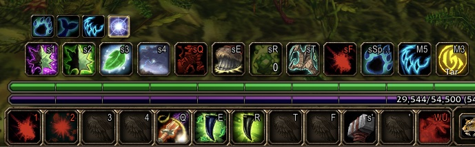
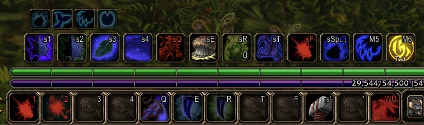
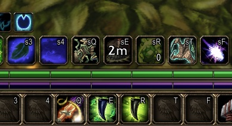
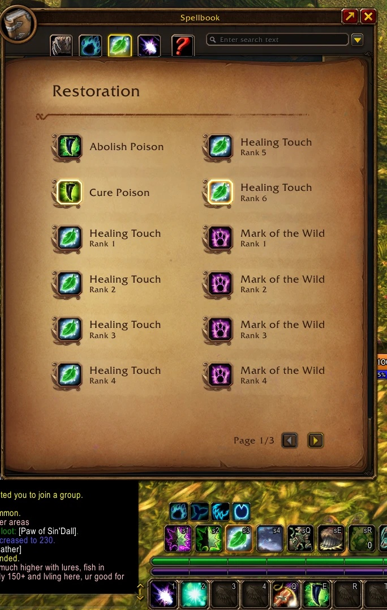
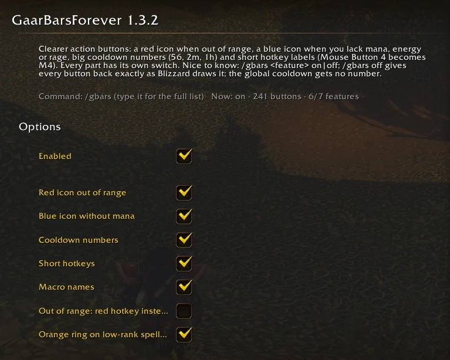
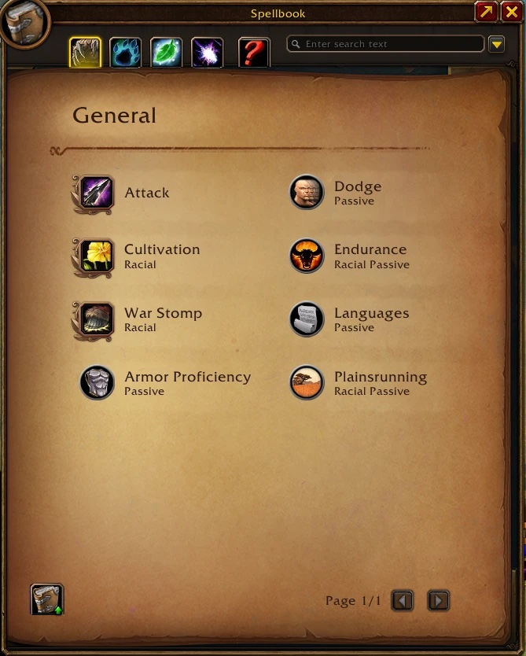
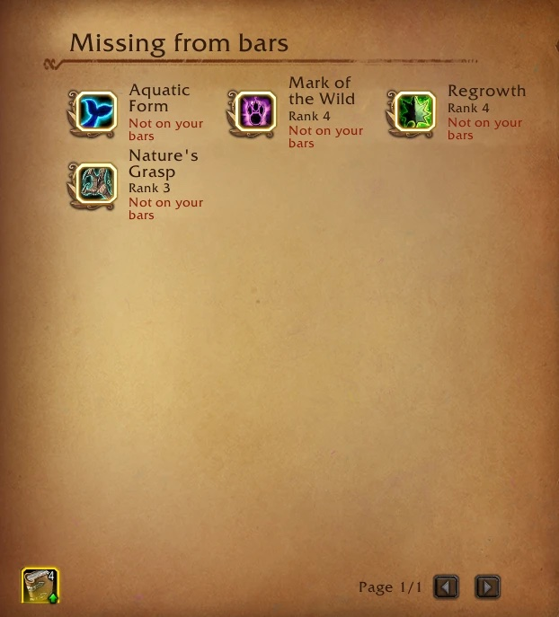
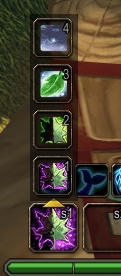
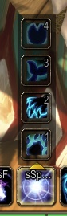

# GaarBarsForever

> Formerly **BetterBarsForever**. The folder is now `GaarBarsForever` as well; the update also ships a tiny `BetterBarsForever` folder, a
> settings bridge that moves your old settings over on the first login (each character on its own
> first login). It is safe to delete after logging in once on each character, and later updates drop it. The command is
> now `/gbars` (`/gaarbarsforever`); the old `/bbars` and `/betterbarsforever` still work.
> CurseForge: https://www.curseforge.com/wow/addons/gaarbarsforever

A small standalone addon for the WoW Forever client (`_forever_`, interface 16001). It makes
Blizzard's own action buttons easier to read: a red icon when the action is out of range, a blue
icon when you lack the mana, energy or rage, big cooldown numbers, short hotkey labels, and macro
names you can switch off, plus flyouts: drop spells, items or macros on a button and it opens a
flyout of up to 12 that you cast from with 1-9, 0, -, =. Every part can be switched on or off on its own. It needs GaarForever, the family hub, and no other addon or library, and it is not part of the Gaar suite.

## What it does

| Feature | Default | What it does |
|---|---|---|
| `rangeColor` | on | The icon is tinted red (0.8, 0.1, 0.1) while the action is out of range of your target |
| `manaColor` | on | The icon is tinted blue (0.3, 0.3, 1.0) while you lack the mana, energy or rage (`IsUsableAction`: usable false, notEnoughMana true). Unusable for any other reason stays Blizzard's grey |
| `cooldownText` | on | A big, centred, outlined cooldown number on the button: `56`, `2m`, `1h` (no space, rounded up, the same format as GaarFramesForever's aura times). Nothing for the global cooldown (1.5 s or less) |
| `hotkeyShort` | on | Short hotkey labels: `Mouse Button 4` -> `M4`, `Middle Mouse` -> `M3`, `Num Pad 1` -> `N1`, `Mouse Wheel Up/Down` -> `WU`/`WD`, `Shift-` -> `s`, `Ctrl-` -> `c`, `Alt-` -> `a` (`Ctrl-Shift-4` -> `cs4`). Blizzard's own short forms (`s-`, `MwU`, ...) are shortened the same way |
| `macroText` | on | Macro names on the buttons. Off hides them (the text is made transparent, never hidden) |
| `outOfRangeHotkey` | off | Out of range tints only the hotkey text red, not the icon. While on, it overrides `rangeColor` for the icon |
| `lowRankWarn` | on | While the spellbook is open, an action button whose spell is not the highest rank you know (Claw Rank 1 on the bar, Rank 3 known) gets a pulsing orange ring. The same ring sits on the spellbook entry of the highest rank you know when a bar holds a lower rank of it (Claw Rank 3 in the book gets it when Claw Rank 1 is on the bar), so you see what to drag up; classic `SpellButton1..12` and the paged `PlayerSpellsFrame` are both handled, and the book rings follow page and tab changes. Rings disappear when the spellbook closes. Rank comes from the spell's `Rank N` subtext, compared with the spellbook. Not re-checked in combat |
| `bookMissingTab` | on | A square icon tab of its own in the spellbook's bottom-left corner, level with the page arrows, in the look of Forever's category icon tabs (a book with a green arrow, the number of entries on it, a glow while open; click it again to go back); tooltip **Missing from bars**. It opens one list, over the spell pages and in the same look (icon frame, name, `Rank 3`, the same grid and paging), of every known, castable, non-passive spell that is on no action bar (**Not on your bars**) or only at a lower rank than the one you know (**Bar has Rank 2 · Rank 3 known**). Hover for the spell tooltip, drag a spell onto a bar, click it to cast. Clicking any Blizzard tab, What's Training?'s **?** tab, the search box or closing the book closes the list; opening the list closes What's Training?'s page. The list never covers the category tab row. Empty: *All your spells are on your bars at their highest rank.* Auto Attack, Auto Shot and Shoot are left out. Opening it is refused in combat; an open list stays as it is in combat and updates afterwards |
| `flyouts` | on | Flyouts on any action button, see [Flyouts](#flyouts) below. `/gbars flyout on\|off`; `/gbars flyout dir up\|down\|left\|right` (default up) |

- **Order.** Out of range wins over no mana. When neither applies, the icon gets its normal
  colour back.
- **Which buttons.** The main bar (`ActionButton1-12`), the multi bars
  (`MultiBarBottomLeft/BottomRight/Right/Left`, `MultiBar5-7`), the bonus and override bars where
  the client has them, plus anything Blizzard's `ActionBarButtonEventsFrame` lists. The stance bar
  (`StanceButton1-10`) and the pet bar (`PetActionButton1-10`) get the cooldown numbers, short
  hotkeys and macro switch; range and mana colours are for action buttons only.
- **Master switch.** `/gbars off` hands every button back exactly as Blizzard draws it: colours,
  hotkey text and colour, macro names and the cooldown's own numbers.

Settings are saved account-wide in `GaarBarsForeverDB`: `enabled`, one key per feature above and
`flyoutDir`. The flyouts themselves are saved per character in `GaarBarsForeverCharDB`.

## Flyouts

- **Adding.** While the cursor holds a spell, an item or a macro (out of combat), a small **+**
  sits on every action bar button that has an action. Drop it on the **+** and it goes into that
  button's flyout; the first drop creates the flyout with the button's own action as entry 1. Up
  to 12 entries; a duplicate is ignored.
- **Opening and casting.** A button with a flyout has a small arrow. Clicking it, or pressing its
  key, opens the flyout and casts nothing. Right-clicking the button casts the flyout's first entry
  directly, without opening it (in and out of combat, also when a stance, form or stealth pages
  the main bar; nothing happens if that entry is an item you have none of, as checked out of
  combat). `/gbars status` says on how many buttons the right-click is set. While it is open, `1`-`9`, `0`, `-` and `=` cast entry
  1-12, and clicking an entry casts it; then the flyout closes. Escape, clicking the button again
  or clicking elsewhere closes it. All of this works in combat.
- **Missing from bars.** Spells (and macros that cast a spell) inside a flyout on a button that is on
  a bar count as being on your bars in the spellbook's *Missing from bars* tab, with the same rank
  rules as for bar slots. Ignored while flyouts are off.
- **Look.** Like the game's own flyouts: icons with the cooldown swipe, red out of range, blue
  without mana, grey when unusable, the item count and the key that casts each entry.
- **Removing** (out of combat; in combat a chat line says so): right-click an entry, or drag it
  out (it lands on the cursor). With one entry left the flyout is removed and the button is a
  plain button again.
- **Saved per character**, keyed by the button's action (`spell:<id>`, `item:<id>`,
  `macro:<name>`), so a flyout follows its ability when you move it to another button; any other
  kind of action is keyed by its slot. Items you have none of are left out of the open flyout
  (checked out of combat) but stay saved.
- **Bars and keys.** The main bar (`ActionButton1-12`, also when a stance, form or stealth pages it)
  and `MultiBarBottomLeft/BottomRight/Right/Left`, `MultiBar5-7`. The keys are the ones bound to
  the button (`ACTIONBUTTONn`, `MULTIACTIONBARmBUTTONn`).
- **Off** (`/gbars flyout off`, `/gbars off`, or while the addon `FallensFlyouts` is loaded, which
  `/gbars status` then says): no overlay, binding or **+**; the buttons are exactly Blizzard's.
  The flyouts stay saved. With no flyouts at all nothing of this is even created.
- **How it stays secure.** A header of ours (`SecureHandlerStateTemplate`) runs restricted
  snippets that show and hide the flyout and bind `1`-`=` and Escape with `SetBindingClick` while
  it is open. Over each button with a flyout sits a `SecureActionButtonTemplate` overlay of ours
  (a child of the button); the button's keys are override-click bindings to that overlay. Its
  click is wrapped (`SecureHandlerWrapScript`): a left click or a key opens or closes the flyout
  and cancels the secure action; a right click closes any open flyout and lets the overlay's own
  right-click action run (`type2` with `spell2` / `item2` / `macro2`, the flyout's entry 1, on
  release). A state driver on the main bar's page conditions moves the overlays, and their
  right-click action, with the page in combat. The
  entries are `SecureActionButtonTemplate` buttons (`type1` spell / item / macro), cast on
  release. Frames, attributes and bindings are set only out of combat; anything that changes in
  combat waits for `PLAYER_REGEN_ENABLED`. Blizzard's buttons keep their own attributes, scripts
  and bindings.

## How it works

- **A ticker of its own** (5 times a second, visible buttons only) reads `IsUsableAction`,
  `IsActionInRange` and the cooldown, and sets the colours and texts.
- **Right after Blizzard.** So that Blizzard's own update never shows its colour for a moment in
  between, the addon also runs right after it, through `hooksecurefunc` on whichever of these the
  client has: the 12.x mixin methods on each button (`UpdateUsable`, `UpdateRangeIndicator`,
  `Update`, `UpdateHotkeys`, `SetHotkeys`) and the older globals (`ActionButton_UpdateUsable`,
  `ActionButton_UpdateRangeIndicator`, `ActionButton_Update`, `ActionButton_UpdateHotkeys`,
  `PetActionButton_SetHotkeys`). `/gbars status` lists which were found. `ActionButton_OnUpdate`
  is not hooked on purpose: it runs every frame for every button, and the ticker covers it.
- **Cooldown numbers.** While the timing is plain, the addon draws its own number from
  `C_ActionBar.GetActionCooldown` (else `GetActionCooldown`; `GetShapeshiftFormCooldown` and
  `GetPetActionCooldown` for the stance and pet bars) in a frame of its own above the swipe, and
  keeps the cooldown's built-in numbers off so they never show twice. Where the client hides the
  timing (a secret), only the client can draw it: the cooldown's own countdown numbers are
  switched on (`SetHideCountdownNumbers(false)`), in the bigger font (`GetCountdownFontString`,
  else `SetCountdownFont`) and in the same `56 / 2m / 1h` format where the client has
  `C_StringUtil`'s rule formatter (`SetCountdownFormatter`). Those are hidden for the global
  cooldown only when the client says so in plain (`isOnGCD`). Whether built-in numbers show at all
  may also depend on the client's `countdownForCooldowns` setting; `/gbars status` prints it.

## Secret values

On the 12.x engine `IsUsableAction`, `IsActionInRange` and cooldown values may come back secret. A
secret is never compared or tested; it only goes into a widget setter that takes it as it is, each
one checked first:

- **Range secret, usable plain:** `Texture:SetVertexColorFromBoolean(inRange, normal, red)` on the
  icon. Without it, a red texture of the addon's own over the icon, with
  `SetAlphaFromBoolean(inRange, 0, 0.55)`.
- **Usable secret:** `SetVertexColorFromBoolean(usable, white, grey)` (blue too when the mana flag
  is plain). Two secret booleans cannot be combined, so then there is no blue. A secret range on
  top uses the red overlay.
- **No setter:** the icon is left to Blizzard.
- **Hotkey mode with a secret range:** Blizzard's own range indicator already reds the hotkey; the
  addon only takes over where the hotkey has `SetVertexColorFromBoolean`.

`/gbars status` counts every secret answer and every missing or refused setter.

## Commands

| Command | Does |
|---|---|
| `/gbars` or `/gbars help` | Help |
| `/gbars on`, `/gbars off` | Switch the addon on or off |
| `/gbars range on\|off` (or `rangeColor`) | Red icon out of range |
| `/gbars mana on\|off` (or `manaColor`) | Blue icon without mana |
| `/gbars cooldown on\|off` (or `cooldownText`) | Cooldown numbers |
| `/gbars hotkey on\|off` (or `hotkeyShort`) | Short hotkeys |
| `/gbars macro on\|off` (or `macroText`) | Macro names |
| `/gbars rangehotkey on\|off` (or `outOfRangeHotkey`) | Out of range: red hotkey instead of red icon |
| `/gbars rank on\|off` (or `lowRankWarn`) | Orange ring on low-rank spells while the spellbook is open |
| `/gbars missing on\|off` (or `bookMissingTab`) | The spellbook tab of spells missing from your bars |
| `/gbars flyout on\|off` (or `flyouts`) | Flyouts on action buttons |
| `/gbars flyout dir up\|down\|left\|right` | Which way flyouts open (all of them; default up) |
| `/gbars status` | Version, the switches, the buttons handled (action, stance, pet), the hooks found and the ones this client lacks, the secret answers counted, which secret-safe setters and cooldown APIs exist, `countdownForCooldowns`, the client countdown formatter, the missing tab (spells not on a bar, spells on a bar at a lower rank, whether the tab is anchored, the last error), the flyouts (saved, on bars, buttons with an overlay, direction, whether the main bar's paging matches, and on how many shown overlays right-click casts entry 1) and the last error caught |

A feature command with no `on`/`off` toggles it. `/gaarbarsforever` works as well as `/gbars`.

## With GaarForever (required)

Since 1.0.1 this addon lists `GaarForever` (the GaarForever folder) under `## Dependencies`: install the `GaarForever` folder next to it, or the client will not load this addon. GaarForever also gives it a page under **Esc > Options > AddOns > Gaar Forever**, built from the same `MenuEntries()` as the hub's menu, with a short intro at the top; that intro comes from `Intro()`, a field the API table gained in 1.0.1 (it is also the first line of the slash command's help).

Since 1.0.2 it takes its shared helpers from GaarForever's library (`GaarForever`, `Lib.lua`) instead of carrying its own copies: the chat prefix, the secret-value checks (`IsSecret`, `Num`, `Str`), `InCombat`, the cooldown text (`TimeShort`) and the drawing of its menu (`RenderMenu`). Nothing you see or set changed.

[GaarForever](../GaarForever/README.md) is the family hub with one minimap button
whose menu can hold this addon's options: **Enabled**, then one checkbox per feature (**Red icon
out of range**, **Blue icon without mana**, **Cooldown numbers**, **Short hotkeys**, **Macro
names**, **Out of range: red hotkey instead of red icon**). They go through the same functions as
the slash command. This addon has no minimap button or menu of its own, so nothing here changes
with or without the hub.

The hub talks to this addon only through `GaarBarsForeverAPI`:

| Field | What it is |
|---|---|
| `version` | This addon's version, a string |
| `StatusLine()` | One line of state, e.g. `on · 120 buttons · 5/6 features`, or `off` |
| `MenuEntries()` | The options as plain data (`{ text, func }`, `{ text, checkbox, checked, func }`, `{ text, radio, checked, func }`, `{ text, submenu }`, `{ divider }`), for a menu drawn without `MenuUtil` |
| `AddMenuEntries(root)` | Adds the same options to a `MenuUtil` root or submenu description |
| `SetMinimapHidden(hidden)` | Does nothing: there is no minimap button to hide. It is there so every addon the hub knows has the same API |

## How it stays out of the way

- Action buttons are secure. Blizzard code is only followed, never replaced: `hooksecurefunc`
  only. No Blizzard function, script or table is written, no protected function is called, and no
  button is shown, hidden, moved or given an attribute. Flyouts use secure frames of the addon's
  own (see [Flyouts](#flyouts)).
- Only visual properties of non-secure regions change: the icon's vertex colour, the hotkey's
  text and colour, the macro name's alpha and the cooldown's own countdown numbers, plus textures,
  font strings and one plain frame per button that the addon creates itself, out of combat (a
  `/reload` in combat waits for `PLAYER_REGEN_ENABLED`).
- Every client API is checked with `type(...) == "function"` before use, every handler runs in
  `pcall` (the last error is kept for `/gbars status`), and a secret value is never compared or
  tested.
- Saved variables are read at `ADDON_LOADED`, never at file scope.
- **The spellbook tab** (`BookTab.lua`) only reads Blizzard's spellbook: its tab system, categories
  and pages are never changed and its selected tab is left alone; Blizzard tab clicks are followed
  with `hooksecurefunc` (`SetTab`) and `HookScript`. The spell icons in the list are the addon's
  own `SecureActionButtonTemplate` buttons (`type1 = "spell"`), so clicking casts. They are given
  their spell, shown, hidden and moved only out of combat, and their panel sits in the spellbook
  only while the tab is open, so the book carries no secure frames of ours otherwise.

## Names it relies on

From Blizzard's retail FrameXML, which Forever's UI follows
([Gethe/wow-ui-source](https://github.com/Gethe/wow-ui-source)): the action button names above,
`ActionBarButtonEventsFrame`, the button fields `action`, `icon`, `HotKey`, `Name` and `cooldown`,
`IsUsableAction`, `IsActionInRange`, `HasAction`, `C_ActionBar.GetActionCooldown`,
`GetActionCooldown`, `GetShapeshiftFormCooldown`, `GetPetActionCooldown`, `RANGE_INDICATOR`, `GetActionInfo`, `C_Spell.GetSpellSubtext`, `C_SpellBook` (or `GetSpellBookItemInfo`), `SpellBookFrame` / `PlayerSpellsFrame`,
`Texture:SetVertexColorFromBoolean`, `Region:SetAlphaFromBoolean`, `CreateColor`,
`Cooldown:SetHideCountdownNumbers`, `GetCountdownFontString`, `SetCountdownFont`,
`SetCountdownFormatter`, `C_StringUtil.CreateNumericRuleFormatter`, `issecretvalue`,
`issecrettable`, `hooksecurefunc` and `InCombatLockdown`. It ships a `_Camelot` TOC and a plain
fallback TOC, both at 16001.

## License

MIT, see [LICENSE](LICENSE).

## Support

If you enjoy this addon, you can [buy me a coffee](https://buymeacoffee.com/tgaarden) ☕

## Screenshots

**Bars**

**Bars nomana**

**Bars cooldown**

**Spellbook ring**

**Options**

**Missing tab**

**Missing list**

**Flyout**

**Flyout 2**

