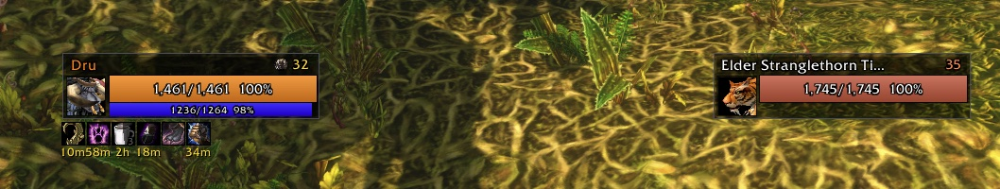
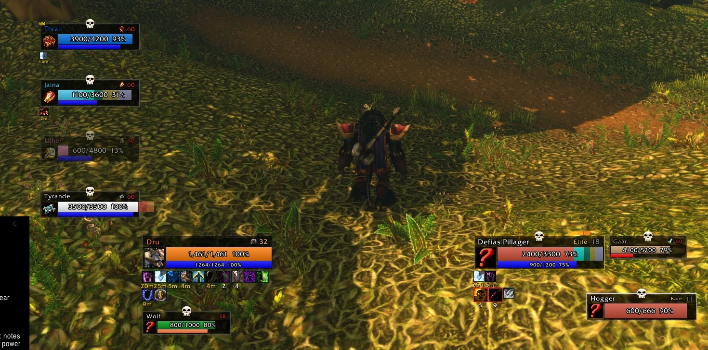
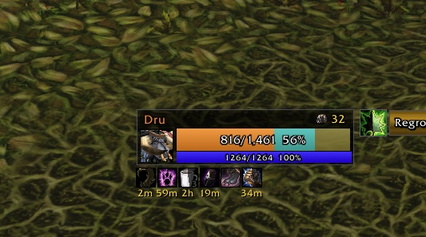
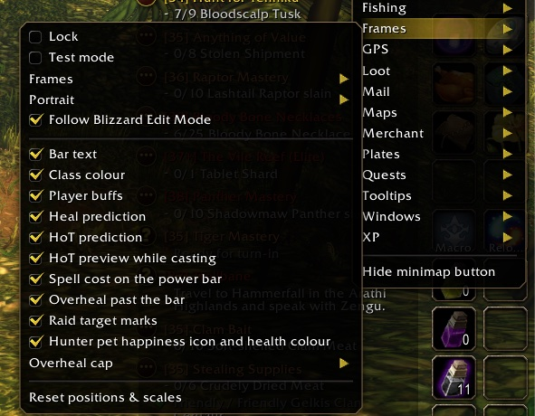
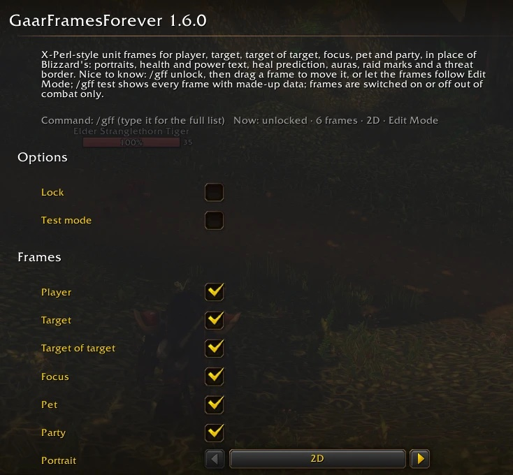
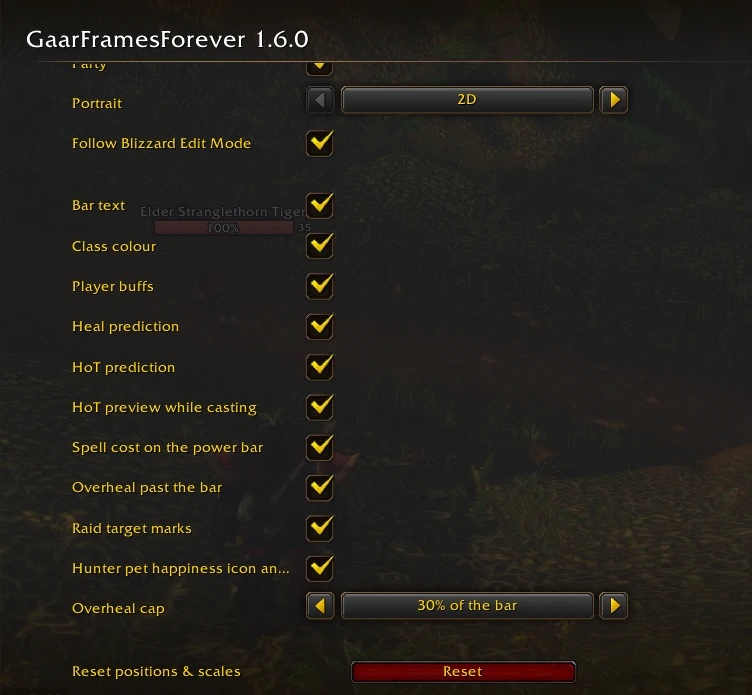
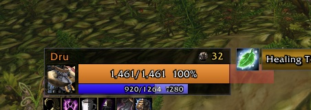

# GaarFramesForever

> Formerly **BetterFramesForever**. The folder is now `GaarFramesForever` as well; the update also ships a tiny `BetterFramesForever` folder, a
> settings bridge that moves your old settings over on the first login (each character on its own
> first login). It is safe to delete after logging in once on each character, and later updates drop it. The command is
> now `/gff` (`/gaarframesforever`); the old `/bff` and `/betterframesforever` still work.
> CurseForge: https://www.curseforge.com/wow/addons/gaarframesforever

A small standalone addon for the WoW Forever client (`_forever_`, interface 16001). It draws
X-Perl-style unit frames of its own for the player, target, target of target, focus, pet and
party, and switches Blizzard's off. It needs GaarForever, the family hub, and no other addon or library.

## What it does

- **Frames.** Player, target, target of target, focus (only where the client has a focus unit),
  pet and party1-4. No raid frames and no XP bar.
- **X-Perl layout.** A name bar on top with the name, the level (coloured by difficulty, `??` for
  a boss) and, for players, a class icon; NPCs get an `Elite`, `Rare`, `Rare Elite` or `Boss`
  tag there instead. The portrait sits on the left (2D by default, a 3D model as an option), the
  health and power bars on the right with `cur/max  NN%` text, all on a dark see-through
  backdrop with a thin border. Target of target and pet are smaller, the party frames are a
  compact version of the same. A unit that is dead, a ghost or offline says so in its health bar.
  Since 1.2.6 the current health in that text (and the bar) is the same reading as the percent:
  1.2.5 showed a mob near death as `1/473  4%`, the number read with the client's health
  prediction (`UnitHealth(unit)`, `usePredicted` on by default) and the percent without it
  (`UnitHealthPercent(unit, false, ...)`). Bar, number and percent now all use
  `UnitHealth(unit, false)` / `UnitHealthPercent(unit, false, ...)`, on every frame (player,
  target, target of target, focus, pet, party). Hidden numbers are now written with
  `AbbreviateLargeNumbers`, as Blizzard's own unit frames do (`AbbreviateNumbers` as fallback).
  Since 1.2.10 that one reading is the predicted one (`UnitHealth(unit)` /
  `UnitHealthPercent(unit, true, ...)`, as Blizzard's own frames): 1.2.6's unpredicted reading is
  the last value the server sent, so after a heal landed the bar and text kept the old health for
  a few seconds while the green heal prediction was already gone.
- **Colours** (1.2.11: Blizzard colours with soft gradient). Class colour for players (`RAID_CLASS_COLORS`),
  Blizzard's green for players without class colour, Blizzard's `FACTION_BAR_COLORS` for NPCs, grey
  when someone else tagged the mob, offline or dead. The power bar uses Blizzard's `PowerBarColor`
  (mana, rage, energy, focus, runic power). Where the client has no such table the classic Blizzard
  default values are used. 1.2.8-1.2.10 had a custom palette; the low-health tint (orange under
  35%, red under 20%) and its `/gff lowhp` option are gone, since Blizzard's frames do not tint by health.
- **The look** (1.2.8, colours from 1.2.11). Every bar - health, power, the druid mana bar and the
  heal prediction overlays - has a soft vertical gradient in its own colour: lighter at the top,
  darker at the bottom, so the bars have some depth instead of a flat hard fill (they are a plain
  white texture coloured that way). The health bar has a thin near-black border and a faint shadow
  fading out 2 px beyond it, drawn under the bars, so the power bar and portrait are not covered.

  | Heal prediction | 1.2.11 (r, g, b, alpha) |
  |---|---|
  | Your heals / all heals | 0.0, 0.827, 0.765, 0.85 / 0.0, 0.631, 0.557, 0.55 (Blizzard's teal) |
  | HoTs (Blizzard has none) | 0.95, 0.85, 0.30, 0.55 |
  | Overheal past the bar: heals / HoTs (1.5.0) | 1.0, 0.25, 0.25, 0.5 / 1.0, 0.55, 0.20, 0.5 |
  | Absorb / heal absorb | white 0.55 / red 1.0, 0.0, 0.0, 0.75 |
- **Target.** Combo points above the frame for rogues and druids. A row of buffs and a row of
  debuffs under it, up to 16 each, with stacks and a cooldown swipe; your own debuffs are larger
  with a bright border, other debuffs are smaller and greyed. Elites and bosses get a gold
  border, rares a silver one. A unit without power (most beasts) has no power bar; the health
  bar takes its room.
  Switching target (or a party slot changing hands) rebuilds the aura rows, so they never keep
  the previous unit's buffs and debuffs (1.2.4).
  Other players' debuffs and DoTs show too (1.2.5): your own in one group (`HARMFUL|PLAYER`,
  large, red border), everyone else's in the other (`HARMFUL|!PLAYER`, small, grey), so each
  debuff appears once. Up to 1.2.4 the "other" group used the candidate filter
  `isFromPlayerOrPlayerPet = false`, but that flag is true for every player's aura (not only
  yours), so only the mob's own debuffs got through and a group mate's DoTs never showed. On a
  client without the `!` filter negation (before retail 12.1) the two groups become one plain
  `HARMFUL` group: every debuff once, yours not set apart. Buffs and HoTs on the player, party
  and a friendly target were already shown from everyone (`HELPFUL`, no caster filter).
- **Aura timing** (1.2.2, Blizzard buff-frame style). Every aura icon (player buffs, target
  buffs and debuffs, party auras, test mode) has its time left **under** the icon, in Blizzard's
  small gold buff-duration font (`GameFontNormalSmall`, 10 px; 8 px under the small party icons),
  white below a minute as on Blizzard's buff frame. Never a seconds unit: `45` under a minute,
  then `9m`, `59m`, `1h`, `2d` (rounded up, no space before the unit; 1.2.3). The icon
  rows are spaced to leave room for the text. The swipe runs as on Blizzard's own aura buttons
  (since 1.2.1): bright when the aura is fresh, darker as it runs out.
- **Heal prediction** (1.2.2, on by default: `/gff healpred off` to hide). On every health bar
  (player, pet, target, target of target, focus, party), as on Blizzard's frames: incoming heals
  from the health edge into the missing health, your own in a strong green over everyone's in a
  lighter green, then absorb shields in white (with Blizzard's shield stripes where the client has
  the texture), and heal absorbs (necrotic and the like) in dark red drawn back over the health.
  Nothing is drawn past the end of the bar.
- **Hunter pet happiness** (1.4.0, on by default: `/gff pethappiness off` to hide). A 20 px happy / content / unhappy face
  just right of the pet frame, always shown while a hunter has a pet, with a tooltip on hover (happiness, damage bonus
  or penalty, gaining or losing loyalty). Read with `GetPetHappiness()` inside a pcall; no chat or sound alert.
  1.4.1 fixes the face not showing on WoW Forever and adds the bar colour: the level comes from `GetPetHappiness()`,
  or, where that is missing or empty, from the pet's happiness power (`UnitPower("pet", Enum.PowerType.Happiness)`
  against `UnitPowerMax`, split in thirds: below 350000 of 1050000 unhappy, below 700000 content, else happy).
  It shows for a hunter with a pet out (`HasPetUI()` is no longer required), with red / yellow / green dots where the
  client has no face texture, and is re-checked every 2 seconds in case no happiness event comes. The pet's health
  bar is coloured by happiness too (happy green, content yellow, unhappy red; the health value and text are
  unchanged), on every health update; with no happiness known it keeps its normal colour. `/gff pethappiness`
  switches icon and colour together. `/gff status` prints a `pet happiness:` line with the raw reads (hunter, pet
  out, `GetPetHappiness`, `HasPetUI`, `UnitPower` happiness, source used, level, icon shown, last error).
  1.4.2 fixes the pet health bar staying white: `Happy` was declared inside the Look block, so it was a nil global in
  `UpdateHealth` and the health update threw (and latched off). It is now declared at file scope; the bar is green,
  yellow or red by happiness as intended.
- **Raid target marks** (1.2.9, on by default: `/gff marks off` to hide). On every frame the raid
  mark (skull, cross, star ...) is an 18 px icon on a frame of its own above the bars, centred on the
  top edge so half of it sticks out above the frame; nothing covers it and it does not touch the
  name, health or auras. Hidden without a mark; updates on `RAID_TARGET_UPDATE` and unit changes.
  A secret index goes only to `SetRaidTargetIconTexture` inside a `pcall`. `/gff test` shows a sample skull.
- **HoT prediction** (1.2.7, on by default: `/gff hotpred off` to hide). After the green incoming
  heals, a soft yellow segment shows what every active HoT on the unit (Renew, Rejuvenation,
  Regrowth's HoT, Lifebloom where the client has it, First Aid bandages; from any healer) will
  still heal before it runs out, so you can see whether the HoTs already cover the missing health.
  It is cut like the green: health + incoming heals + HoTs never go past the end of the bar. The
  client's heal prediction has no HoT part, so the sum comes from the buffs themselves (per-tick
  amount times the ticks left). On Forever auras are secret in combat, and then the yellow
  segment is simply not drawn; `/gff status` says so. Out of combat - topping someone up,
  resting - it is, and it comes back as combat ends. 1.2.10 fixes it never showing: HoTs are now
  also matched by their (localized) name, the per-tick amount comes from the aura's tooltip
  (`Heals 32 damage every 3 seconds.`, or `Heals 66 damage over 6 sec.` spread over the ticks)
  when the aura's `points` hold none, and the yellow bar no longer hangs on the hidden green bar
  when no heal is incoming. `/gff status` lists each HoT on your target (or you) with its spell,
  amount, source and ticks left, or why nothing is drawn; `/gff hotdebug` prints the raw buff data.
  1.4.4 makes it steady: each HoT's amount, once read, is kept with that aura and preferred over
  a new tooltip read; with no amount readable the last reading of that rank, the spell's
  description or the rank's base value (no +healing) stands in, and the aura tooltip is retried
  every 2 s (it used to wait 10 s after a failed read, so a fresh Rejuvenation often had no
  segment at all). In combat the HoTs read before stay until they run out, and a HoT you cast
  yourself is added from the cast, so your own Rejuvenation, Regrowth and Renew show in combat
  too. Ticks left are counted from the HoT's tick schedule, and the segment drops as each tick is
  due, not only on the next event. An aura change redraws every frame showing that unit (you as
  player and as target). `/gff hotdebug [unit]` lists, per HoT, the amount and its source
  (points, tooltip, cached, stand-in or your cast), the interval, ticks left, total, what is
  secret, and why a HoT adds nothing.
- **Overheal past the bar** (1.5.0, on by default: `/gff overheal off` to hide). When health +
  incoming heals + HoTs come to more than the maximum, the excess hangs past the right edge of
  the health bar on every frame with heal prediction (player, target, target of target, focus,
  pet, party), at the same pixels per health point as the bar, up to 30% of the bar's width
  (`/gff overheal cap 0.1-1`). Inside the bar nothing changes: health, green, yellow, cut at the
  end; what does not fit carries on outside as one reddish, half see-through segment in two
  tints - the overflowing part of the incoming (cast) heals in red `1.0, 0.25, 0.25, 0.5`, the
  HoT part after it in orange-red `1.0, 0.55, 0.20, 0.5`. It sits on its own frame anchored to
  the health bar's right edge, at its height and frame level, so a full-health druid casting
  Regrowth now sees the heal as overheal instead of nothing; it may overlap whatever sits right
  of a frame (target of target, a cast bar), being see-through. The layout is one pure function,
  `HealLayout(cur, max, incoming, hot, overCap)`, used whenever health, maximum and incoming
  heals are plain (the incoming heals unclamped, from `UnitGetIncomingHeals`). When one of them
  is hidden (secret, in combat) nothing can be added or compared, so two bars are laid out like
  the green and yellow - the client's raw incoming heals from the health edge, the HoTs after
  them, on the bar's own scale - and the overheal frame clips them to what reaches past the end;
  there the heal part can reach past the end by at most the current health's share of the bar.
- **PvP flag** (1.7.0, on by default: `/gff pvp off` to hide). A faction (Alliance / Horde) or free-for-all icon on the left edge of the player, target and party frames while the unit is PvP flagged. The player's also shows the time left (`m:ss`) under the icon while the flag times out; it updates once a second only while a timer runs. Blizzard's own PvP icon goes with its frames, so there is no duplicate. A value the client hides in combat keeps the last known state.
- **Spell cost on the power bar** (1.6.0, on by default: `/gff cost off` to hide). On the player
  frame only, from `UNIT_SPELLCAST_START` of a spell with a cast time until `_STOP`, `_FAILED`,
  `_INTERRUPTED` or `_SUCCEEDED`, the right end of the filled power bar, as wide as the cost, is
  drawn bright and gently pulsing with a small `-340`; red when the power is less than the cost.
  The cost is the entry of `C_Spell.GetSpellPowerCost(spellID)` (older `GetSpellPowerCost` as a
  fallback) for your current power type (a cost in another power type is ignored). The segment is
  a reversed-fill StatusBar hung on the power bar's fill, set with `SetMinMaxValues`/`SetValue`,
  so a secret power, maximum or cost needs no arithmetic; only the red test and the number are
  left out when a value is secret. Channels are not marked (paid at the start).
- **HoT while casting** (1.5.0, on by default: `/gff hotcast off` to hide). While you cast a HoT
  spell with a cast time (Regrowth; Rejuvenation and Renew are instant and show from the cast's
  success as before), its full HoT (per tick x ticks) is drawn in yellow from the start of the
  cast on every frame showing its target: the target frame, the player frame on a self-cast, the
  party frame. The target is the name `UNIT_SPELLCAST_SENT` gives, matched by GUID to every
  frame; without a name your target if you can help it, else you (classic self-cast). The
  amount is that rank's last reading, else the spell's description, else the rank's base value.
  It goes on `UNIT_SPELLCAST_STOP`, `_FAILED` and `_INTERRUPTED` of that cast (a failed attempt
  at another spell mid-cast leaves it), and on `_SUCCEEDED` it hands over to the own-cast entry
  of 1.4.4 and then to the aura, never counted twice; a recast replaces your own HoT of that name
  in the sum. It needs no aura read, so it works in combat. Regrowth's direct heal is the
  client's to show (green); if the client's prediction of your own heals on the target
  (`UnitGetIncomingHeals(unit, "player")`, unclamped) is a plain 0 during the cast, the addon
  adds the direct part itself (the description's range middle, else the rank base), and stops
  doing so as soon as the client shows your cast; hidden or missing, the client is trusted.
  `/gff hotdebug` prints the pending cast: spell, target and how it was found, amount, source,
  the direct part and whether the client's prediction includes your cast.
- **Druid mana** (1.2.2). While a form shows another power (bear rage, cat energy) and you have
  mana, a thin blue mana bar with `cur/max  NN%` sits under the power bar of the player frame, as
  Blizzard's alternate mana bar; the health bar gives up the room. The form's own power bar stays
  as it is - and since 1.2.2 it also stays at 0 rage or energy (1.2.1 hid the player's empty bar).
- **Player buffs** (1.2, on by default: `/gff playerbuffs off` to hide). Your own buffs in rows
  under the player frame, X-Perl style: up to 20 icons of 20 px, 10 to a row, with the same look
  as the target's buffs (icon, stack count, remaining-time swipe, tooltip on hover). Buffs only,
  no debuffs; right-click to cancel a buff is not there (that needs Blizzard's secure buff
  buttons). They move and scale with the player frame and follow Edit Mode with it. To make room
  the pet frame's default place is now under the two buff rows, and the party block's below it
  (a position you dragged yourself is kept). 1.2.2 moves those defaults down again to make room
  for the time text under the icons (pet at -176, party at -234; party frames 52 px apart); a
  position you saved yourself is not moved, so after updating check that pet and party do not
  overlap the buff rows (`/gff test`).
- **Party.** Small debuffs and buffs under each frame (up to 8 each), and the frame fades to 50%
  when the member is out of range.
- **Icons.** Raid target icon on every frame, group leader on the player and party frames, combat
  and resting on the player portrait, and a coloured border round any frame with threat
  (yellow, orange, red).
- **Click.** Left-click targets the unit, right-click opens Blizzard's own unit menu.
- **Move.** `/gff unlock` and drag a frame (out of combat; the border turns blue while unlocked).
  The party frames move as one block. Each frame has its own scale, 0.6 to 1.5. Positions and
  scales are saved account-wide in `GaarFramesForeverDB`. `/gff reset` puts them back.
- **Follow Blizzard Edit Mode** (1.1, off by default: `/gff editmode on`). Player, target, focus
  and party sit where Blizzard's own `PlayerFrame`, `TargetFrame`, `FocusFrame` and `PartyFrame`
  are placed in Edit Mode, each with its own scale and size; the other party members keep their
  spacing below the first. Pet and target of target have no Edit Mode place of their own: they
  keep the offset they have from player and target in your own layout, and move with them. Open
  Edit Mode and Blizzard's frames are there to drag (ours go see-through); close it and ours move
  to the new place. A layout switch, a loading screen or a UI scale change moves them too. Frames
  placed this way cannot be dragged with `/gff unlock`; your own positions are kept untouched, so
  `/gff editmode off` puts everything back where it was.
- **Test mode.** Shows every enabled frame with made-up data, the party included without a group,
  so they can be placed. The player frame stays the real one, but its buffs are replaced by
  twelve made-up ones (two rows, some with a swipe) so the buff rows can be placed too. Out of
  combat only; entering combat ends it. Not saved.

Not in 1.2.2: raid frames, an XP bar, an options panel, a minimap button, cast bars on the frames
(use GaarCastbarsForever), click-casting.

## Commands

| Command | Does |
|---|---|
| `/gff`, `/gff help` | Help, with the current settings |
| `/gff status` | Settings, each frame and its scale, Edit Mode following (which frames sit at Blizzard's place, which at their own and why), how auras are drawn (target and player buffs), which aura API and templates this client has and how the aura time text is formatted, heal prediction (on/off and which API), HoT prediction (on/off; for your target, or you without one: whether it is drawn or why not - off, heal prediction off, in combat, auras secret, no known HoT, full health - each HoT found with spell ID, name, how it matched, per-tick amount and its source (`points` / tooltip / none), ticks left and remaining healing; what it drew last; any HoT method the client's heal prediction calculator has), the player's mana bar and power bar (shown or not and why), the target's power values (power type, `UnitHasPowerType`, whether `UnitPower` / `UnitPowerMax` are hidden, the two `C_Secrets` power predicates, and whether the power bar shows and why), the target's health readings (`UnitHealth` with and without prediction, `UnitHealthMax`, `ShouldUnitHealthMaxBeSecret`: each shown or "hidden") and the number formatter in use, tried on 19 and 12345, what this client allows (secure frames, focus, hidden values, text for hidden values, range), which Blizzard frames are switched off, anything the client refused, changes waiting for the end of combat, and conflicting unit-frame addons |
| `/gff lock`, `/gff unlock` | Stop or allow dragging the frames (locked by default; frames that follow Edit Mode are not dragged) |
| `/gff editmode on\|off` | Follow Blizzard's frames placed in Edit Mode (off by default; without `on`/`off`: toggle). `/gff follow` works too |
| `/gff test`, `/gff test on\|off` | Test mode with made-up data |
| `/gff reset` | Positions and scales back to the defaults |
| `/gff scale <player\|target\|tot\|focus\|pet\|party> <0.6-1.5>` | One frame's scale (`120` works for 1.2 too) |
| `/gff frame <player\|target\|tot\|focus\|pet\|party> on\|off` | Which frames are drawn (without `on`/`off`: toggle) |
| `/gff portrait 2d\|3d` | 2D portrait (default) or 3D model |
| `/gff text on\|off` | `cur/max  NN%` text on the bars (on by default) |
| `/gff classcolor on\|off` | Class colour for players (on by default; off: green) |
| `/gff playerbuffs on\|off` | Your buffs under the player frame (on by default) |
| `/gff healpred on\|off` | Incoming heals, absorbs and heal absorbs on the health bars (on by default) |
| `/gff hotpred on\|off` | What active HoTs will still heal, in yellow after the incoming heals (on by default; needs `healpred`) |
| `/gff hotcast on\|off` | While you cast a HoT spell (Regrowth), its HoT in yellow on the target's frames from the start of the cast (on by default; needs `hotpred`) |
| `/gff pvp on\|off` | PvP flag icon beside the portrait of a flagged unit, plus the flag timer on the player frame (on by default) |
| `/gff cost on\|off` | While you cast a spell with a cast time, its cost marked on your power bar: the part that will go, bright and pulsing with a `-number`, red when you lack the power (on by default) |
| `/gff overheal on\|off` | Heals past the maximum as a red / orange-red segment past the health bar's right edge (on by default) |
| `/gff overheal cap <0.1-1>` | The overheal segment's longest length, as a share of the bar's width (default 0.3; `30` works too) |
| `/gff hotdebug` | The raw helpful-aura fields behind the HoT prediction on your target (or you): `spellId`, `name`, `points`, `duration`, `expirationTime`, `timeMod`, `isHelpful`, `sourceUnit`, `auraInstanceID`, the secret check, and for a HoT its tooltip text and what was parsed from it |
| `/gff marks on\|off` | Raid target marks (skull, cross, star ...) on the frames (on by default) |
| `/gff pethappiness on\|off` | Hunter pet happiness icon next to the pet frame and pet health bar coloured by happiness (on by default) |

`/gaarframesforever` works the same as `/gff`. `targettarget` works for `tot`.

## With GaarForever (required)

Since 1.2.12 this addon lists `GaarForever` (the GaarForever folder) under `## Dependencies`: install the `GaarForever` folder next to it, or the client will not load this addon. GaarForever also gives it a page under **Esc > Options > AddOns > Gaar Forever**, built from the same `MenuEntries()` as the hub's menu, with a short intro at the top; that intro comes from `Intro()`, a field the API table gained in 1.2.12 (it is also the first line of the slash command's help). Since 1.2.13 it also takes its small helpers (the chat line, the number and secret-value checks, the short number and aura-time text, drawing the hub's menu) from GaarForever's shared library instead of carrying its own copies; nothing it does or shows changed.

[GaarForever](../GaarForever/README.md) is the family hub: one minimap button whose
menu has a submenu per Gaar...Forever addon. Its **Frames** row is in the hub (then named BetterGaarForever) 2.4
and later; older versions of the hub do not list it. The submenu has **Lock**, **Test mode** (just before Reset),
**Frames** (a checkbox per frame), **Portrait** (2D or 3D), **Follow Blizzard Edit Mode**, **Bar text**,
**Class colour**, **Player buffs**, **Heal prediction**, **HoT prediction** and **Reset positions & scales**, the same settings as `/gff` (both go through
the same functions). This addon has no minimap button or menu of its own, so nothing here
changes with or without the hub.

The hub talks to this addon only through `GaarFramesForeverAPI`:

| Field | What it is |
|---|---|
| `version` | This addon's version, a string |
| `StatusLine()` | One line of state, e.g. `unlocked · 6 frames · 2D` (` · Edit Mode` while following it, ` · test mode` while testing) |
| `MenuEntries()` | The options as plain data (`{ text, func }`, `{ text, checkbox, checked, func }`, `{ text, radio, checked, func }`, `{ text, submenu }`, `{ divider }`), for a menu drawn without `MenuUtil` |
| `AddMenuEntries(root)` | Adds the same options to a `MenuUtil` root or submenu description |
| `SetMinimapHidden(hidden)` | Does nothing: there is no minimap button to hide. It is there so every addon the hub knows has the same API |

## How it stays out of the way

- **Own frames, not Blizzard's restyled.** [GaarFrames](../GaarFrames/GaarFrames.lua) restyles
  Blizzard's unit frames in place, and turns itself off on Forever: writing to those frames
  taints them, and once the client hands out secret values Blizzard's own code inside a tainted
  frame can no longer compare them (`Blizzard_UnitFrame/Mainline/UnitFrame.lua:777` in the taint
  log). So this addon never writes to Blizzard's unit frames. It builds its own, the way X-Perl
  and oUF do.
- **Secure frames, changed only out of combat.** Each frame is a `SecureUnitButtonTemplate`
  button with `unit`, `type1 = "target"` and `type2 = "togglemenu"` set once, at creation, out of
  combat. `RegisterUnitWatch` shows and hides every frame but the player's. Creating, showing,
  hiding, moving and scaling a secure frame happen only out of combat; asked for in combat
  (`/gff scale`, `/gff frame`, `/gff reset`, a login or `/reload` in combat), the change is
  queued and made at `PLAYER_REGEN_ENABLED`, with one line in chat. In combat the addon only
  paints: bars, text, icons and alpha. A drag in progress when combat starts is ended and saved
  first.
- **How Blizzard's frames are switched off.** oUF's `DisableBlizzard` approach, out of combat
  only, when a frame of ours is switched on (at login, or `/gff frame <x> on`): the Blizzard frame
  gets `UnregisterAllEvents()`, `Hide()` and is re-parented to a hidden frame of the addon's own
  (`GaarFramesForeverHiddenParent`); its health, mana, cast, buff and similar sub-frames lose
  their events too. Player: `PlayerFrame`. Target: `TargetFrame` and `ComboFrame`. Target of
  target: `TargetFrameToT`. Focus: `FocusFrame`, `FocusFrameToT`, `TargetofFocusFrame`. Pet:
  `PetFrame`. Party: `PartyFrame` (its member frames `PartyFrame.MemberFrame1-4` lose their
  events and are hidden, but are not re-parented, as in oUF) or the old `PartyMemberFrame1-4`.
  Every name is checked first; a missing one is skipped. **`CompactPartyFrame`** (the raid-style
  party frames) is not switched off by the addon. But in retail's FrameXML it is created as a
  child of `PartyFrame` (`CompactPartyFrame_Generate`), so parking `PartyFrame` most likely hides
  it as well - not yet checked in game; `/gff frame party off` and a `/reload` bring both back.
- **The trade-off.** Events cannot be handed back, so turning a frame off (`/gff frame <x> off`)
  hides ours at once but brings Blizzard's back only after `/reload`. With `PlayerFrame` gone,
  anything Blizzard hangs off it goes too (a class bar under the player frame, for example); the
  combo points on our target frame are there for that reason. Vehicle art on the player frame is
  not handled.
- **Edit Mode.** After `EDIT_MODE_LAYOUTS_UPDATED` and every loading screen the addon checks,
  out of combat, that the frames it parked are still parked and hidden. If doing so ever raises
  an error, switching Blizzard's frames off is stopped for the session with one line in chat,
  rather than an error every time.
- **Following Edit Mode without touching Blizzard's code.** Only `EventRegistry` callbacks
  (`EditMode.Enter` / `EditMode.Exit`; `HookScript` on `EditModeManagerFrame` where there is no
  `EventRegistry`), no replaced function, nothing written into Blizzard's tables. Nothing of ours
  is anchored to Blizzard's frames either: their top-left is read (`GetLeft` / `GetTop` times
  their effective scale over UIParent's), each number checked for a secret, and our frame gets a
  `TOPLEFT` point on UIParent there. A frame that will not report its place keeps the last good
  reading, or our own position; an error reading it switches following off for the session with
  one line. When Edit Mode opens, out of combat (queued otherwise), `PlayerFrame`, `TargetFrame`,
  `FocusFrame` and `PartyFrame` - only for the frames we draw - are re-parented to their own
  parent and shown, so Edit Mode's selection boxes are there to drag; their sub-frames (target of
  target, pet, combo points) stay parked. Their events stay unregistered: Edit Mode moves the frame
  and its selection box with no events, and `PartyFrame` sets its member frames up again itself
  when it is shown. Blizzard's target and focus frames therefore show stale or empty content in
  Edit Mode. Our followed frames go see-through with the mouse off meanwhile; test mode is off.
  When Edit Mode closes, the new place is read, the frames are parked exactly as at login
  (`UnregisterAllEvents`, `Hide`, re-parent) and ours move.
- **Hidden (secret) values.** The bars always get the raw values (`SetMinMaxValues(0, max)`,
  `SetValue(cur)`): a StatusBar takes a secret. Nothing is worked out from a secret: no
  comparison, no sum, no boolean test, not even `x or y`. The `cur/max  NN%` text is written from
  plain numbers when they are plain. When they are hidden, the client's own secret-safe helpers
  are used where it has them (`AbbreviateLargeNumbers`, else `AbbreviateNumbers`, for `cur/max`, `UnitHealthPercent` /
  `UnitPowerPercent` with `CurveConstants.ScaleTo100` for the percent, written with
  `SetFormattedText`); without them the text is left empty and the bar alone shows the value.
  The class colour is used only when they can be worked out; a hidden threat
  status, level or classification is dropped. Party range uses `UnitInRange`; a hidden answer
  goes straight to `SetAlphaFromBoolean` where the client has it. Aura timings that are hidden
  use the client's duration object (`C_UnitAuras.GetAuraDuration` and
  `SetCooldownFromDurationObject`) where it has one.
- **Auras in combat.** On this client auras are secret in combat, and reading one by index from
  addon code then raises an error ("Auras cannot be accessed when secret while tainted"); 1.0
  switched auras off for the session on the first DoT. 1.1 lets the client draw them: the target,
  party and (1.2) player frames get a Blizzard aura container (`CreateFrame("AuraContainer", ...,
  "CustomAuraContainerTemplate")`, retail 12.x's `Blizzard_AuraContainer`) with groups for buffs,
  your debuffs (larger) and other debuffs (smaller, grey), and buttons whose icon, cooldown and
  stack count this addon supplies; the container's own secure code reads the auras, secret or
  not. Where the client has no such container, the addon reads auras itself, one `pcall` per
  read, asking `C_Secrets.ShouldUnitAuraIndexBeSecret` first; a refused read is counted and tried
  again at the next update, so the auras are there out of combat and gone while they are secret.
  Looking auras up by spell ID is not used: in game it answers nil for your own DoTs in combat.
  `/gff status` says which way auras are drawn, what the target shows, how many reads were
  refused, and which aura API and templates the client has.
- **No power, no power bar.** When a unit has no power the power bar is hidden and the health
  bar takes its room. A plain maximum of 0 says so. But on Forever `UnitPowerMax` is secret for
  every unit that is not player-controlled (`SecretWhenUnitPowerMaxRestricted` in the API
  documentation), so for a beast 1.1 could not test it and wrote the secret-safe text, `0/0 0%`.
  1.2 asks `UnitHasPowerType(unit, UnitPowerType(unit))` instead: neither carries a secret flag
  in the API documentation, so the answer is plain. Where the client has no `UnitHasPowerType`,
  a plain current power of 0 next to a hidden maximum counts as no power (`UnitPower` is plain
  only for a power the unit does not have, or a type flagged never secret). Otherwise the bar
  stays, with the secret-safe text. `/gff status` shows the values for the current target.
- **Hidden 0/0 power** (1.2.1). In game a low beast in the Barrens still answered power type
  RAGE, `UnitHasPowerType` true, `UnitPower` and `UnitPowerMax` both secret - and the maximum
  is 0, so 1.2 wrote `0/0 0%`. Addon code cannot test a hidden 0, and cannot evaluate a curve on
  it either (`LuaCurveObject:Evaluate` takes secrets only from untainted code). What the client
  does take from addons: `C_StringUtil.TruncateWhenZero` (`""` for 0) and
  `C_StringUtil.WrapString` (`""` when its middle part is `""`), so the power text is built round
  the truncated maximum and comes out empty when it is 0; and `UnitPowerPercent(unit, nil, false,
  curve)` with our own step curve (`C_CurveUtil.CreateCurve`, `Enum.LuaCurveType.Step`: 0 -> 0,
  anything above -> 1) gives a hidden alpha for `SetAlpha`, so the bar is invisible while the
  power is 0. Its room stays (a hidden value cannot move a layout), and an NPC with real power at
  0 (rage out of combat) shows no bar until it has some. Where these helpers are missing, an
  NPC's hidden rage gets no text. Each step runs in `pcall`; a refusal switches it off for the
  session with one line. `/gff status` names the method in use and which helpers the client has.
  Since 1.2.2 this hiding is only for a hidden maximum: a unit whose maximum is plain and above 0,
  the player, and anything player-controlled keep the bar at 0 (a bear at 0 rage showed no rage
  bar in 1.2.1), and the "plain 0 next to a hidden maximum means no power" fallback no longer
  applies to them either.
- **Aura time text in combat** (1.2.2). Where the client draws the icons, the remaining time is
  secret in combat, so it cannot be formatted in Lua. The button's `SetDurationText` takes a
  `NumericFormatter`: this addon gives it a `C_StringUtil.CreateNumericRuleFormatter` with one
  breakpoint per unit (`%d` below 60, then the value divided by 60, 3600 or 86400, rounded up,
  with `m`, `h` or `d`), and a step colour curve on the remaining duration
  (`C_CurveUtil.CreateColorCurve`, white below 60 s, gold above). The client evaluates both. The
  formatter is checked on a few plain numbers when it is built; where it is missing or gives other
  text, the container's own formatter is used (`45s`, `9m`), and `/gff status` says which.
- **Heal prediction without sums** (1.2.2). Each overlay is a `StatusBar` as wide as the health
  bar, anchored to the health fill texture's right edge (the heal absorb one reversed, back from
  it), with its min/max and value set straight from the client. The client's calculator
  (`CreateUnitHealPredictionCalculator`, `UnitGetDetailedHealPrediction(unit, "player", calc)`)
  clamps incoming heals to the missing health, absorbs to what is left after them and heal absorbs
  to the current health. Your heals are drawn over everyone's from the same edge, so no
  subtraction is needed. Without the calculator the raw `UnitGetIncomingHeals`,
  `UnitGetTotalAbsorbs` and `UnitGetTotalHealAbsorbs` are used, and the health bar clips its
  children (`SetClipsChildren`) so nothing shows past its end.
- **HoT prediction from the buffs** (1.2.7). Retail's calculator and `UnitGetIncomingHeals` only
  predict cast heals (classic HealComm's HoT flags were a library, not the client), so the yellow
  segment is summed in Lua: `C_UnitAuras.GetAuraDataByIndex(unit, i, "HELPFUL")`, and for each
  known HoT spell ID (a small table with its tick interval and which effect is the periodic one)
  `points` per tick times the ticks left from `expirationTime - GetTime()`. Only plain values are
  used; a secret spell ID, amount or expiration, or a refused read, hides the segment instead.
  It is anchored to the green bar's fill edge, and the absorb bar now to its edge. Where health,
  maximum and incoming heals are plain the sum is cut to the missing health after the incoming
  heals; otherwise the clipping health bar cuts it. `UNIT_AURA` refreshes it as well.
- **Gradient without allocations** (1.2.8). Every bar colour goes through `Look.SetBarColor`,
  which calls `Texture:SetGradient("VERTICAL", bottom, top)` on the bar's texture with two `Color`
  objects cached on the bar (`SetRGBA`, no new tables per update) and skips a colour the bar
  already has. `SetStatusBarColor` would put one flat vertex colour over the gradient, so it is
  only the fallback where `SetGradient` or `CreateColor` is missing. Bar textures are set once,
  when a bar is built. The border and shadow are 1 px texture lines on a frame one level under
  the bars (the bars were raised one level for it).
- **One refusal, one message.** `issecretvalue` does not flag everything, so each part of a
  frame's update (health, power, name and level, portrait, icons, threat, auras, range, combo
  points, text for hidden values) runs inside `pcall`. The first refusal switches that part off
  for the session on every frame, with one line in chat and a note in `/gff status`, instead of
  an error on every event.
- **Test mode does not touch the secure frames.** The previews are plain, non-secure frames of
  their own, filled with made-up data; the real frames only go see-through (`SetAlpha(0)`) under
  them, with every attribute and the unit watch as they were.
- **Other unit-frame addons.** If `GaarFrames`, `XPerl`, `XPerl_Player`, `ShadowedUnitFrames` or
  `PitBull4` is loaded, a one-time warning is printed at login and `/gff status` repeats it.
  Nothing is disabled: use one of them.
- Events are registered with `pcall`, so an event this client does not have is skipped. Target
  of target has no events of its own, so it and party range are refreshed by a light 0.2 s
  ticker; everything else is event-driven.
- Party frames follow `RegisterUnitWatch`, so in a raid they show your own subgroup.
- Saved variables are read at `ADDON_LOADED`, never at file scope. Only `locked`, `portrait`,
  `text`, `classColor`, `followEditMode`, `playerBuffs`, `healPrediction`, `hotPred`, `frames`, `scales` and `positions` are kept, each type-checked
  (scales clamped to 0.6-1.5, positions with a missing field dropped); anything else is cleared
  on load. A position is saved only when none of its numbers is secret. Test mode is never saved.

## Names it relies on

From Blizzard's retail FrameXML, which Forever's UI follows
([Gethe/wow-ui-source](https://github.com/Gethe/wow-ui-source)): `SecureUnitButtonTemplate`
(with the `togglemenu` action), `RegisterUnitWatch` / `UnregisterUnitWatch`, `BackdropTemplate`,
`CooldownFrameTemplate`; the frames `PlayerFrame`, `TargetFrame`, `ComboFrame`, `TargetFrameToT`,
`FocusFrame`, `FocusFrameToT`, `TargetofFocusFrame`, `PetFrame`, `PartyFrame` (and
`PartyFrame.MemberFrame1-4`, `PartyMemberFramePool`) or `PartyMemberFrame1-4`; the tables
`RAID_CLASS_COLORS`, `CLASS_ICON_TCOORDS`, `PowerBarColor`,
`DebuffTypeColor` and `CurveConstants`; `GameTooltip_SetDefaultAnchor`; `EventRegistry`
(`EditMode.Enter`, `EditMode.Exit`) and `EditModeManagerFrame:IsEditModeActive()`; the
`AuraContainer` frame type with `CustomAuraContainerTemplate` (`SetUnit`, `AddAuraGroup`,
`SetFlowLayoutMaximumLineSize`, `GetAuraGroupFrame`, `SetEnabled`; buttons: `SetIcon`, `SetDurationCooldown`,
`SetDurationText` with `textFormatter` / `textColor`, `SetApplicationCount`); `GameFontNormalSmall`, `CreateColor`, `Texture:SetGradient`.

Unit API (every one of these is a string in Forever's client binary, build 70790; the FrameXML names above cannot be read off disk and are feature-detected): `UnitHealth`,
`UnitHealthMax`, `UnitPower`, `UnitPowerMax`, `UnitPowerType`, `UnitHasPowerType`, `UnitHealthPercent`,
`UnitPowerPercent`, `AbbreviateNumbers`, `UnitName`, `UnitLevel`, `UnitClass`,
`UnitClassification`, `UnitIsPlayer`, `UnitReaction`, `UnitCanAttack`, `UnitIsTapDenied`,
`UnitIsConnected`, `UnitIsDeadOrGhost`, `UnitIsGhost`, `UnitIsVisible`, `UnitGUID`,
`UnitThreatSituation` (mob GUID as second argument, unit token tried as well),
`UnitInRange` (or `CheckInteractDistance` out of combat), `UnitIsGroupLeader`,
`UnitAffectingCombat`, `IsResting`, `GetRaidTargetIndex`, `GetComboPoints`,
`SetPortraitTexture`, `C_UnitAuras.GetAuraDataByIndex` (or `UnitAura`),
`C_UnitAuras.GetAuraDuration`, `C_UnitAuras.GetAuraApplicationDisplayCount`,
`C_Secrets.ShouldUnitAuraIndexBeSecret`, `C_Secrets.ShouldUnitPowerBeSecret` and
`C_Secrets.ShouldUnitPowerMaxBeSecret` (status only), `C_AuraContainerUtil` (detected only),
`C_StringUtil.CreateNumericRuleFormatter`, `C_CurveUtil.CreateColorCurve`, `Enum.NumericRuleFormatRounding`,
`Enum.DurationTextBindingProperty`, `CreateUnitHealPredictionCalculator`, `UnitGetDetailedHealPrediction`
(or `UnitGetIncomingHeals`, `UnitGetTotalAbsorbs`, `UnitGetTotalHealAbsorbs`), `UnitPlayerControlled`,
`Enum.PowerType.Mana`, `issecretvalue`, `InCombatLockdown`,
`C_AddOns.IsAddOnLoaded` / `IsAddOnLoaded`; widget methods `SetFormattedText`,
`SetAlphaFromBoolean`, `SetCooldownFromDurationObject` where they exist. Events:
`UNIT_HEALTH`, `UNIT_MAXHEALTH`, `UNIT_CONNECTION`, `UNIT_POWER_UPDATE`, `UNIT_POWER_FREQUENT`,
`UNIT_MAXPOWER`, `UNIT_DISPLAYPOWER`, `UNIT_AURA`, `UNIT_PORTRAIT_UPDATE`, `UNIT_MODEL_CHANGED`,
`UNIT_NAME_UPDATE`, `UNIT_LEVEL`, `UNIT_CLASSIFICATION_CHANGED`, `UNIT_FACTION`,
`UNIT_THREAT_SITUATION_UPDATE`, `UNIT_THREAT_LIST_UPDATE`, `UNIT_TARGET`, `UNIT_PET`,
`RAID_TARGET_UPDATE`, `PARTY_LEADER_CHANGED`, `GROUP_ROSTER_UPDATE`,
`PLAYER_TARGET_CHANGED`, `PLAYER_FOCUS_CHANGED`, `PLAYER_REGEN_DISABLED`,
`PLAYER_REGEN_ENABLED`, `PLAYER_UPDATE_RESTING`, `PLAYER_ENTERING_WORLD`,
`EDIT_MODE_LAYOUTS_UPDATED`, `DISPLAY_SIZE_CHANGED`, `UI_SCALE_CHANGED`, `UNIT_HEAL_PREDICTION`,
`UNIT_ABSORB_AMOUNT_CHANGED`, `UNIT_HEAL_ABSORB_AMOUNT_CHANGED`, `UPDATE_SHAPESHIFT_FORM`; `UNIT_HEALTH_FREQUENT` and `UNIT_COMBO_POINTS` are registered too, but are not in Forever's binary, so there they are simply skipped (combo points come from `UNIT_POWER_UPDATE` with `COMBO_POINTS`). Textures: `Interface\TargetingFrame\UI-Classes-Circles`, `UI-RaidTargetingIcons`, `Interface\GroupFrame\UI-Group-LeaderIcon`,
`Interface\CharacterFrame\UI-StateIcon`, `Interface\Buttons\WHITE8x8`, `Interface\RaidFrame\Shield-Overlay`.

## Layout

```
GaarFramesForever.toc, GaarFramesForever_Camelot.toc   both at 16001, same file list
GaarFramesForever.lua    frames, Blizzard hiding, combat queue, /gff, GaarFramesForeverAPI
```

## License

MIT, see [LICENSE](LICENSE).

## Support

If you enjoy this addon, you can [buy me a coffee](https://buymeacoffee.com/tgaarden) ☕

## Screenshots

**Player target**



**Testmode all**



**Heal hot preview**



**Menu**



**Options 1**



**Options 2**



**Cost overheal**


