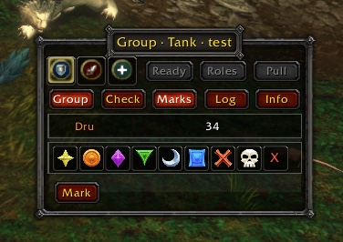
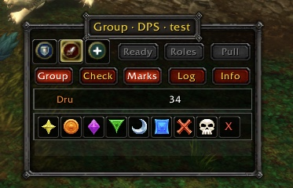
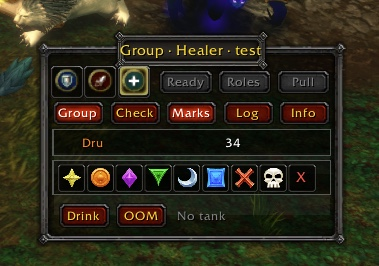
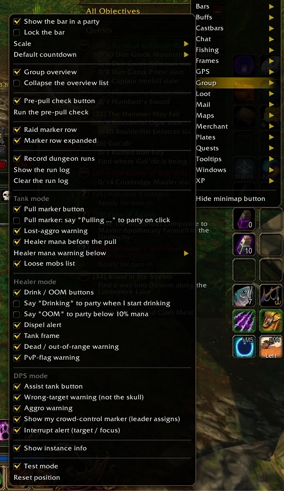
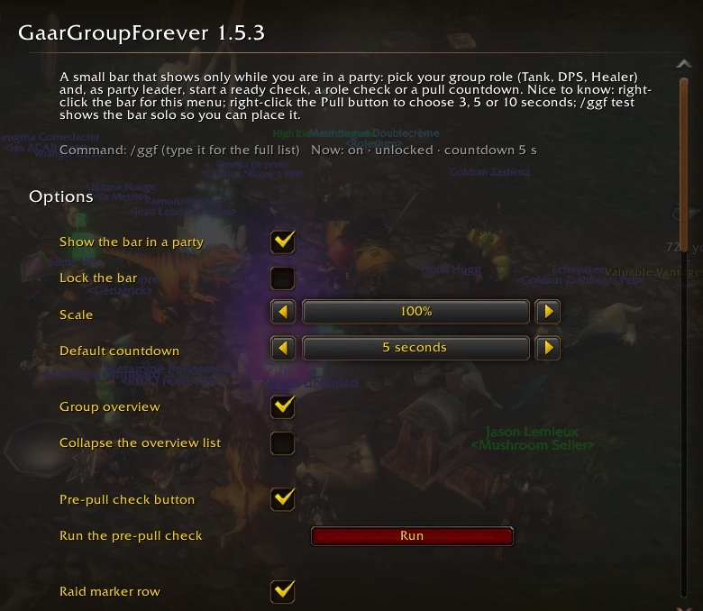
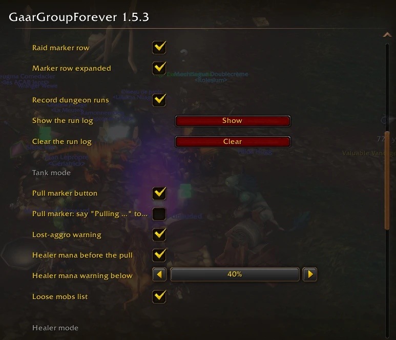
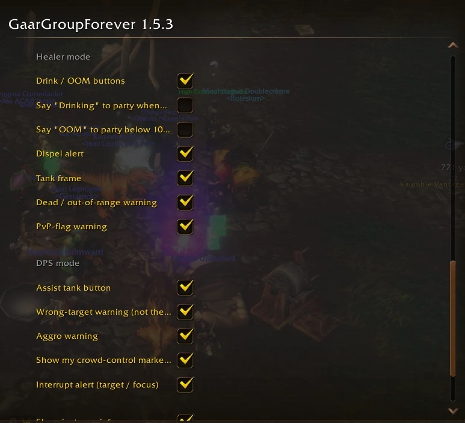
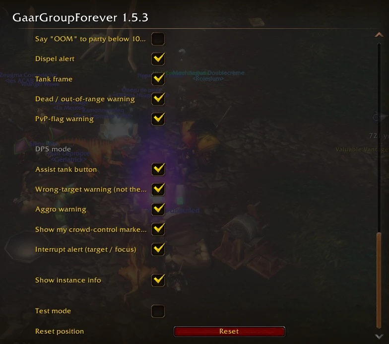

# GaarGroupForever

Part of the **Gaar…Forever** suite — [see all addons](https://www.curseforge.com/wow/addons/gaarforever).

A small standalone addon for the WoW Forever client (`_forever_`, interface 16001). A movable bar that
is shown only while you are in a party (hidden solo and in a raid): pick your group role and, as
party leader, start a ready check, a role check or a pull countdown. It needs GaarForever, the family
hub, and no other addon or library, and it is not part of the Gaar suite.

## Right-click menu

Right-click the bar to open this addon's menu (the same options as the GaarForever hub menu). Since 1.1.0 it has a **Test mode** entry (the same as `/ggf test`): the bar is shown solo, this session only.

## What it does

- **Mode buttons: Tank, DPS, Healer** (role icons). A click sets your group role with
  `UnitSetRole("player", ...)` (when the client has it and you are in a group), highlights the mode
  and remembers it for this character. The highlight follows the game: a role set from the
  Group Finder or by someone else (`PLAYER_ROLES_ASSIGNED`, `GROUP_ROSTER_UPDATE`,
  `UnitGroupRolesAssigned`) shows on the bar too. When you join a party and the game has no role for
  you yet, your saved mode is applied once.
- **Ready**: starts a ready check (`DoReadyCheck`). Greyed out unless you are the party leader.
- **Roles**: starts a role check (`InitiateRolePoll`). Greyed out unless you are the party leader.
- **Pull**: a countdown. Left-click uses the default length (5 s); right-click opens a menu of 3, 5
  or 10 s. It uses the game's own `C_PartyInfo.DoCountdown(n)` when the client has it (the button is
  then greyed out unless you are the leader, as the game refuses anyone else). Without it, the
  countdown is typed to party chat (`Pull in 5`, `4`, `3`, `2`, `1`, `Go!`), only when you click, and
  needs no rank.
- **Tooltips** on every button; a greyed button explains why in red.
- **Position** is saved; lock it with `/ggf lock`.

Settings are saved account-wide in `GaarGroupForeverDB`: `show`, `locked`, `scale`, `countdown`
(default length 3, 5 or 10) and the bar's position. Your mode is saved per character in
`GaarGroupForeverCharDB`.

## Dock under the bar (since 1.2.0)

Under the bar sits a row of small buttons (**Group**, **Check**, **Marks**, **Log**) and, below it, the
member list and the raid-marker row. Each part has an option in the right-click / hub menu and Options
page, all **on by default**; nothing is ever sent to chat unless you click Announce.

- **Group overview** (`overview`, `ovCollapsed`): each party member with role icon, name and level in
  class colour, and a status: `offline`, `dead`, or `far` (out of range / out of view, from
  `UnitInRange`, else `CheckInteractDistance`). Refreshed once a second. The Group button collapses it.
- **Pre-pull check** (`checks`): the Check button or `/ggf check` opens a local report window: who is
  dead, offline, out of range, low on mana (under 50 %, mana users only) and who lacks Power Word:
  Fortitude, Arcane Intellect (mana users), Mark of the Wild or a Blessing, each only when a class
  that gives it is in the party. The window's **Announce** button posts a short summary to PARTY
  (RAID in a raid); `/ggf check announce` does the same. Buffs are not read in combat; a mana or aura
  value the client keeps secret is skipped, never compared.
- **Raid markers** (`markers`, `markersOpen`): a row of the 8 markers. Left-click marks your target
  (`SetRaidTarget("target", i)`), right-click clears your target's mark, **X** clears every mark it
  can reach (target, focus, group, their pets and targets). No rank check: in a party anyone may mark.
  The Marks button collapses the row.
- **Dungeon run log** (`runlog`): per character, each dungeon run from entering to leaving
  (`IsInInstance` / `GetInstanceInfo` on `PLAYER_ENTERING_WORLD` and `ZONE_CHANGED_NEW_AREA`): name,
  time, deaths in the party and wipes (everyone dead at once), XP gained and the loot you received
  (`CHAT_MSG_LOOT`, your own lines). Deaths are polled with `UnitIsDeadOrGhost` once a second, not read
  from the combat log. Coming back to the same dungeon within 10 minutes (graveyard run) is the same
  run. The Log button or `/ggf log` shows the last 20; 50 are kept in `GaarGroupForeverCharDB.runs`.

## Threat bars (1.6.0)

At the very bottom of the bar, under every other part: one bar per party member (you included) with
their threat on one mob, highest first, in class colour, with the name and the %. The member who has
aggro (is tanking) gets a gold tint and the main-tank shield icon. The header names the mob.

- **Which mob**: your target when you can attack it; otherwise your target's target when you can
  attack that (target the tank and you see the threat on what the tank is fighting); otherwise none.
- **When**: only in a party and only while there is such a mob. Otherwise the section is hidden and
  the bar shrinks, so there is no empty space. In test mode (`/ggf test`) it also shows solo.
- **Data**: `UnitDetailedThreatSituation(member, mob)` (isTanking, status, scaled %), with
  `UnitThreatSituation` as the fallback for the status. Updated on `UNIT_THREAT_LIST_UPDATE`,
  `UNIT_THREAT_SITUATION_UPDATE`, `PLAYER_TARGET_CHANGED`, `UNIT_TARGET` (target) and
  `GROUP_ROSTER_UPDATE`, plus a 0.3 s tick that runs only while the section is shown. The combat log
  is not used.
- **Secret values** (the 12.x engine can hide threat in combat): nothing is compared, sorted or added
  on a hidden value. A hidden % is handed straight to the client (`StatusBar:SetValue`,
  `FontString:SetFormattedText`), so the bar and the number still show; if the client refuses, the
  bar is empty and the text is `?`. While any % is hidden the list is not sorted by %: it is ordered
  by who has aggro and the threat status when those are readable, else in party order (you, then
  party1-4). A hidden "is tanking" flag tints the row through `Texture:SetVertexColorFromBoolean`.
  `/ggf status` (and `/ggf threat`) says which path is in use.
- **In combat**: the bar is not a protected frame (the secure Assist button and tank frame are not
  its children), so the section can appear, disappear and resize the bar in combat. Only this last
  panel is placed then, at the spot the last out-of-combat layout left for it, so nothing above it
  moves. If that is not possible (no layout yet, the bar is not top-anchored) the change waits for
  the end of combat.
- **Option** `threat` (on by default): right-click menu / hub **Threat bars (group, attackable
  target)**, or `/ggf threat on|off|toggle`.

## Group finder role filter (1.7.0)

When you have a listing of your own in the group finder (the **Your Listing** row in the Browse tab),
the players under the **Players** header can be filtered by role.

- **Toggles**: three small role icons (Tank, Healer, DPS, Blizzard's group finder role icons) at the
  right end of the Players header, just left of its **−**. Click one to hide or show that role; an
  off role is greyed out. Each icon has a tooltip. All three are on by default.
- **Matching**: a player is shown while **any** of the roles they list is on, so a Tank/Healer stays
  while Healer is on. Players who list no role are always shown. All three on = the list is not
  touched at all.
- **Last role**: the last role that is on cannot be switched off (the list is never emptied by
  mistake); `/ggf lfg all` switches all three on again.
- **Count**: `N hidden` next to the icons (also players scrolled out of view).
- **Scope**: only solo players under the Players header, only while you have a listing. Your own row
  and the **Groups** list are never filtered.
- **Saved** account-wide in `GaarGroupForeverDB` (`lfgTank`, `lfgHealer`, `lfgDps`).
- **How**: a hidden card is faded out (alpha 0) and stops taking the mouse; it is not removed, so it
  leaves an empty slot in the list. Blizzard's list, layout and selection are never changed, which
  keeps **Send Message** and **Group Invite** working. The card you have selected is never hidden.
  A role the game keeps secret is never compared: that player is shown.

## Commands

`/ggf` or `/gaargroupforever`:

| Command | Does |
|---|---|
| `/ggf` or `/ggf help` | list the commands |
| `/ggf show` / `hide` / `toggle` | the bar in a party (option **Show the bar in a party**) |
| `/ggf lock` / `unlock` | lock or unlock the bar's position |
| `/ggf reset` | put the bar back where it started |
| `/ggf scale 0.5-2` | bar size |
| `/ggf countdown 3\|5\|10` | default pull countdown |
| `/ggf test` | show the bar solo to place it (this session only) |
| `/ggf group on\|off\|collapse\|expand` | the member list under the bar |
| `/ggf check` / `check announce` | the pre-pull report window / post its summary to party chat |
| `/ggf marks on\|off\|collapse\|expand\|clear` | the raid-marker row; `clear` removes the marks it can reach |
| `/ggf log` / `log clear` | the last 20 dungeon runs / empty the log |
| `/ggf threat on\|off\|toggle` | the threat bars at the bottom; `/ggf threat` alone prints their status |
| `/ggf lfg tank\|healer\|dps [on\|off]` / `lfg all` | the group finder role filter (no on/off = toggle); `/ggf lfg` alone prints its state |
| `/ggf status` | settings, group state, which countdown path is used, the threat bars' state (plain or secret values), the group finder role filter (viewer frame found, players filtered), and the last 5 actions the game blocked for this addon this session (if any) |

## With GaarForever (required)

This addon lists `GaarForever` under `## Dependencies`: install the `GaarForever` folder next to it,
or the client will not load this addon. GaarForever gives it a **Group** page under
**Esc > Options > AddOns > Gaar Forever**, built from the same `MenuEntries()` as the hub's menu, with
a short intro from `Intro()`.

`GaarGroupForeverAPI` (`version`, `Intro`, `StatusLine`, `MenuEntries`, `AddMenuEntries`,
`SetMinimapHidden`) lets the hub list these options in its menu.

## Role modules (1.3.0)

Active only while your mode is that role (the bar's highlighted mode) and the bar is shown. Each shows a row
in the dock under the bar and/or warnings in a line above it. Every feature has an option (right-click menu,
grouped per mode, or `/ggf <role> <name> on|off`); all on by default except the ones that type in chat. A
warning is throttled and skipped when the game hides the value (secret values are never compared).
`/ggf <role> test` shows sample warnings. Chat is only sent on your click, or by an option you turn on.

**Tank** (`/ggf tank`)

| Feature | How it shows | Option (default) |
|---|---|---|
| Pull marker | "Mark" button / `/ggf tank mark [x]`: skull on target (X if a skull is out; Shift-click or `x` = X) | `mark` on; `announce` off (says "Pulling <mob>" to party on the click) |
| Lost aggro | red line "<mob> is on <member>" (mob in combat targeting a party member) | `aggro` on |
| Healer mana | out of combat: "Healer mana 62%", red "Healer 30% mana - wait" below the threshold | `mana` on; `manapct 20-70` = 40 |
| Loose mobs | in combat: "Loose (2): Wolf, Boar" (nameplates, target, focus, party targets not on you) | `loose` on |

**Healer** (`/ggf healer`)

| Feature | How it shows | Option (default) |
|---|---|---|
| Drink / OOM | two buttons post "Drinking" / "OOM" to party on click (`/ggf healer drink`, `oom`) | `buttons` on; `autodrink` off, `autooom` off (post by themselves) |
| Dispel alert | "Dispel: Mira (Magic)" for what your class removes (Priest Magic/Disease, Paladin Magic/Poison/Disease, Druid Curse/Poison, Shaman Poison/Disease; needs the spell known) | `dispel` on |
| Tank frame | small secure frame (name, health, target) for the member with the Tank role; click targets. Created and re-pointed out of combat only; sits over the bar but is not part of it (a child of the screen), so in combat it stays put and fades out if the bar goes away | `tankframe` on |
| Dead / out of range | "Mira died", "Bob is out of range" | `deadrange` on |
| PvP flag | "Kaz is PvP flagged - you are not" (target or mouseover) | `pvp` on |

**DPS** (`/ggf dps`)

| Feature | How it shows | Option (default) |
|---|---|---|
| Assist tank | "Assist" secure button (type assist on the tank). Created and re-pointed out of combat only; sits over the bar but is not part of it (a child of the screen), so in combat it stays put and fades out if the bar goes away | `assist` on |
| Wrong target | "Not skull: <mob>" in combat while a skull is out | `wrongtarget` on |
| Aggro | "<mob> is on you!" | `aggro` on |
| CC assignment | party leader: right-click the bar > DPS mode > Crowd control > player > marker; says "Sheep = Moon (Name)" to party on that click and sends a `GGFcc` addon message; the assigned player sees "CC: Moon" above their bar. Session only (`/ggf dps cc` lists) | `cc` on |
| Interrupt | "Interrupt <mob>: <spell>" when target or focus starts an interruptible cast | `interrupt` on |

Limits: in combat the client often hides aura, target and cast values, then the matching warning is skipped
(the dispel alert in particular mostly works out of combat). A secure button keeps its old tank until combat
ends. Only players running this addon see the CC marker.

## How it is built

Plain (non-secure) buttons; none of the calls used is protected, and no Blizzard frame is touched, except
that the role filter fades player cards in the group finder list (`SetAlpha` / `EnableMouse` after
`hooksecurefunc("LFGBrowseSearchEntry_Update")`, nothing else).
Every handler runs in `pcall`, every client API is checked with `type(...) == "function"` first, and
a secret value is never compared: it is treated as no value. The modes are a table (`Modes`) with a
hook per mode (`ModeHooks`); the role modules (`Roles.lua`, `Tank.lua`, `Healer.lua`, `Dps.lua`) use it, plus the
dock, menu, slash and defaults hooks of `GaarGroupForeverAPI._M`. The Assist button and the tank frame are the only
secure frames: children of `UIParent` laid over their row (never of the bar, so the bar and its dock can hide,
move and scale in combat), created, shown, hidden, moved and re-pointed out of combat only (in combat only their
alpha changes). The combat log is never registered: WoW Forever keeps `COMBAT_LOG_EVENT_*` from addons and
registering it is itself blocked ("blocked from an action only available to the Blizzard UI"; 1.4.0 did, at
every login). The instance panel ticks a boss from `ENCOUNTER_END` / `BOSS_KILL`, else from the kill chat line
(`CHAT_MSG_COMBAT_HOSTILE_DEATH`). `ADDON_ACTION_BLOCKED` / `ADDON_ACTION_FORBIDDEN` naming this addon are kept
for `/ggf status` (one chat note per session at most). It ships a `_Camelot` TOC and a
plain fallback TOC, both at 16001.

## License

MIT, see [LICENSE](LICENSE).

## Support

If you enjoy this addon, you can [buy me a coffee](https://buymeacoffee.com/tgaarden) ☕

## Screenshots

**Tank mode**

**DPS mode**

**Healer mode**

**Right-click menu**

**Options**

**Options: tank**

**Options: healer and DPS**

**Options: instance info and test mode**

