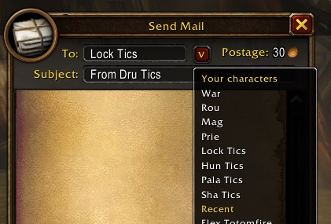
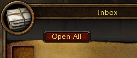
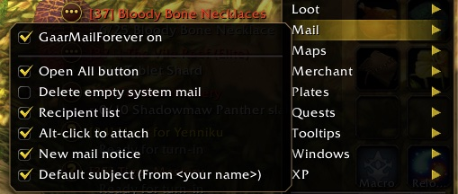
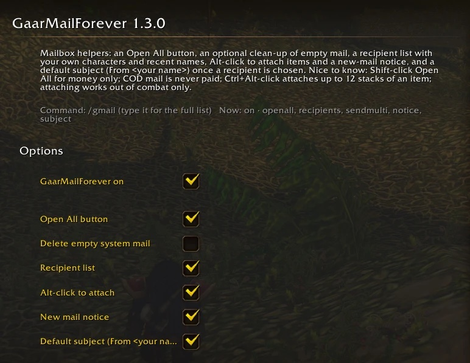

# GaarMailForever

> Formerly **BetterMailForever**. The folder is now `GaarMailForever` as well; the update also ships a tiny `BetterMailForever` folder, a
> settings bridge that moves your old settings over on the first login (each character on its own
> first login). It is safe to delete after logging in once on each character, and later updates drop it. The command is
> now `/gmail` (`/gaarmailforever`); the old `/bmail` and `/bettermailforever` still work.
> CurseForge: https://www.curseforge.com/wow/addons/gaarmailforever

A small standalone addon for the WoW Forever client (`_forever_`, interface 16001): mailbox
helpers. It needs GaarForever, the family hub, and no other addon or library and is not part of the Gaar suite. Every feature
is its own setting (`/gmail <feature> on|off`) and there is a master switch (`/gmail on|off`).

## Right-click menu

Right-click the mailbox window's round portrait (top-left) to open this addon's menu (the same options as the GaarForever hub menu).

## Features

| Feature | Command word | Default | What it does |
|---|---|---|---|
| Open All | `openall` | on | An **Open All Mail** button at the spot of Blizzard's own Open All button (its anchors and size are copied when the mailbox opens; bottom-centre of the inbox, above the page buttons, if the client has none). Takes money, then items, from one mail at a time and waits for `MAIL_INBOX_UPDATE` / `MAIL_SUCCESS` between actions (0.3 s apart at the fastest). **Shift-click: money only.** Click again (the button reads *Stop*, then *Open All Mail* again) to stop. Prints a summary: gold taken, item count. |
| Use GaarMail's Open All instead of Blizzard's | `blizzopenall` | on | Exactly one **Open All** button shows. On: ours (**Open All Mail**) sits where Blizzard's button is and Blizzard's `OpenAllMail` is hidden with `Hide()` plus an `OnShow` hook that hides it again; none of its scripts are replaced and only our own frame is positioned. Off (or the master switch or Open All off): Blizzard's button shows and ours is hidden. `/gmail open` works either way. |
| Delete empty | `deleteempty` | off | With Open All: deletes mails that are empty after taking. See the safety rules. |
| Recipient list | `recipients` | on | A `v` button right of the **To:** box on the Send Mail tab: your own characters on this realm and faction (every character that logs in is recorded) and the last 15 recipients (account-wide, recorded when a letter is sent). Click a name to fill in **To:**. |
| Alt-click to attach | `sendmulti` | on | On the Send Mail tab, **Alt-click** an item in your bags to attach it. **Ctrl+Alt-click** attaches up to 12 stacks of the same item. Out of combat only. |
| Default subject | `subject` | on | Once a recipient is chosen (list, typed and left with Enter/Tab/click away, or filled in by the client), an empty **Subject** becomes `From <your full name>` (e.g. `From Dru Tics`). Only an empty subject or our own earlier default is replaced; text you typed is never touched. Attaching an item replaces our default with the item name, as Blizzard does for an empty subject. |
| New mail notice | `notice` | on | A chat line at login and when new mail arrives, with the senders from `GetLatestThreeSenders` (plain values only). |

## Safety rules

- **COD is never paid.** A mail with a cash-on-delivery amount is skipped by Open All and counted
  in the summary (`N COD skipped`). Take it by hand if you want it.
- **Open All stops** when the bags are full (`ERR_INV_FULL`), when you click *Stop*, when you turn
  Open All off, and when the mailbox closes. A mail that does not answer three times is skipped.
- **Delete empty** deletes a mail only when all of this holds: it has no money, no item and no
  COD; it has been read; you cannot reply to it (a system or auction house mail); and it is not
  from a GM. **A letter from a player is never deleted**, with or without a text. It is off by
  default and only runs during Open All.
- Attaching never sends anything; it only fills the attachment slots. Items that cannot be sent
  (soulbound, say) are put back.

## Commands

| Command | Does |
|---|---|
| `/gmail` or `/gmail help` | Help |
| `/gmail on`, `/gmail off` | Master switch |
| `/gmail openall\|blizzopenall\|deleteempty\|recipients\|sendmulti\|notice\|subject on\|off` | One feature on or off (without `on`/`off` it prints the state) |
| `/gmail open` | Run Open All, the same as the button (mailbox must be open) |
| `/gmail status` | Version, master and every feature, mailbox open or closed, Open All running or idle, remembered names, the last error caught |

Also `/gaarmailforever`. Settings are saved account-wide in `GaarMailForeverDB`
(the features, `recent`, `alts`).

## With GaarForever (required)

Since 1.0.1 this addon lists `GaarForever` (the GaarForever folder) under `## Dependencies`: install the `GaarForever` folder next to it, or the client will not load this addon. GaarForever also gives it a page under **Esc > Options > AddOns > Gaar Forever**, built from the same `MenuEntries()` as the hub's menu, with a short intro at the top; that intro comes from `Intro()`, a field the API table gained in 1.0.1 (it is also the first line of the slash command's help). Since 1.0.2 it also takes its small helpers (the chat line, the secret-value check, the combat check, the coin text, drawing the hub's menu) from GaarForever's shared library instead of carrying its own copies; nothing it does or shows changed.

The hub talks to this addon only through `GaarMailForeverAPI`:

| Field | What it is |
|---|---|
| `version` | This addon's version, a string |
| `StatusLine()` | One line of state, e.g. `on · openall, recipients, sendmulti, notice` |
| `MenuEntries()` | The options as plain data: a master checkbox, a divider and one checkbox per feature |
| `AddMenuEntries(root)` | Adds the same options to a `MenuUtil` root or submenu description |
| `SetMinimapHidden(hidden)` | Does nothing: there is no minimap button |

## How it stays out of the way

- Blizzard code is only followed (`hooksecurefunc` on `SendMail`, `HandleModifiedItemClick` and
  `ContainerFrameItemButton_OnModifiedClick`, `HookScript` on `SendMailFrame`), never replaced.
- Every handler runs in `pcall` (the last error is kept for `/gmail status`), every client API is
  checked with `type(...) == "function"`, and a secret value is treated as no value.
- The Open All Mail button copies the anchors and size of Blizzard's Open All button (fallback: bottom-centre of the inbox) and the recipient button sits right of the
  **To:** box. Neither can be checked here without the client, so move them if they collide with
  another addon.

## License

MIT, see [LICENSE](LICENSE).

## Support

If you enjoy this addon, you can [buy me a coffee](https://buymeacoffee.com/tgaarden) ☕

## Screenshots

**Send recipients**

**Open all**

**Menu**

**Options**

