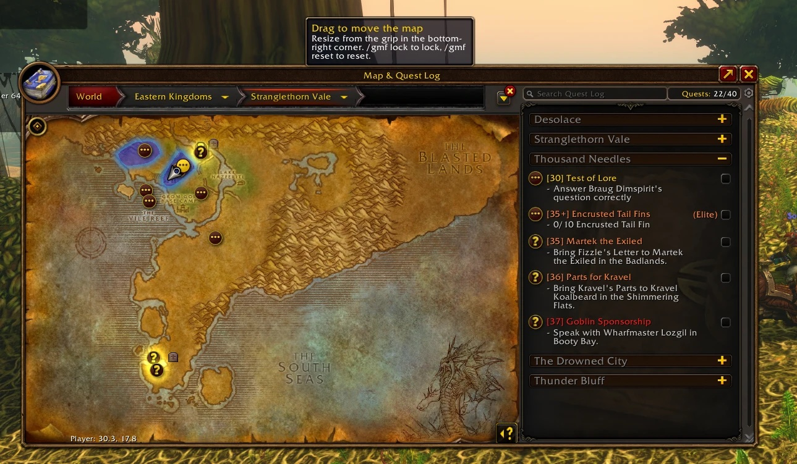
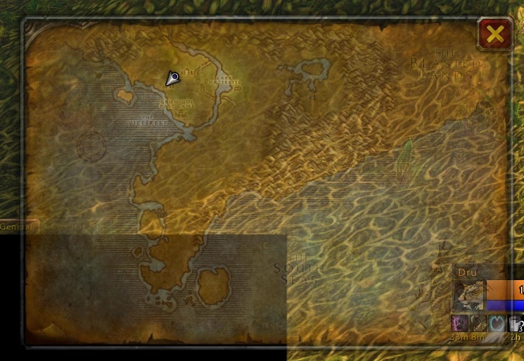
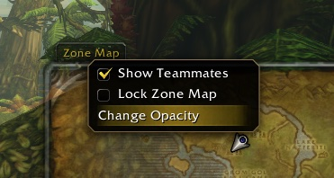
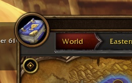
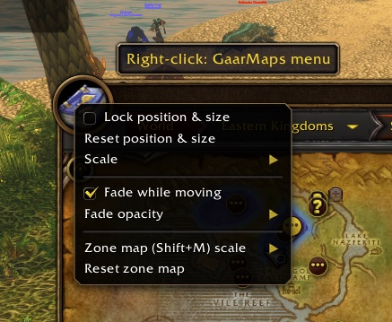
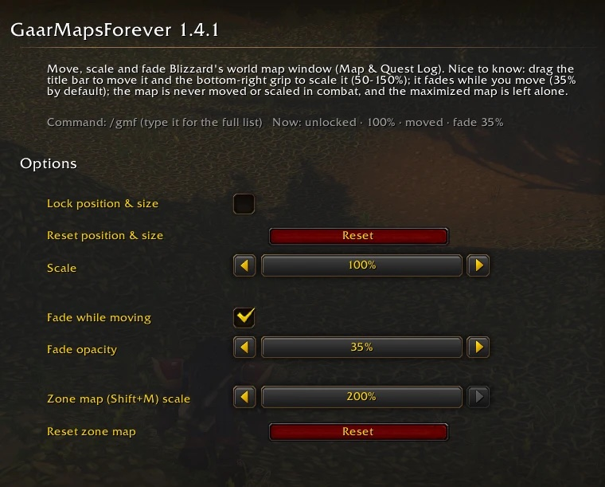
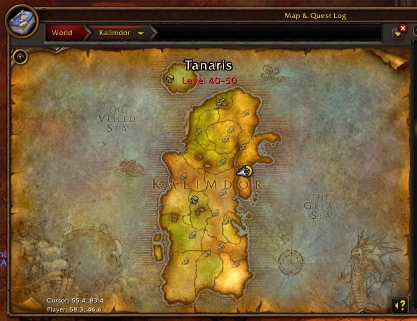

# GaarMapsForever

> Formerly **BetterMapsForever**. The folder is now `GaarMapsForever` as well; the update also ships a tiny `BetterMapsForever` folder, a
> settings bridge that moves your old settings over on the first login (each character on its own
> first login). It is safe to delete after logging in once on each character, and later updates drop it. The command is
> now `/gmf` (`/gaarmapsforever`); the old `/bmf` and `/bettermapsforever` still work.
> CurseForge: https://www.curseforge.com/wow/addons/gaarmapsforever

A small standalone addon for the WoW Forever client (`_forever_`, interface 16001). It lets you
move, scale and fade Blizzard's own world map window, **Map & Quest Log** (`WorldMapFrame`), and
does nothing else. It needs GaarForever, the family hub, and no other addon or library, and it is not part of the Gaar suite.

## What it does

- **Move.** Drag the title bar of the windowed map. An invisible handle sits over the title strip
  and stops short of the maximize and close buttons, so those still work. The position is saved
  account-wide in `GaarMapsForeverDB`, in UIParent units, and put back every time the map
  opens and every time Blizzard's panel layout re-anchors it. It is kept on screen.
- **Resize.** Drag the grip in the bottom-right corner. It changes the frame's **scale**, not its
  width and height, so the whole window (map, pins, overlays and the quest log) grows and shrinks
  together, from 50% to 150%. The top-left corner stays where it is while you drag, and the
  corner follows the cursor. Releasing the grip saves the scale and the top-left corner, so the
  map opens exactly there next time. This is GaarMap's approach: the map is a canvas with its own
  pins, and scaling moves all of it together where resizing would leave the contents laid out for
  the old size.
- **Fade while moving** (on by default). While your character moves, the map drops to a lower
  opacity (35% by default), and it comes back to full opacity once you stand still. This is
  GaarMap's fade: a check ten times a second, `IsPlayerMoving()` first (it answers as a plain
  boolean), `GetUnitSpeed("player")` only where that is missing (it can be a secret number on this
  client), and the map is left alone when neither can answer. One difference: closing the map
  while it is faded puts it back to full opacity, so it never opens faded while you stand still.
  While the mouse cursor is over the map window (including its quest log panel) the map stays at
  full opacity even while you move, and it fades again when the cursor leaves.
  The fade works in both windowed and maximized mode, and in combat (it is only `SetAlpha`).
- **Lock.** No moving and no resizing; the grip and the title-bar handle are hidden.
- **Reset.** Blizzard's default position and 100% scale.
- **Combat.** The map is never moved or scaled in combat. Dragging the title bar or the grip
  prints a short message instead, a drag that is still going when combat starts ends there, and
  anything that would move or scale the map (opening it, Blizzard re-anchoring it, `/gmf scale`,
  `/gmf reset`) waits for `PLAYER_REGEN_ENABLED`. Opening the map in combat is Blizzard's own
  path and keeps working; it opens at Blizzard's anchor and moves to your position once combat
  ends.
- **Portrait menu** (1.4.0, fixed in 1.4.1: own 60x60 size, re-placed above the border on every map open, errors shown; `/gmf portrait` prints its state). Right-click the round book portrait in the world map's top-left corner to open this addon's menu (lock, reset, scale, fade, zone map): the same entries as in the GaarForever hub menu. It is a small transparent button of our own over the portrait; left click does nothing, and the map's drag area is untouched.
- **Zone map (Shift+M)** (1.3.0). Blizzard's zone map (`BattlefieldMapFrame`, from the load-on-demand
  `Blizzard_BattlefieldMap`) can be moved and scaled too. Drag the frame itself or Blizzard's tab to move it; drag the grip in its
  bottom-right corner to scale it, from 50% to 200%. Position and scale are saved in their own keys (`zoneMapPoint`, `zoneMapScale`)
  and put back whenever the map is shown. `/gmf lock` locks it as well. Blizzard's opacity option (right-click the tab) is left
  alone, and it does not fade while you move. Skipped in combat and applied once combat ends.
- **Zone levels** (1.5.0, `/gmf levels on|off`, on by default). The zone's level range, `Level 35–45`, coloured like mob difficulty (the hub's `LevelDifficultyColor`, midpoint of the range against your level). It is one line, always in the same spot directly under the name Blizzard's own hover label shows (no name text from us). On a continent map it shows the hovered zone's range. In zone view (since 1.5.2) it shows the range of the neighbouring zone you hover, and the range of the zone the map shows when you do not hover a neighbour. Ranges come from `Data/ZoneLevels.lua` (the 40 classic Eastern Kingdoms and Kalimdor zones, by uiMapID, with an English-name fallback), `C_Map.GetMapLevels` (guarded, cached) for any zone not in the table, so WoW Forever's new zones get a range when the client has one. `/gmf status` lists the map ids that still have no level data. Cities, instances and zones without a range show nothing. `/gmf status` shows the current map id and the matched range.
- **Tracked NPC pins** (1.6.0, `/gmf pins on|off`, on by default). On a map that shows a single zone (map type Zone, Dungeon or Micro; never a continent or the world map, wherever you stand) the addon draws icons for the town NPCs whose types are **checked in the minimap tracking menu**: Auctioneer, Banker, Battlemaster, Class Trainer, Profession Trainers, Flight Master, Innkeeper, Mailbox, Repair, Stable Master, Food & Drink, Reagents, Poisons, Ammunition. Tick or untick a type there and the icons follow (`MINIMAP_UPDATE_TRACKING`). Each icon is the tracking type's own texture; hover it for the name and categories.
  - **Learned as you go.** The addon cannot read the client's NPC list, so it learns: when you open an NPC's window it stores your own position (you stand next to the NPC) on your current zone map. Merchant (`MERCHANT_SHOW`: vendor, Repair if the merchant repairs, Food & Drink / Reagents / Ammunition / Poisons when at least 40% of the goods are of that kind), bank (`BANKFRAME_OPENED`), auction house (`AUCTION_HOUSE_SHOW`), flight master (`TAXIMAP_OPENED`), trainer (`TRAINER_SHOW`, class or profession), mailbox (`MAIL_SHOW`), innkeeper (`CONFIRM_BINDER`, or a gossip with "Make this inn your home"), stable master (`PET_STABLE_SHOW`), battlemaster (`BATTLEFIELDS_SHOW`), and the 12.x engine's `PLAYER_INTERACTION_MANAGER_FRAME_SHOW` for the same windows. Stored with the NPC's name and id (from its GUID, when that is not a secret value). One entry per NPC per map; a mailbox (no name) is the same mailbox within about 1% of the map.
  - **Shared by all characters**: the places live in their own account-wide saved variable, `GaarMapsForeverNPCDB` (`maps[uiMapID]` = list of `{ x, y, name, id, c = { banker = true, ... }, n, t }`). `/gmf pins clear` forgets them (it asks you to type `/gmf pins clear yes`).
  - **Built-in seed** (1.7.0). `Data/TrackedSeed.lua` is a read-only list of places that ships with the addon (MIT, our own data only - no third-party NPC database such as pfQuest, Questie or CMaNGOS, and no coordinates typed by hand). It is merged per map at draw time; a learned entry always wins over a seed row for the same NPC or place (the seed row only adds its categories), and nothing from the seed is written to your saved variables. It ships empty for now.
  - **Export** (1.7.0). `/gmf pins export` opens a window of our own with your learned places as a Lua table literal, in exactly the seed file's format (`[uiMapID] = { { id = ..., x = ..., y = ..., name = "...", c = "banker" }, ... }`); `/gmf pins export <uiMapID>` limits it to one map, `/gmf pins export here` to the map the open world map shows (else the zone you stand in). The text is read-only, selected on open (and with the **Select all** button): Ctrl+C copies it.
  - **How the seed grows.** Walk the capitals (Stormwind, Ironforge, Darnassus, Orgrimmar, Undercity, Thunder Bluff) and WoW Forever's own zones, open each NPC's window once (merchant, bank, auction house, flight master, trainer, innkeeper, stable master, battlemaster) and use the mailboxes, then `/gmf pins export`, copy, and paste the text into `Data/TrackedSeed.lua` (in this repo, Claude merges it in a PR). No need to read the WTF SavedVariables.
  - Pins are frames of our own on the map canvas; no Blizzard pin or function is touched. `/gmf status` (and `/gmf pins`) shows `tracked pins: on, N learned (per category)`, which tracking types the client lists and which have no category.
- **Maximized map.** Left to Blizzard: no handle, no grip, 100% scale. Going back to the windowed
  map puts the saved position and scale back.

At 100% and the default position the addon does not touch the map at all.

## Commands

| Command | Does |
|---|---|
| `/gmf` | Help (also: right-click the world map's round portrait for the menu) |
| `/gmf lock`, `/gmf unlock` | Stop or allow moving and resizing (hides or shows the grip and the handle) |
| `/gmf reset` | Back to Blizzard's default position and 100% scale |
| `/gmf scale <50-150>` | Set the scale in percent. On the open, windowed map the top-left corner stays put (and is saved) |
| `/gmf zone scale <50-200>` | Set the zone map (Shift+M) scale in percent |
| `/gmf zone reset` | Zone map back to its default position and 100% |
| `/gmf fade on`, `/gmf fade off` | Fade the map while you move, or not |
| `/gmf fade <10-100>` | Opacity while moving, in percent (default 35) |
| `/gmf levels on`, `/gmf levels off` | Show the zone's level range on the map, or not |
| `/gmf pins on`, `/gmf pins off` | NPC icons for the minimap's checked tracking types on a zone map, or not |
| `/gmf pins clear` | Forget the learned NPC places (confirm with `/gmf pins clear yes`) |
| `/gmf pins export [<uiMapID> \| here]` | The learned places as text to copy, in the seed file's format (all maps, one map, or the current one) |
| `/gmf pins` | Tracked pins status: learned counts, the tracking types the client lists |
| `/gmf status` | Which frames and functions this client has, whether the map is open and maximized, and the current settings |

## With GaarForever (required)

Since 1.1.1 this addon lists `GaarForever` (the GaarForever folder) under `## Dependencies`: install the `GaarForever` folder next to it, or the client will not load this addon. GaarForever also gives it a page under **Esc > Options > AddOns > Gaar Forever**, built from the same `MenuEntries()` as the hub's menu, with a short intro at the top; that intro comes from `Intro()`, a field the API table gained in 1.1.1 (it is also the first line of the slash command's help). Since 1.1.2 it also takes its small helpers (the chat line, the number and secret-value checks, drawing the hub's menu) from GaarForever's shared library instead of carrying its own copies; nothing it does or shows changed.

[GaarForever](../GaarForever/README.md) is the family hub: one minimap button whose
menu has a **Maps** submenu with **Lock position & size**, **Reset position & size**, **Scale**
(75, 90, 100, 110, 125%), **Fade while moving** and **Fade opacity** (25, 35, 50, 75%), **Zone level range on the map**, **NPC icons from minimap tracking**, **Zone map (Shift+M) scale** (75, 100, 125, 150, 200%) and **Reset zone map**, the same
settings as `/gmf lock|unlock`, `/gmf reset`, `/gmf scale`, `/gmf fade on|off` and `/gmf fade
<percent>` (both go through the same functions). This addon has no minimap button or menu of its
own, so nothing here changes with or without the hub.

The hub talks to this addon only through `GaarMapsForeverAPI`:

| Field | What it is |
|---|---|
| `version` | This addon's version, a string |
| `StatusLine()` | One line of state, e.g. `unlocked · 100% · default position · fade 35%` |
| `MenuEntries()` | The options as plain data (`{ text, func }`, `{ text, checkbox, checked, func }`, `{ text, radio, checked, func }`, `{ text, submenu }`, `{ divider }`), for a menu drawn without `MenuUtil` |
| `AddMenuEntries(root)` | Adds the same options to a `MenuUtil` root or submenu description (`CreateCheckbox`, `CreateRadio`, submenus via `CreateButton`) |
| `SetMinimapHidden(hidden)` | Does nothing: there is no minimap button to hide. It is there so every addon the hub knows has the same API |

## How it stays out of the way

- Blizzard code is only followed, never replaced: `HookScript` on the map's `OnShow` and `OnHide`,
  `hooksecurefunc(WorldMapFrame, "Maximize" | "Minimize" | "SynchronizeDisplayState")` and
  `hooksecurefunc("UpdateUIPanelPositions")`. No Blizzard function or table is written, and
  `SetAttribute` is never called on a Blizzard frame.
- The map is moved with `StartMoving` from its own handle, then anchored by the addon; the client's
  own copy of the position (`SetUserPlaced`) is switched off again, so the only saved position is
  the addon's.
- Because Blizzard's panel layout can re-anchor the map at moments no hook sees, the addon also
  checks once a frame after the map opens and then every 0.1 s while it is open (only out of
  combat, and only when it manages the map) whether the anchor or the scale has been put back,
  and re-applies them.
- Blizzard's last anchor is remembered, so `/gmf reset` can put it back on the open map.
- Every name is checked before use, and secret geometry is treated as no geometry.
- Saved variables are read at `ADDON_LOADED`, never at file scope. Only `locked`, `scale`,
  `position`, `fade`, `fadeAlpha` and `zoneLevels` (plus the zone map's two) are kept.

## Known limit: the cursor on a scaled map

Blizzard's map works out the point under the cursor against UIParent's scale, not the map's. Once
the map is scaled, the zone highlight on a continent map, a click that zooms into a zone, and
mouse-wheel zoom can land a little off from the pointer; the further from 100%, the more. Pins,
the quest log and buttons are normal frames and are not affected. GaarMap and Mapster correct it
by replacing `WorldMapFrame.ScrollContainer.GetCursorPosition`, which writes a Blizzard table.
This addon does not do that, so the correction is not here.

## GaarMap

GaarMap also scales and fades the world map. With both loaded they fight over the same frame, so
GaarMapsForever says so at login and in `/gmf status`. Use one of the two.

## Names it relies on

From Blizzard's retail FrameXML, which Forever's UI follows
([Gethe/wow-ui-source](https://github.com/Gethe/wow-ui-source), `Blizzard_WorldMap` and
`UIParent.lua`): `WorldMapFrame` (its `BorderFrame` with `TitleContainer`,
`MaximizeMinimizeFrame` and `CloseButton`, and `IsMaximized`, `Maximize`, `Minimize`,
`SynchronizeDisplayState` from `WorldMapMixin`), `UpdateUIPanelPositions`, `IsPlayerMoving`,
`GetUnitSpeed`, `InCombatLockdown` and the size-grabber textures
`Interface\ChatFrame\UI-ChatIM-SizeGrabber-*`. It ships a `_Camelot` TOC and a plain fallback
TOC, both at 16001.

## License

MIT, see [LICENSE](LICENSE).

## Support

If you enjoy this addon, you can [buy me a coffee](https://buymeacoffee.com/tgaarden) ☕

## Screenshots

**Map questlog**

**Map faded**

**Zonemap menu**

**Portrait**

**Portrait menu**

**Options**

**Zone levels**

Hover a zone on the continent map: its level range, coloured by your level.
