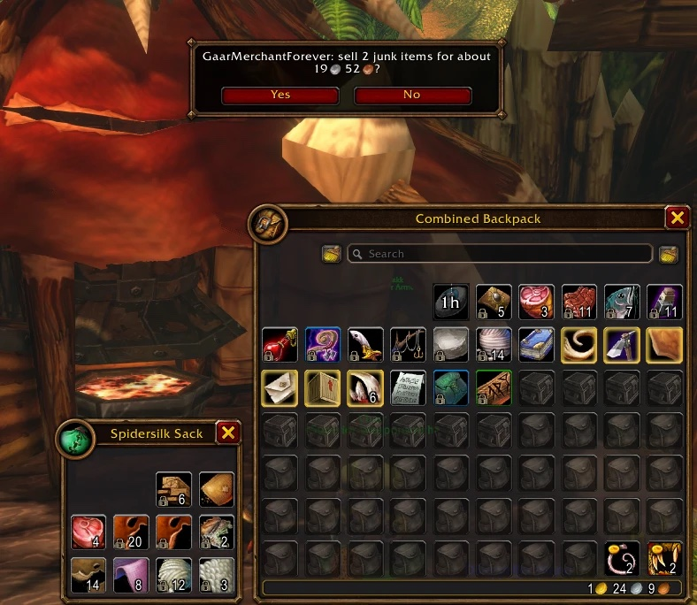
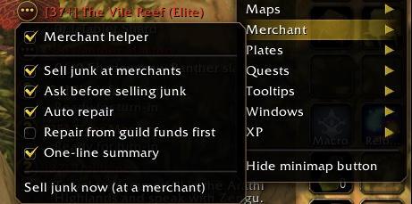
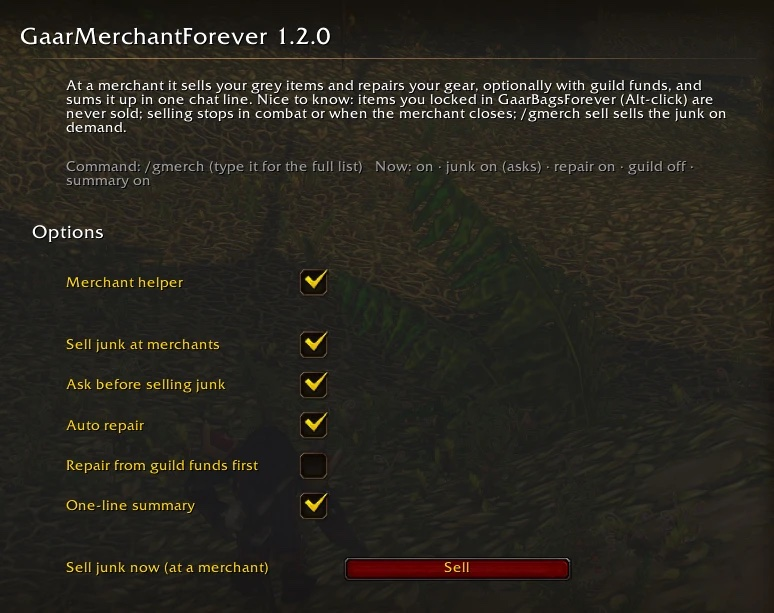
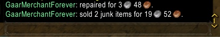

# GaarMerchantForever

Part of the **Gaar…Forever** suite — [see all addons](https://www.curseforge.com/wow/addons/gaarforever).

> Formerly **BetterMerchantForever**. The folder is now `GaarMerchantForever` as well; the update also ships a tiny `BetterMerchantForever` folder, a
> settings bridge that moves your old settings over on the first login (each character on its own
> first login). It is safe to delete after logging in once on each character, and later updates drop it. The command is
> now `/gmerch` (`/gaarmerchantforever`); the old `/bmerch` and `/bettermerchantforever` still work.
> CurseForge: https://www.curseforge.com/wow/addons/gaarmerchantforever

A small standalone addon for the WoW Forever client (`_forever_`, interface 16001). When you open a
merchant it sells your grey items and repairs your gear. Every feature has its own switch. It needs GaarForever, the family hub, and no other addon or library, and it is not part of the Gaar suite.

## Right-click menu

Right-click the merchant window's round portrait (top-left) to open this addon's menu (the same options as the GaarForever hub menu).

## What it does

- **Sell junk** (on by default). At a merchant, sells every grey (quality 0) item in your bags,
  out of combat, 3 items every 0.2 s so the server never throttles it. It stops when the merchant
  closes or combat starts. Items with no sell price are left alone.
- **GaarBagsForever locks are respected.** An item you locked in GaarBagsForever (Alt + click)
  is never sold. BBF has no API for this, so the addon reads its per-character saved table
  `GaarBagsForeverCharDB.lockedItems[itemID]`, read-only, and checks it again right before each
  sale. If BBF later gets `GaarBagsForeverAPI.IsItemLocked(itemID)`, that is used first.
- **Ask first** (`sellJunkConfirm`, off by default). A popup says how many items and roughly what
  they are worth before anything is sold.
- **Auto repair** (on by default). Repairs everything when the merchant can repair, the cost is
  above zero and you can pay it. If you cannot pay, it says what the repair would cost.
- **Guild repair** (`guildRepair`, off by default). Tries guild funds first when the client offers
  `CanGuildBankRepair` and the guild's withdraw allowance covers the cost; if the guild refuses,
  your own money is used.
- **Summary** (on by default). One chat line, e.g. `sold 12 junk items for 3s 40c; repaired for 1g 2s`, with coin icons like Blizzard's own loot lines (since 1.1.2; plain `1g 2s 3c` text if the client has no coin API).
  With it off, each part prints its own line.
- **Master switch.** `/gmerch off` turns all of the above off (`/gmerch sell` still works).

Settings are saved account-wide in `GaarMerchantForeverDB`: `enabled`, `sellJunk`,
`sellJunkConfirm`, `autoRepair`, `guildRepair`, `summary`.

## Commands

`/gmerch` or `/gaarmerchantforever`:

| Command | Does |
|---|---|
| `/gmerch` or `/gmerch help` | list the commands |
| `/gmerch on` / `off` | master switch |
| `/gmerch junk on\|off` | sell junk (`sellJunk`) |
| `/gmerch confirm on\|off` | ask before selling (`sellJunkConfirm`) |
| `/gmerch repair on\|off` | auto repair (`autoRepair`) |
| `/gmerch guild on\|off` | guild funds first (`guildRepair`) |
| `/gmerch summary on\|off` | one-line summary |
| `/gmerch sell` | sell the junk now, while a merchant is open |
| `/gmerch status` | settings, BBF lock count and the last result |

## With GaarForever (required)

Since 1.0.1 this addon lists `GaarForever` (the GaarForever folder) under `## Dependencies`: install the `GaarForever` folder next to it, or the client will not load this addon. GaarForever also gives it a page under **Esc > Options > AddOns > Gaar Forever**, built from the same `MenuEntries()` as the hub's menu, with a short intro at the top; that intro comes from `Intro()`, a field the API table gained in 1.0.1 (it is also the first line of the slash command's help).

`GaarMerchantForeverAPI` (`version`, `StatusLine`, `MenuEntries`, `AddMenuEntries`,
`SetMinimapHidden`) lets the GaarForever hub list these switches in its menu.

Since 1.0.2 the small helpers (the chat prefix, secret-value and number checks, client API
lookups, the combat check and the menu drawing) come from GaarForever's shared library
(`GaarForever`, `Lib.lua`) instead of a copy in this addon. Nothing you see changed.

## How it is built

No Blizzard function or frame is replaced or hooked. Selling is `C_Container.UseContainerItem`
(which sells at a merchant), repairing is `RepairAllItems`. Every handler runs in `pcall`, every
client API is checked with `type(...) == "function"` first, and a secret value is never compared
or tested. It ships a `_Camelot` TOC and a plain fallback TOC, both at 16001.

## License

MIT, see [LICENSE](LICENSE).

## Support

If you enjoy this addon, you can [buy me a coffee](https://buymeacoffee.com/tgaarden) ☕

## Screenshots

**Ask sell junk**

**Menu**

**Options**

**Summary**

