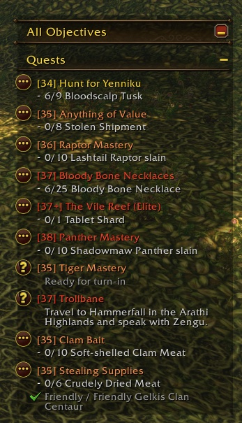
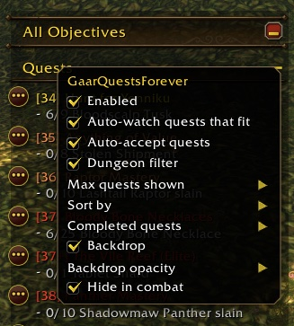
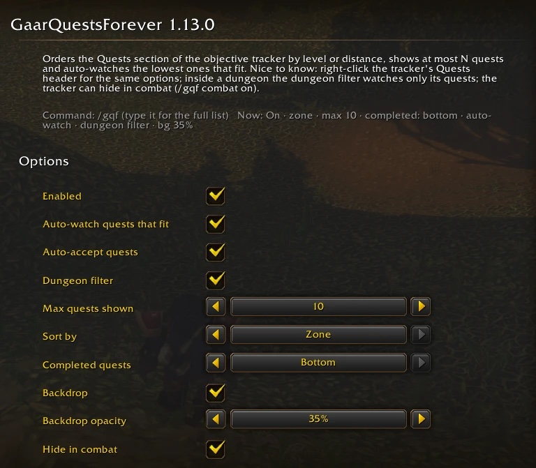
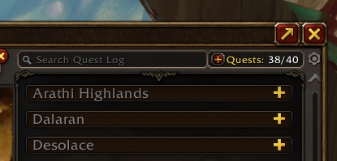
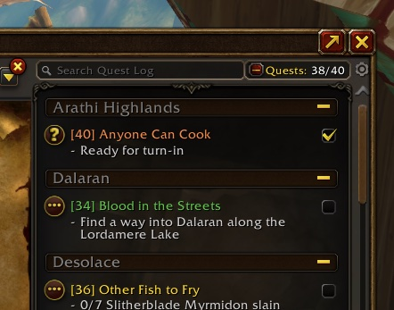
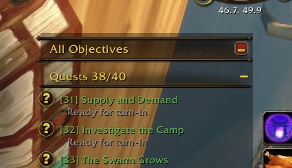
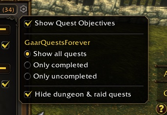

# GaarQuestsForever

> Formerly **BetterQuestsForever**. The folder is now `GaarQuestsForever` as well; the update also ships a tiny `BetterQuestsForever` folder, a
> settings bridge that moves your old settings over on the first login (each character on its own
> first login). It is safe to delete after logging in once on each character, and later updates drop it. The command is
> now `/gqf` (`/gaarquestsforever`); the old `/bqf` and `/betterquestsforever` still work.
> CurseForge: https://www.curseforge.com/wow/addons/gaarquestsforever

A small standalone addon for the WoW Forever client (`_forever_`, interface 16001). It
changes how the **Quests** section of Blizzard's own objective tracker (`QuestObjectiveTracker`)
orders and limits the tracked quests, and (with auto-watch, default on) which quests are tracked
so that the lowest ones fill the tracker's height. It needs GaarForever, the family hub, and no other addon or library.

## What it does

- **Order.** Tracked quests are shown by quest level, lowest first (the `[n]` the tracker shows,
  `C_QuestLog.GetInfo(logIndex).level`, falling back to `difficultyLevel`). Quests of the same
  level are ordered by title, ignoring case.
- **Collapse all (1.14, default on).** A small +/- button in the quest log's header row, between
  the search box and the "Quests: n/m" count. Minus (at least one zone header is open) collapses
  every header; plus (all collapsed) expands them all. Tooltip: Collapse all / Expand all.
  `/gqf collapse` toggles it (or **Collapse-all button in quest log** in the menus). It calls
  Blizzard's `CollapseQuestHeader(0)` / `ExpandQuestHeader(0)` from its click (falling back to one
  header at a time) and replaces nothing.
- **Quest count on the tracker (1.14, default on).** The objective tracker's "Quests" header reads
  "Quests 38/40": quests in the log (not zone headers) over the log's size
  (`C_QuestLog.GetMaxNumQuestsCanAccept()`, else `MAX_QUESTLOG_QUESTS`, else 40). `/gqf questcount`
  toggles it (or **Quest count on tracker header** in the menus). Only the header's text is set,
  again after each of Blizzard's updates of that module.
- **Sort by zone (optional, 1.13).** `/gqf sort zone` (or **Sort by > Zone** in the minimap menu)
  groups quests by the zone header they sit under in your quest log. The zone you are in comes
  first, the other zones follow alphabetically, and quests whose header cannot be found ("Other")
  go last. Inside a zone the order is the level order; completed quests go top, bottom or among
  the others within each zone. Changing zone re-sorts. Auto-watch ranks the same way: your zone's
  quests first, then by level.
- **Sort by distance (optional).** `/gqf sort distance` (or **Sort by** in the minimap menu)
  shows the nearest quest first, using `C_QuestLog.GetDistanceSqToQuest` (what Blizzard's own
  proximity sort uses; check your client with `/gqf distance`). Quests without a distance (no
  value, not a number, negative) go after those with one, ordered by level then title. The order
  is worked out again about every 3 seconds, out of combat only and only while the tracker is
  shown, and the layout is only touched when the order changes. To stop quests from jumping
  around, two quests keep their order unless the one behind is closer by at least 50 yards and at
  least 10 %. The limit then shows the N nearest quests. `/gqf sort level` (the default) is the
  level order described above, with no timer.
- **Completed quests.** Quests that are ready to turn in (`C_QuestLog.IsComplete`) go to the
  **bottom** by default. `/gqf completed top` puts them first; `/gqf completed level` sorts
  them among the others (by level, or by distance in distance mode; the menu calls it "By level" or "With the others").
- **Limit.** Only the first **N** quests of that order are shown (default **10**, 1-49, or all).
  With 30 tracked quests and N = 10, you see the 10 lowest-level quests that are not complete.
  When one of them completes it moves to the bottom, out of the 10, and the next tracked quest
  takes its place.
- **Auto-watch (1.9, default on): the quests that fit are the lowest ones.** Blizzard lays the
  Quests section out in its own watch order and stops at the first quest that does not fit the
  tracker's height; that quest and every one after it get no block, so no sorting can show them.
  So the addon now decides *which* quests are watched: it watches the quests that come first in
  its order (level or distance, completed quests where you put them) as long as they fit the
  tracker's height, at most N (**Max quests shown**) and within Blizzard's watch cap, and
  un-watches the other quests of the Quests section. What Blizzard draws is then exactly the
  addon's top quests that fit, and the order above sorts them. See [Auto-watch](#auto-watch).
  - **The height is Blizzard's, always.** The tracker's height is the Edit Mode **Height** (or down
    to the screen bottom in the default position). The addon never resizes the tracker, never tops
    up Blizzard's `UpdateHeight` and does nothing different in Edit Mode; the tracker looks the
    same in and out of Edit Mode. (1.7 and 1.7.1 made the container taller; that is gone.)
  - **Not in combat, not in Edit Mode.** The watch list is only changed out of combat (queued to
    the end of the fight) and not while Edit Mode is open (looked at again when it closes).
  - **Your focused quest stays.** The super-tracked quest (Focus / the waypoint) is never
    un-watched and counts first. Super-tracking itself is never touched. At least one quest stays
    watched.
  - **Manual tracking is overridden.** While auto-watch is on, a quest you track or untrack by
    hand is set back the way the order wants on the next pass (a fraction of a second later). Turn
    auto-watch off to manage the watch list yourself.
  - **Off** (`/gqf autowatch off`, the menu's **Auto-watch quests that fit**, or `/gqf off`): the
    watch list is left exactly as it is and is yours again; nothing is restored or re-tracked. The
    order and the limit then only change what is drawn of the quests you track, as before 1.7.
- **Auto-accept (1.12, default off).** `/gqf autoaccept` toggles it (or **Auto-accept quests** in the menus). When a quest's accept window opens (`QUEST_DETAIL`) the quest is accepted. Hold Shift while it opens to skip. Quests the client already accepts itself and escort/shared confirmations are left alone; turn-ins and gossip are never touched.
- **Dungeon filter (1.10, default off).** `/gqf dungeon on` (or **Dungeon filter** in the menus).
  Inside a dungeon or raid instance only that instance's quests are watched, in the usual order;
  the other quests of the Quests section are un-watched. If no quest matches, nothing changes (the
  normal order and auto-watch). Outside instances it does nothing. See
  [Dungeon filter](#dungeon-filter).
- **Quest filter (1.15, default off).** Show only the quests that are ready to turn in, or only
  the ones that are not, and/or hide quests tagged Dungeon or Raid - in the quest log list *and*
  the tracker's Quests section (never on the map). Set it in the quest log's own gear menu (next to
  Blizzard's "Show Quest Objectives"), in the **Quest log filter** submenu of the tracker header's
  right-click menu, or with `/gqf filter`. While a filter is on, the quest log's count reads
  "Quests: 37/40 (12 shown)". See [Quest filter](#quest-filter).
- **Only the Quests section.** Campaign quests, world quests, bonus objectives, achievements,
  professions and every other section are left alone.
- It re-evaluates after every layout of the Quests section, and also (throttled to once per
  0.3 s) after `QUEST_LOG_UPDATE`, `QUEST_WATCH_LIST_CHANGED`, `QUEST_ACCEPTED`,
  `QUEST_REMOVED`, `QUEST_TURNED_IN`, `PLAYER_LEVEL_UP`, `SUPER_TRACKING_CHANGED`,
  `ZONE_CHANGED_NEW_AREA`, login and every loading screen (`PLAYER_ENTERING_WORLD`), the end
  of combat and leaving Edit Mode. A
  settings change is applied at once (after combat if you are in one).

- **Backdrop.** An optional plain dark rectangle (black, 50% opacity by default) behind the
  whole objective tracker, from just above the "All Objectives" header down to the last visible
  block, with 4 px of padding. It follows the content as it grows and shrinks (including after
  the order and the limit change the height) and is hidden when the tracker is hidden, collapsed
  or empty. See [Backdrop](#backdrop).
- **Set GPS target** (1.6, needs [GaarGpsForever](../GaarGpsForever/README.md) 1.1). The
  tracker's own right-click menu for a quest (Focus, Open Quest Details, Open Quest Map, Untrack,
  Abandon) gets **Set GPS target** after Focus. It sets GaarGpsForever's one waypoint on the
  point Blizzard shows for the quest, titled with the quest's name (e.g. "Harpy Raiders"):
  1. `C_QuestLog.GetNextWaypoint(questID)` - the next step of the route Blizzard plots to a quest
     somewhere else;
  2. else the quest's POI from `C_QuestLog.GetQuestsOnMap(uiMapID)` - the objective area, or the
     turn-in point once the quest is complete (Blizzard moves the POI there) - looked up on the
     quest's own map (`GetQuestUiMapID`), the map you are on, and the parents of both;
  3. else `C_QuestLog.GetNextWaypointForMap(questID, uiMapID)` on the same maps.

  With none of them the entry is greyed out (and a click, where a client cannot grey it, says
  "No map point for this quest."). Without GaarGpsForever the entry is not there and the addon
  works as before. The entry is added with Blizzard's public
  `Menu.ModifyMenu("MENU_QUEST_OBJECTIVE_TRACKER", ...)`, which runs after Blizzard has built the
  menu and only adds an element of ours; the menu does not say which quest it is for, so that is
  the tracker block under the mouse, checked against the menu's title (or else the one tracked
  quest with that title). The waypoint goes through `GaarGpsForeverAPI.SetWaypoint` only. The
  first error switches the entry off for the session with one line in chat; `/gqf status` shows
  its state.
- **Hide in combat** (default on). When a fight starts the whole objective tracker ("All
  Objectives", every section) and the backdrop are hidden; when it ends the tracker comes back,
  sorted and limited as before, with its backdrop. It only comes back if it was shown when the
  fight started, so a tracker Blizzard had hidden (no quests, a cinematic) stays hidden. Off, the
  tracker stays visible in combat with Blizzard's own order, as in 1.2. See
  [Hide in combat](#hide-in-combat).

## Commands

| Command | Does |
|---|---|
| `/gqf` | Help |
| `/gqf max <n>`, `/gqf max all` | Show at most n quests, 1-49 (default 10); `all` (stored as 50) shows every one, still sorted |
| `/gqf sort level`, `distance`, `zone` | Order by quest level (default), by distance (nearest first) or by zone (yours first, then A-Z) |
| `/gqf completed top`, `level`, `bottom` | Where quests ready to turn in go (default bottom) |
| `/gqf autowatch on`, `/gqf autowatch off` | Auto-watch: watch the lowest quests that fit the tracker's height and un-watch the rest (default on); off leaves the watch list as it is |
| `/gqf autoaccept` | Toggle auto-accept (1.12, default off): accepts a quest when its window opens; hold Shift to skip. Never turns in quests or picks gossip |
| `/gqf collapse` | Toggle the collapse-all +/- button in the quest log's header row (1.14, default on) |
| `/gqf questcount` | Toggle the quest count ("Quests 38/40") on the tracker's Quests header (1.14, default on) |
| `/gqf dungeon on`, `/gqf dungeon off` | Dungeon filter: inside a dungeon or raid, watch only that instance's quests (default off) |
| `/gqf filter all`, `completed`, `uncompleted` | Quest filter (1.15): show all quests (default), only those ready to turn in, or only the others - in the quest log and the tracker |
| `/gqf filter dungeons on`, `/gqf filter dungeons off` | Quest filter: hide quests tagged Dungeon or Raid (default off) |
| `/gqf filter` | The quest filter's current setting and these two commands |
| `/gqf on`, `/gqf off` | Switch on or off. Off puts the section back exactly as Blizzard laid it out |
| `/gqf bg on`, `/gqf bg off` | Show or hide the backdrop behind the tracker (default on) |
| `/gqf bg <0-100>` | Backdrop opacity in percent (default 50; values outside 0-100 are clamped) |
| `/gqf combat on`, `/gqf combat off` | Hide the whole objective tracker during combat (default on) |
| `/gqf minimap` | Show or hide the minimap button |
| `/gqf minimap reset` | Minimap button back to its default place (285 degrees) and shown |
| `/gqf status` | On/off, sort, max, completed mode, how many quests are tracked and shown, whether the tracker was recognised, which hooks are in place (and how Edit Mode is followed), auto-watch: its state (`settled`, waiting, paused and why), the Quests section's room from Blizzard's layout (watched, drawn, room and used px, which quest did not fit), how many quests fit and what the next one would need, and which quests the last pass watched and un-watched; the dungeon filter (`dungeon filter: on - in The Deadmines, 3 quests match` and which, `... no match, normal sort`, `... not in an instance`, how many of its changes are still to be undone, and which instance/quest-tag/quest-map/quest-text functions the client has); `order: visual (applied to N blocks)` or why it could not be applied, which client functions exist, whether hide in combat is ready (or why not), whether `ObjectiveTrackerFrame` is shown and protected, and the minimap button's state |

## Right-click the tracker headers (1.8)

Right-click the objective tracker's **All Objectives** header or its **Quests** header to open
the same menu as the minimap button's options (without Hide minimap button). Left-click is
untouched: the collapse buttons work as Blizzard made them. Blizzard's headers do not take mouse
input, so the addon lays its own transparent frame over each header (stopping short of the
collapse button) and hooks nothing on Blizzard's frames. It also works in combat.

## Minimap button

Left- or right-click opens a menu with the same settings: **Enabled** (checkbox), **Auto-watch
quests that fit** (checkbox), **Dungeon filter** (checkbox), **Quest log filter** (Show all
quests, Only completed, Only uncompleted, Hide dungeon & raid quests), **Max quests
shown** (3, 5, 8, 10, 12, 15, 20, 25, All), **Sort by** (Level, Distance, Zone), **Completed quests** (Top, By level, Bottom),
**Backdrop** (checkbox), **Backdrop opacity** (20, 35, 50, 65, 80 %), **Hide in combat**
(checkbox) and **Hide minimap button** (`/gqf minimap` brings it back). Changes apply at once. Drag the button
to move it around the minimap's edge; on a square minimap (`GetMinimapShape() == "SQUARE"`,
e.g. with GaarMap) it follows the square edge. The menu is Blizzard's `MenuUtil` where the
client has it, otherwise a small menu drawn by the addon (never `UIDropDownMenu`). The placement
code is a copy of GaarVanguard's, so this addon still has no dependencies; its default angle
(285 degrees) keeps it clear of GaarOptions (205) and GaarVanguard (245).
`GaarQuestsForever_PlaceMinimapButton()` re-places it, for an addon that changes the minimap's
shape.

Settings are saved in `GaarQuestsForeverDB` (`enabled`, `max`, `completed`, `sort`, `hideInCombat`, `autoWatch`,
`questFilter` (`all`, `completed`, `uncompleted`), `hideInstanceQuests`,
`backdrop = { enabled, alpha }` (alpha 0-1), `minimap = { hide, angle }`), read at `ADDON_LOADED`, never at file scope.

## With GaarForever (required)

Since 1.10.1 this addon lists `GaarForever` (the GaarForever folder) under `## Dependencies`: install the `GaarForever` folder next to it, or the client will not load this addon. GaarForever also gives it a page under **Esc > Options > AddOns > Gaar Forever**, built from the same `MenuEntries()` as the hub's menu, with a short intro at the top; that intro comes from `Intro()`, a field the API table gained in 1.10.1 (it is also the first line of the slash command's help). Since 1.10.2 it also takes its small helpers (the chat line, the secret-value check, the safe frame calls, the combat check, the addon-loaded check, drawing the menus) from GaarForever's shared library instead of carrying its own copies; nothing it does or shows changed.

[GaarForever](../GaarForever/README.md) is the family hub: one minimap button whose
menu has a **Quests** submenu with exactly the options above (all but **Hide minimap button**).
While it is loaded, this addon's own minimap button is hidden for the session; the saved
`minimap.hide` setting is not changed, so without the hub the button is back as you left it.
`/gqf minimap` still changes the saved setting, and `/gqf status` says when the hub is hiding the
button. Everything else (settings, `/gqf`, behaviour) is the same with or without the hub.

The hub talks to this addon only through `GaarQuestsForeverAPI` (since 1.5):

| Field | What it is |
|---|---|
| `version` | This addon's version, a string |
| `StatusLine()` | The one-line state the minimap tooltip shows (`On · level · max 10 · completed: bottom · bg 50%`) |
| `MenuEntries()` | The options as plain data (`{ text, func }`, `{ text, checkbox\|radio, checked, func }`, `{ text, submenu }`, `{ divider }`), for a menu drawn without `MenuUtil` |
| `AddMenuEntries(root)` | Adds the same options to a `MenuUtil` root or submenu description |
| `SetMinimapHidden(hidden)` | Hides (`true`) or shows again (`false`) this addon's own button for this session only |

The addon's own menu and the API build on the same list of options, so they cannot drift apart.
It also checks `C_AddOns.IsAddOnLoaded("GaarForever")` (or the old name `BetterGaarForever`; the older `IsAddOnLoaded` where `C_AddOns` is missing)
before it shows its button, so the load order does not matter.

## How it works

Version 1.0 set the order in the client's watch list. Forever orders the watch list itself (a
re-added watch is not appended at the end), so that cannot work there. Since 1.1 the order is
purely visual, applied on top of Blizzard's layout:

- **Hooks.** `hooksecurefunc` on the `QuestObjectiveTracker` instance's `Update` and
  `UpdateHeight` runs after Blizzard has laid the section out, out of combat only.
- **Blizzard's layout, measured.** Blizzard lays the quest blocks out as a chain
  (`ObjectiveTrackerModuleMixin:AnchorBlock`): the first block's `TOP` on the section's
  `ContentsFrame` `TOP` at `fromHeaderOffsetY`, every next block's `TOP` on the previous
  block's `BOTTOM` at `fromBlockOffsetY`, and `contentsHeight` grows by each block's height
  minus that offset. The addon reads those anchors back with `GetPoint`, so the spacing it uses is
  Blizzard's own, measured from the layout (the module's offset fields are only a fallback).
- **Re-anchored in sorted order.** The quest blocks are sorted with the order above and the
  first N are re-anchored top to bottom: the first on the same point Blizzard used for its first
  block, each next one on the `BOTTOM` of the one above it in the new order, with the offset
  Blizzard used at that position. Only the `TOP` point is replaced; the block's `LEFT`/`RIGHT`
  points stay Blizzard's. Blocks that are not tracked quests (a quest pop-up, or a block
  Blizzard keeps for a moment after a turn-in) stay on top in Blizzard's order and are not
  counted toward N.
- **The rest hidden.** Blocks after the N-th are hidden with `Hide()`, along with their
  `addedRegions` (item button, find-group button, progress and timer bars). Those frames are
  parented to the section, not to the block, so they are hidden one by one.
- **Buttons follow their block.** Blizzard anchors the item and find-group buttons to their
  own block (`AddRightEdgeFrame`: `TOPRIGHT` on the block, or `RIGHT` on the block's previous
  right-edge frame) and progress and timer bars to the block's lines, so they move with their
  block. Nothing of theirs is re-anchored.
- **Height.** The section's frame gets Blizzard's height minus what Blizzard added for its
  blocks plus what the shown blocks take with the same offsets, so the sections below move up
  with no gap.
- **Put back exactly.** Before moving a block the addon records Blizzard's anchor for it. Off,
  combat, or a problem: every moved block goes back on Blizzard's anchor (in chain order, so no
  anchor loop can form), every hidden frame is shown again (only while Blizzard still uses it for
  the same block), and the section gets Blizzard's height again.
- **Combat.** Nothing changes while `InCombatLockdown()` is true. On `PLAYER_REGEN_DISABLED`,
  which fires just before the lockdown starts, the layout is put back as above, so during a fight
  the Quests section is exactly Blizzard's own (every tracked quest is visible, in Blizzard's
  order). On `PLAYER_REGEN_ENABLED` the order and the limit are applied again.

**Height.** Blizzard only lays out as many quests as fit in the tracker's height, in its own
watch order. The addon does not change that height (1.7/1.7.1 did; 1.9 removed it): with
auto-watch it changes which quests are watched instead, see [Auto-watch](#auto-watch). The only
`SetHeight` left is on the Quests section, to make it shorter while the limit hides blocks (with
auto-watch on that only happens until the watch list has settled).

## Auto-watch

How the fit is measured, without writing anything of Blizzard's:

- **Read after Blizzard's layout.** A `hooksecurefunc` post-hook on the `QuestObjectiveTracker`
  instance's `Update` gets the `availableHeight` Blizzard passed in (the room the container gives
  the section, from its Edit Mode height minus the sections above) and reads `contentsHeight`,
  `hasSkippedBlocks` (set by `ObjectiveTrackerModuleMixin:AddBlock` when `CanFitBlock` says no),
  the block chain (`firstBlock`/`nextBlock`, each block's `id` and `height`) and
  `fromHeaderOffsetY`/`fromBlockOffsetY`. Blizzard's fit test is
  `contentsHeight + block.height - offsetY <= availableHeight`.
- **What it learns.** The height of every quest's block when it was drawn (kept 30 minutes, and
  measured afresh when the quest completes), and for the quest that did not fit - the first
  watched quest in watch order without a block, the one Blizzard tried last - a lower bound: its
  block is taller than the room that was left (kept 10 minutes). A quest never drawn is estimated
  from its objective count (`C_QuestLog.GetQuestObjectives`) times the smallest height per line
  seen, on the low side on purpose: if it then does not fit, the next layout says so.
- **The pass.** All quests of the Quests section in the quest log (not campaign, world, bonus,
  task or bounty quests, which are never touched) are ranked with the addon's order. Walking down
  that ranking it adds each quest's cost to what the header and quest pop-ups take, and stops at
  the first quest that does not fit, so a short quest further down never takes the place of a
  taller one above it. The quests before that point (at most N, within Blizzard's watch cap
  `Constants.QuestWatchConsts.MAX_QUEST_WATCHES`, else 25) are watched (`C_QuestLog.AddQuestWatch`
  with the manual watch type), the other quests of the section un-watched
  (`C_QuestLog.RemoveQuestWatch`). The order of the watch list is not relied on: Forever keeps its
  own (a re-added watch is not appended), so only *which* quests are watched matters.
- **No oscillation.** A quest that is not watched is only added with 4 px to spare; a watched one
  stays while it fits at all. A quest that turns out not to fit gets a measured height or a lower
  bound, so it is not tried again until there is more room or it changes. Nothing changes until
  Blizzard has laid out the previous change (or 2 s passed), at most 10 watch changes per pass,
  and more than 10 changing passes in 30 s pause auto-watch for a minute (said in chat and in
  `/gqf status`). In distance mode the ranking uses the same 50 yd / 10 % hysteresis as the order.
- **When it leaves things alone.** In combat (queued to `PLAYER_REGEN_ENABLED`), while Edit Mode is
  open (re-run on `EditMode.Exit`), while the tracker or the section is collapsed, and when the
  sections above leave the Quests section no room at all.

## Dungeon filter

Off by default; `/gqf dungeon on|off` or the **Dungeon filter** checkbox. It acts only while
`IsInInstance()` says `party` or `raid`. A quest belongs to the instance when:

1. it sits under the quest-log header whose title is the instance's name (`GetInstanceInfo()`,
   and `GetRealZoneText()`), compared ignoring case, extra spaces and a leading "The " (so
   "Deadmines" matches "The Deadmines"), or
2. it is tagged **Dungeon** or **Raid** (`C_QuestLog.GetQuestTagInfo`, else the classic
   `GetQuestTagInfo`; tag IDs 81/85/62/88/89 or `Enum.QuestTag`, or the tag name) **and** either
   its map (`GetQuestUiMapID`) is the player's instance map (`C_Map.GetBestMapForUnit("player")`)
   or one of its parents that is itself an instance map (never the zone or continent around it),
   or its title, description (`GetQuestLogQuestText`) or objective text
   (`C_QuestLog.GetQuestObjectives`) contains the instance's name (plain, case-insensitive).

Every client function is checked before use; a missing or secret value counts as no match.
`/gqf status` lists the matching quests and which of these functions the client has.

- **Auto-watch on:** the filter narrows the ranking auto-watch walks to the matching quests (as
  many as fit, in the usual order); the rest of the section is un-watched with all of
  auto-watch's rules (not in combat - applied right after it -, not in Edit Mode, the focused quest
  stays, the thrash guard). On leaving, auto-watch carries on as normal on the next pass.
- **Auto-watch off:** the filter itself makes the watch list the matching quests (same rules) and
  remembers what it changed (saved, so a `/reload` inside keeps it). When the filter stops
  applying - you leave, no quest matches any more, or you turn it or the addon off - the quests
  it un-watched are watched again in their old order and the ones it added are un-watched, so
  your own list comes back.
- **No match inside the instance:** nothing changes; the tracker never goes empty because of
  the filter.
- Passes run on `PLAYER_ENTERING_WORLD`, `ZONE_CHANGED_NEW_AREA` and `QUEST_LOG_UPDATE` (with the
  same 0.3 s throttle as everything else). Collapsed quest-log headers can hide their quests from
  the quest-log walk, as for auto-watch.

## Quest filter

Two settings (1.15, both off by default), saved in `GaarQuestsForeverDB` as `questFilter` and
`hideInstanceQuests`. The quest log's gear menu, the tracker header's **Quest log filter**
submenu, GaarForever's menu and `/gqf filter` all change the same two values, so they always
agree.

- **Show all quests / Only completed / Only uncompleted** (one choice). "Completed" means ready
  to turn in (`C_QuestLog.ReadyForTurnIn`, else `C_QuestLog.IsComplete`).
- **Hide dungeon & raid quests** (checkbox). Only quests tagged Dungeon or Raid (also the Heroic
  and Raid 10/25 tags), read with `C_QuestLog.GetQuestTagInfo` (else the classic
  `GetQuestTagInfo`) - the same guarded reader the dungeon filter uses. Group and Elite quests stay.

Where it applies:

- **Quest log list.** Filtered quests are hidden with their objective lines and their number
  button, zone headers left without a visible quest are hidden too (collapsed headers count their
  quests, so you can still open them), and the rows below move up so there are no gaps. The count
  reads "Quests: 37/40 (12 shown)" (or "(12)" when the long form does not fit next to the search
  box): 37 quests in the log, 12 of them pass the filter.
- **Tracker (Quests section).** Filtered quests are hidden the same way as quests past **Max
  quests shown**, and do not count towards that limit. With auto-watch on they are also left out
  of its ranking, so the tracker fills up with quests you can see (auto-watch owns the watch list
  then anyway). With auto-watch off your watch list is never changed: filtered quests are only
  hidden from view, and during combat the section is Blizzard's own (as for the limit), so they
  show until the fight ends.
- **Not the map.** Quest pins on the world map and minimap are untouched.

How it relates to the older settings:

- **Dungeon filter** (`/gqf dungeon`) is a different thing: inside a dungeon or raid it *watches
  only that instance's quests*. "Hide dungeon & raid quests" is for the open world. So that they
  never fight, "Hide dungeon & raid quests" pauses (in the log and the tracker) while the dungeon
  filter is on and you are inside a dungeon or raid, and comes back when you leave.
- **Completed quests** (Top / By level / Bottom) only decides *where* ready quests go in the
  tracker's order. It is unchanged; with "Only completed" or "Only uncompleted" every shown quest
  is of one kind, so it has no visible effect then.

`/gqf status` shows the filter, how many quests it shows, what the last quest log pass did, whether
the gear menu entries are registered and how many tracker blocks it hides.

## Backdrop

The backdrop is the addon's own frame (`GaarQuestsForeverBackdrop`, parent `UIParent`, strata
`BACKGROUND`, mouse disabled) with a solid black texture. It is independent of the `on`/`off`
switch for ordering and limiting. It is placed by absolute coordinates, never anchored to a
Blizzard frame:

- **Measured, not anchored.** The addon reads `GetLeft`/`GetRight`/`GetTop`/`GetBottom` of
  `ObjectiveTrackerFrame.Header`, of each shown tracker module and of each shown block of those
  modules (scaled to `UIParent`'s coordinates), and covers them: the top is the header's, the
  bottom the lowest visible block's, left and right the widest of the lot. Blocks the limit
  hides are not shown, so they do not count.
- **When.** `hooksecurefunc` on `ObjectiveTrackerFrame` and each module (`Update`, `UpdateHeight`,
  `SetCollapsed`) and `HookScript` (`OnShow`, `OnHide`, `OnSizeChanged`) only set a flag; our own
  frame measures on the next frame, and every 0.1 s anyway, so a dragged or rescaled tracker is
  followed too. The addon's own layout pass sets the flag as well.
- **Hidden** when the tracker frame is hidden or collapsed, or when no module has a visible block.
- **Combat.** With hide in combat on, the backdrop is hidden for the fight together with the
  tracker. With it off, the backdrop only reads Blizzard's positions and writes to its own frame,
  so it keeps following the tracker in combat. `/gqf status` shows why it is hidden, if it is.
- **Moving the tracker** is Blizzard's Edit Mode. A move fires none of the hooks, but the 0.1 s
  measurement picks up the new position, so the backdrop follows.

## Hide in combat

`ObjectiveTrackerFrame` is not a protected frame, so the client lets it be hidden in combat. The
catch is what runs when it is hidden or shown: its `OnHide` (`ManagedFrameMixin`,
`EditModeSystemMixin:OnSystemHide`) calls `RightManagedFrameContainer:RemoveManagedFrame`, which
writes the container's `showingFrames`, calls `ObjectiveTrackerFrame:UpdateHeight` and lays out
the right-hand container (which also holds the boss and arena frames, which are protected); its
`OnShow` calls `AddManagedFrame` (`SetParent` and `Layout`) and `UpdateHeight`, whose
`OnSizeChanged` marks the tracker dirty. Whoever calls `Hide()` or `Show()` runs all of that. From
addon code it would run tainted, and the tracker update that sets the quest item buttons'
`questLogIndex` attribute would carry the taint, so a click on a quest item would be blocked.
Fading it instead (alpha) would leave the item buttons clickable. So the addon never calls
`Hide()` or `Show()` on it.

A secure handler of the addon's own with a frame reference to the tracker does not work either:
the restricted environment refuses a handle to a frame that is not protected while
`InCombatLockdown()` is true (`RestrictedFrames.lua`, "Invalid frame handle"), and a state driver
only reaches that handler after the lockdown has started.

What it does instead:

- On `PLAYER_REGEN_DISABLED` (which fires just before the lockdown starts) it notes whether the
  tracker is shown and registers Blizzard's state driver on it:
  `RegisterStateDriver(ObjectiveTrackerFrame, "visibility", "hide")`. `SecureStateDriverManager`
  hides it at once from its own secure code, so `OnHide` and everything it calls run untainted.
- If Blizzard shows the tracker during the fight (its update does, on a quest update), the driver
  hides it again within its 0.2 s throttle, so it can blink for a moment. The backdrop stays
  hidden throughout.
- On `PLAYER_REGEN_ENABLED` (just after the lockdown ends), if the tracker was shown when the
  fight started, the driver is set to `show` once (Blizzard's code shows it, untainted) and then
  removed with `UnregisterStateDriver`. After that the order, the limit and the backdrop are
  applied again as after any fight.
- The driver is on the tracker only between those two events. Out of combat Blizzard's own
  show/hide logic is never overridden. The driver itself sets the tracker's `statehidden`
  attribute (`true` when it hides, `nil` when it shows), which nothing in the tracker reads; it
  stays `true` after a fight where the tracker was hidden to begin with.
- It is independent of `/gqf on`/`off` (which only switches the order and the limit) and of the
  backdrop setting.
- A change of the setting during a fight applies from the next fight; turning it off during a
  fight still brings the tracker back when the fight ends.
- If the client has no `RegisterStateDriver`, if there is no `ObjectiveTrackerFrame`, or if the
  lockdown had already started when the event arrived, nothing is hidden (there is no insecure
  fallback) and `/gqf status` says why.

## Taint

The Quests section carries quest item buttons. Clicking one runs Blizzard's
`QuestObjectiveItemButtonMixin:OnClick`, which reads the button's `questLogIndex` attribute and
calls the protected `UseQuestLogSpecialItem`. That attribute is set by Blizzard's layout
(`UpdateSingle` -> `AddRightEdgeFrame` -> `SetUp` -> `SetAttribute`). If addon code ever ran
inside that layout, or left a value Blizzard's layout reads, the attribute would be set from
tainted code and the click would be blocked (`ADDON_ACTION_BLOCKED`). So:

- No Blizzard function is replaced, global or method. Auto-watch changes the watch list with
  `C_QuestLog.AddQuestWatch`/`RemoveQuestWatch`, which are not protected, only from the addon's
  own throttle frame (never from inside Blizzard's code or one of the hooks on it), out of combat
  and outside Edit Mode. Blizzard's tracker hears of it through the client's
  `QUEST_WATCH_LIST_CHANGED` event, as when you click Track yourself. With auto-watch off the watch
  list is never changed.
- The addon never writes a field into a Blizzard table, never calls a Blizzard Lua function of
  the tracker (`MarkDirty`, `Update`, `UpdateHeight`, ...), never sets an attribute and never
  calls a protected function. Hide in combat goes through Blizzard's public
  `RegisterStateDriver`/`UnregisterStateDriver`, out of the lockdown only; see
  [Hide in combat](#hide-in-combat). Its only effect on the tracker is the widget methods `GetPoint`,
  `SetPoint`, `Hide`, `Show` and `SetHeight`, from inside `hooksecurefunc` hooks (which do not
  taint the caller), out of combat.
- Quest filter in the quest log: a `hooksecurefunc` post-hook on the global
  `QuestLogQuests_Update` (and on `QuestLogQuests_ShowQuestCount` for the count). Blizzard has then
  built and laid out the whole list; the hook only hides rows (`Hide`), moves the rows below up
  (`SetPoint` with offsets read back from Blizzard's own layout) and shortens the list
  (`SetHeight`) - widget methods on frames that are not protected. Nothing of Blizzard's is called
  or written into; Blizzard's next update rebuilds the list, and its own `Layout` skips hidden rows.
  The gear menu entries are added with Blizzard's public `Menu.ModifyMenu` on its tag
  `MENU_QUEST_MAP_FRAME_SETTINGS`. In the tracker the filter reuses the limit's hiding, so nothing
  new touches it.
- Before each pass it checks every frame it would touch. If a quest block is protected or
  anchoring-restricted (`IsProtected()`, `IsAnchoringRestricted()`), or an item button or bar it
  would hide is protected, or the section itself is, that pass changes nothing (Blizzard's layout
  is put back) and `/gqf status` says why.

## Names it relies on

From Blizzard's retail FrameXML, which Forever's UI follows
([Gethe/wow-ui-source](https://github.com/Gethe/wow-ui-source),
`Interface/AddOns/Blizzard_ObjectiveTracker`): `QuestObjectiveTracker` (its `Update`,
`UpdateHeight`, `usedBlocks`, `blockTemplate`, `firstBlock`, `ContentsFrame`,
`contentsHeight`, `bottomSpacing`, `heightModifiers`, `fromHeaderOffsetY`,
`fromBlockOffsetY`), the blocks' `nextBlock`, `template`, `id`, `height`, `used`,
`parentModule`, `addedRegions`; `C_QuestLog.GetNumQuestWatches`,
`GetQuestIDForQuestWatchIndex`, `GetLogIndexForQuestID`, `GetInfo`, `IsComplete`,
`IsQuestDisabledForSession`; for auto-watch the section's `availableHeight` (the argument of
`Update`), `hasSkippedBlocks`, `isCollapsed` and `parentContainer`, `C_QuestLog.AddQuestWatch`,
`RemoveQuestWatch`, `GetNumQuestLogEntries`, `GetQuestObjectives`, `Enum.QuestWatchType.Manual`,
`Constants.QuestWatchConsts.MAX_QUEST_WATCHES`, `C_SuperTrack.GetSuperTrackedQuestID`,
`EditModeManagerFrame:IsEditModeActive` and `EventRegistry` (`EditMode.Enter`/`Exit`); `C_QuestInfoSystem.GetQuestClassification` with
`Enum.QuestClassification.Campaign`; `ObjectiveTrackerFrame`, `RegisterStateDriver`,
`UnregisterStateDriver`; `MenuUtil.CreateContextMenu`, `Minimap`, `GetMinimapShape`. For Set GPS
target: `Menu.ModifyMenu`, `MenuUtil.CreateButton` and `GetElementText`, the description's
`EnumerateElementDescriptions`, `Insert` and `SetEnabled`, `SUPER_TRACK_QUEST` /
`STOP_SUPER_TRACK_QUEST`, `GetMouseFoci` (or `GetMouseFocus`), `C_QuestLog.GetNextWaypoint`,
`GetQuestsOnMap`, `GetNextWaypointForMap`, `GetTitleForQuestID`, `GetQuestUiMapID`,
`C_Map.GetBestMapForUnit` and `GetMapInfo` (all present in the Forever binary), and
`GaarGpsForeverAPI`. Every one is checked before use. If the tracker is not recognised the addon
does nothing and `/gqf status` says what is missing.

It ships a `_Camelot` TOC and a plain fallback TOC, both at 16001.

## License

MIT, see [LICENSE](LICENSE).

## Support

If you enjoy this addon, you can [buy me a coffee](https://buymeacoffee.com/tgaarden) ☕

## Screenshots

**Tracker**

**Header menu**

**Options**

**Collapse all**

**Expand all**

**Tracker count**

**Quest log filter (gear menu)**

