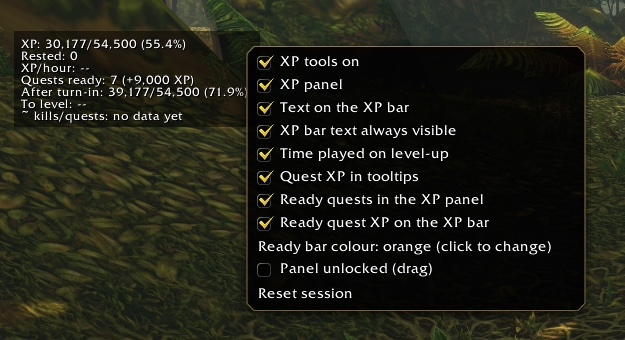
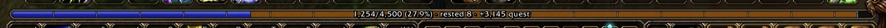
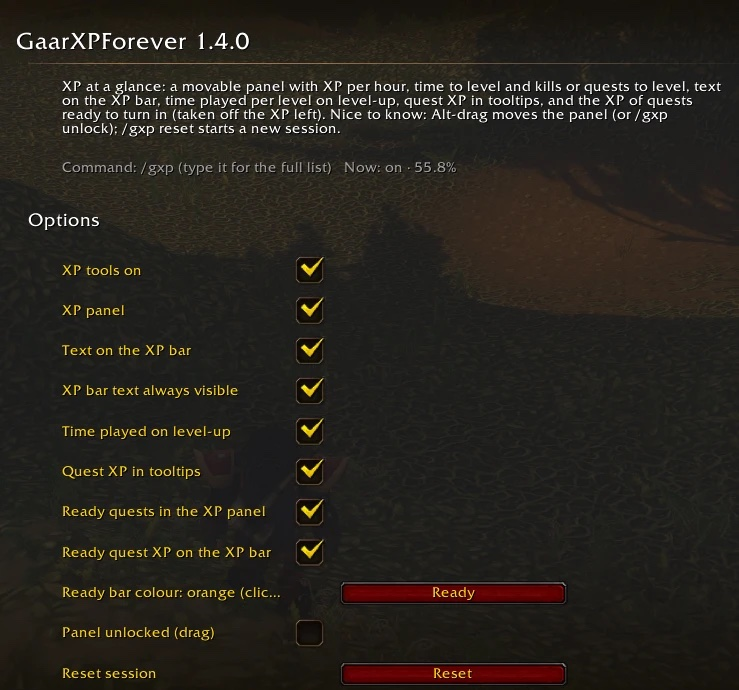

# GaarXPForever

Part of the **Gaar…Forever** suite — [see all addons](https://www.curseforge.com/wow/addons/gaarforever).

> Formerly **BetterXPForever**. The folder is now `GaarXPForever` as well; settings from the old Better…Forever names were migrated up to this version (the old settings-bridge folder is no longer shipped and can be deleted). The command is
> now `/gxp` (`/gaarxpforever`); the old `/bxp` and `/betterxpforever` still work.
> CurseForge: https://www.curseforge.com/wow/addons/gaarxpforever

A small standalone addon for the WoW Forever client (`_forever_`, interface 16001; classic-era
content, level cap 60). XP at a glance: a movable text panel, text on the XP bar, time played per
level on level-up, and quest XP in tooltips. Every part has its own switch. It needs GaarForever, the family hub, and no other addon or library and is not part of the Gaar suite.

## Right-click menu

Right-click the XP panel (when unlocked or locked, anywhere on it) to open this addon's menu (the same options as the GaarForever hub menu).

## What it does

- **XP panel** (`panel`, on): a small movable text panel with XP `cur/max (pct%)`, rested XP (amount
  and % of the level), XP per hour this session, time to level at that rate and "~N kills / ~N
  quests" to level (the session's average XP per kill and per quest turn-in). At max level it says
  "Max level". Alt-drag moves it (or plain drag after `/gxp unlock`); the position is saved.
- **Text on the XP bar** (`xpbarText`, on): only on the XP bar, never on the reputation bar stacked
  with it (the bar is found by `barIndex` / name / `UnitXPMax`, and looked up again when bars change).
  Blizzard's own XP text is kept and supplemented: ours sits to the right of its text, about 16 px
  clear, with what it lacks, e.g. `(89.4%) . rested 6,396 . +3,450 quest`. If it would not fit in the
  bar, rested is dropped first, then quest. Follows Blizzard's text (the `xpBarText` cvar / hover).
  Where Blizzard's text is hidden, ours shows in full (`45,394/50,800 (89.4%) ...`, centred) with
  `xpbarAlways` (off), else on hover. `/gxp status` names the bar and text region found.
- **Level log** (`levelLog`, on): on level-up, one chat line with the time played on that level and
  in total. Blizzard's own time-played print is held back for that one request.
- **Quest XP** (`questXP`, off): the quest's XP reward as a line in the quest log / quest link
  tooltip, where the client gives it (`C_QuestLog.GetQuestLogRewardXP`). Plain values only.
- **Ready quests** (`questReady`, on): quests in the log that are complete but not turned in
  (`C_QuestLog.ReadyForTurnIn` / `IsComplete`, else the legacy `GetQuestLogTitle` isComplete flag;
  headers skipped). Their XP rewards are summed (`C_QuestLog.GetQuestLogRewardXP(questID)`, else the
  legacy `GetQuestLogRewardXP()` on the selected log entry, with the old selection restored; not used
  while the quest log window is open). The panel gets `Quests ready: 3 (+2,450 XP)` and
  `After turn-in: 8,654/8,800 (98.3%)`, or `Turn in to level up!` and `To level: turn in quests`
  when they cover the rest of the level. "To level" and the kill/quest counts use
  remaining XP = max(0, XP needed - XP - ready quest XP); XP/hour is unchanged. The lines show only
  when at least one quest is ready. Rescanned on `QUEST_LOG_UPDATE` / `QUEST_TURNED_IN`, at most every
  0.5 s, each call in `pcall`. Quests under a collapsed zone header may not be listed by a legacy
  client's quest log API.
- **Ready quest XP on the bar** (`questBar`, on): a semi-transparent segment on the XP bar from the
  current fill to fill + ready quest XP, clamped at the end of the bar (a little brighter when the quests
  cover the rest of the level). Own frame, a child of the bar's StatusBar (frame level +1, same height),
  following its size (`OnSizeChanged`) and visibility; hidden at max level, with no ready quests, or when
  `questBar` or `questReady` is off. Colour `orange` (default), `green` or `yellow`. The bar text
  gets ` . +2,325 quest` added when quests are ready. The segment, rested shift and tick are only
  ever on the XP bar.
- **Session reset**: `/gxp reset` resets the session's XP, rate, kills and quests.

How the change is counted: `PLAYER_XP_UPDATE` deltas (across a level-up, the rest of the old level
plus the new XP), classified a moment later: a `CHAT_MSG_COMBAT_XP_GAIN` = a kill, a
`QUEST_TURNED_IN` = a quest, anything else only counts toward XP/hour. Chat text is never parsed.
The rate needs a minute of session.

Settings are saved account-wide in `GaarXPForeverDB`: `enabled`, `panel`, `xpbarText`,
`xpbarAlways`, `levelLog`, `questXP`, `questReady`, `questBar`, `questBarColor`, `locked` and `pos`.

## Commands

`/gxp` or `/gaarxpforever`

| Command | What it does |
|---|---|
| `/gxp` , `/gxp help` | Help |
| `/gxp on`, `/gxp off` | Everything on or off |
| `/gxp panel on\|off` | The XP panel |
| `/gxp xpbar on\|off` | Text on the XP bar (`xpbarText`) |
| `/gxp always on\|off` | Keep the bar text visible without hover (`xpbarAlways`) |
| `/gxp levellog on\|off` | Time played on level-up |
| `/gxp questxp on\|off` | Quest XP in tooltips |
| `/gxp ready on\|off` | Ready quests and their XP in the panel (`questReady`) |
| `/gxp readybar on\|off` | Ready quest XP segment on the XP bar (`questBar`) |
| `/gxp readybar color orange\|green\|yellow` | Segment colour |
| `/gxp ready debug` | Per ready quest: title, questID and which source gave its XP (or the raw returns) |
| `/gxp restcap auto\|150\|180` | Rested XP cap, account-wide (1.5.3): 150% of a level or 180% (Well Rested). `auto` (default) switches to 180% once more than 150% rested has been seen. No argument shows the mode |
| `/gxp unlock`, `/gxp lock` | Drag the panel without Alt / back to Alt-drag |
| `/gxp test` | Test mode (1.5.0): the XP panel with made-up numbers (also at max level), to place it; this session only. Also a **Test mode** menu entry |
| `/gxp resetpos` | Panel back to its default place |
| `/gxp reset` | Reset the session |
| `/gxp status` | Version, every setting, the XP bar frame found, session numbers and the last error |

## With GaarForever (required)

Since 1.0.1 this addon lists `GaarForever` (the GaarForever folder) under `## Dependencies`: install the `GaarForever` folder next to it, or the client will not load this addon. GaarForever also gives it a page under **Esc > Options > AddOns > Gaar Forever**, built from the same `MenuEntries()` as the hub's menu, with a short intro at the top; that intro comes from `Intro()`, a field the API table gained in 1.0.1 (it is also the first line of the slash command's help).

Since 1.0.2 it takes its shared helpers from GaarForever's library (`GaarForever`, `Lib.lua`) instead of carrying its own copies: the chat prefix, the secret-value checks (`IsSecret`, `Num`) and the drawing of its menu (`RenderMenu`). Nothing you see or set changed.

The optional hub talks to this addon only through `GaarXPForeverAPI`:

| Field | What it is |
|---|---|
| `version` | This addon's version, a string |
| `StatusLine()` | One line, e.g. `on · 45.2% · 12,300 xp/h` |
| `MenuEntries()` | Options as plain data (`{ text, func }`, `{ text, checkbox, checked, func }`, `{ text, radio, checked, func }`, `{ text, submenu }`, `{ divider }`) |
| `AddMenuEntries(root)` | Adds the same options to a `MenuUtil` root or submenu description |
| `SetMinimapHidden(hidden)` | Does nothing: no minimap button |

## How it stays out of the way

- Blizzard code is only followed: `hooksecurefunc` on tooltip helpers and a `HookScript` on
  `GameTooltip`; the XP bar is only polled (`IsMouseOver`), never hooked or changed.
- Every client API is checked with `type(...) == "function"`, every handler runs in `pcall` (the
  last error is shown by `/gxp status`), and a secret value is treated as no value.
- Saved variables are read at `ADDON_LOADED`, never at file scope.

## License

MIT, see [LICENSE](LICENSE).

## Support

If you enjoy this addon, you can [buy me a coffee](https://buymeacoffee.com/tgaarden) ☕

## Screenshots

**Panel menu**

**Xp bar**

**Options**

